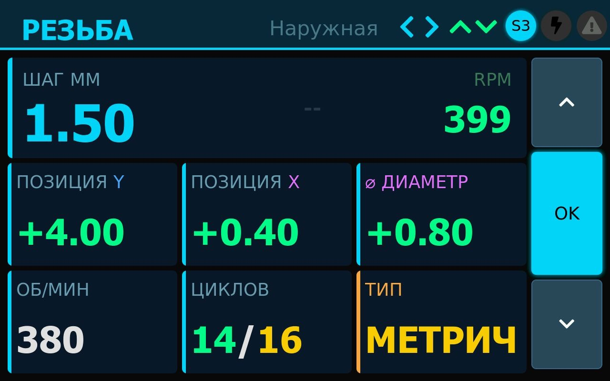
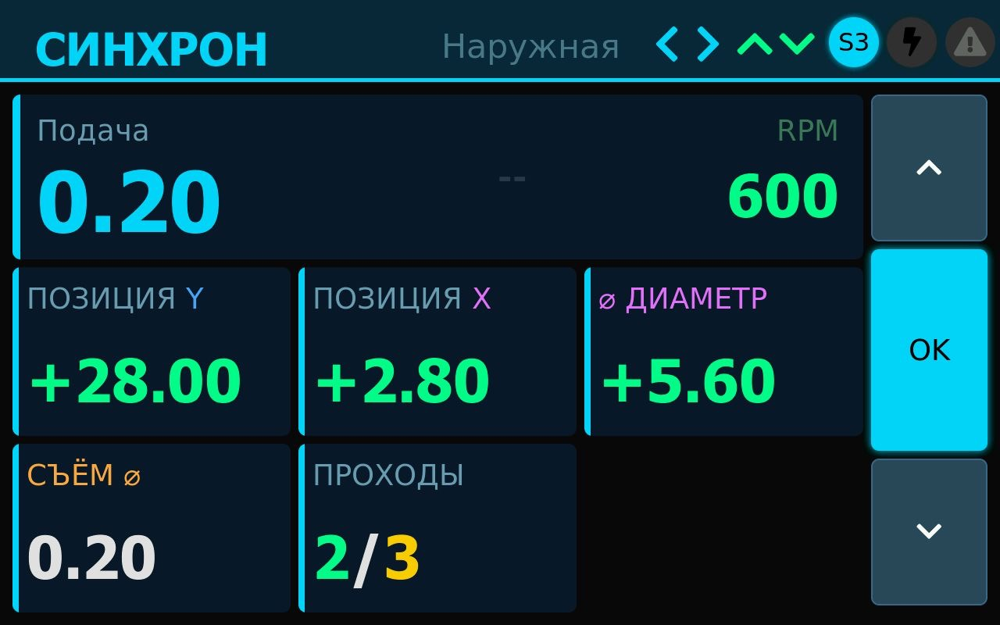
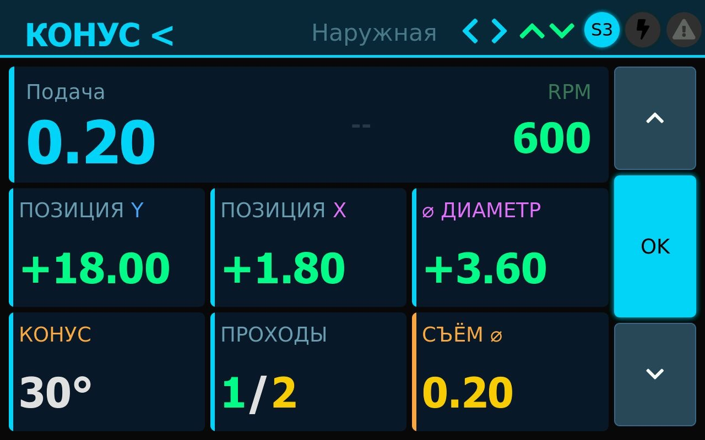
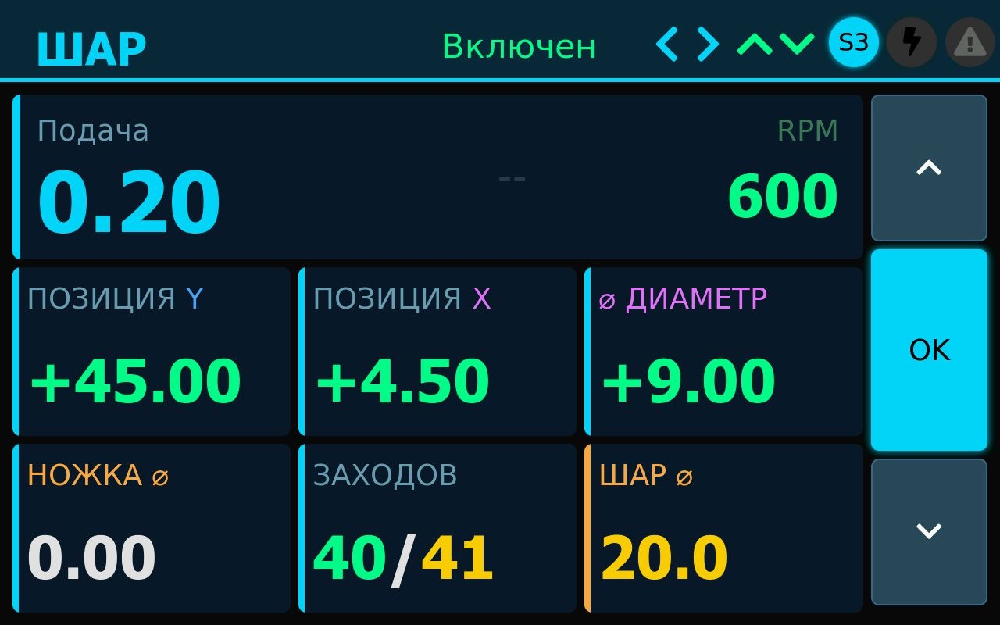
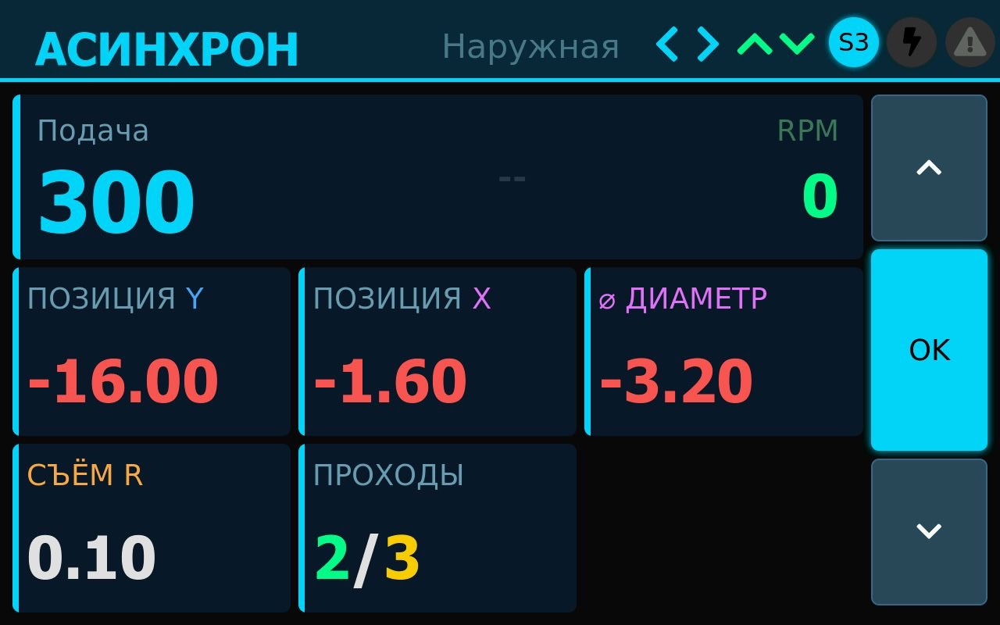
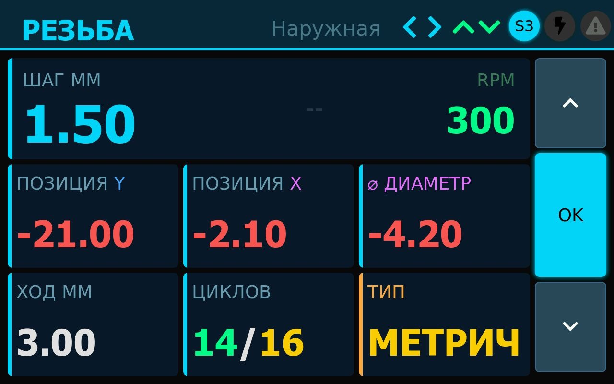

# Электронная гитара токарного станка на STM32

Контроллер электронного ходового винта (ELS) на плате **STM32F4DISCOVERY** (STM32F407VG).
Логика станка — прошивка **7e2** с форума chipmaker.ru (Arduino Mega), перенесённая без изменений
в расчётах: резьбы с привязкой к углу шпинделя, синхронная и асинхронная подача, конусы, шар,
делилка, автоциклы «Внутренний»/«Наружный», ускоренные ходы, РГИ, упоры с плавной остановкой.

Добавлено поверх 7e2:
- сенсорный дисплей ESP32 — 4.3" (JC4827W543), 10.1" (JC8012P4A1C) или 7" (JC1060P470, пока не проверен на железе);
- координаты от блока DRO HS800-2 или от линеек напрямую (квадратура, Sylvac, BIN6, iGaging, Digimatic);
- все настройки в одном файле, пересчёт таблиц резьб под свою механику;
- монитор входов для проверки проводки, проверка ядра на компьютере без платы.

## С чего начать

- **Прошить под Windows с нуля** — [docs/windows](docs/windows/README.md): готовая прошивка с GitHub или своя сборка
  в VS Code + PlatformIO, с картинками по шагам и примерами настроек.
- **Как работать на станке** — [руководство пользователя](docs/manual/README.md): экран, пульт, упоры и автоцикл,
  каждый режим с примером («резьба M20×1.5 длиной 80 мм — делайте так»), все сообщения и что с ними делать.
- **Что куда подключать** — [docs/wiring.html](docs/wiring.html): интерактивная схема — каждая нога Discovery,
  провод, деталь шилда и клемма модуля (откройте файл в браузере).
- **Как собрать** — [docs/assembly](docs/assembly/README.md): список покупок, заказ и пайка шилда, какой провод куда
  (схема на каждый разъём), первое включение по блокам. Макетка без шилда — [docs/README.md](docs/README.md).
- **G-код по Wi-Fi** — [docs/GCODE.md](docs/GCODE.md).

## Как выглядит

Снимки с дисплея 10.1" JC8012P4A1C во время автоциклов на стенде (STM32 + эмулятор шпинделя и DRO):
счётчик проходов показывает, сколько осталось и сколько всего — как «Циклов» на LCD2004.

| Резьба 1.50 мм, наружная — 14 из 16 проходов | Подача 0.20 мм/об, наружная — проход 2 из 3 |
|---|---|
|  |  |
| **Конус 30°, наружный, съём ⌀ 0.20** | **Шар ⌀ 20 мм — 40 заходов из 41** |
|  |  |
| **Асинхронная подача 300 мм/мин, съём на радиус** | **Резьба 1.50 мм, 2 захода** |
|  |  |

На 4.3" всё то же, только мельче.

## С чего начать

**[docs/index.html](docs/index.html)** — руководство со схемами: что купить, что куда прошить, какой
провод куда, сборка на макетке, стенд без станка, линейки, дисплеи, шилд.
Текстовая версия — [docs/README.md](docs/README.md).

## Быстро

```bash
# прошивка платы STM32 (mini-USB в разъём ST-Link) — один из вариантов:
pio run -e stm32f407_discovery -t upload   # без линеек: позиция по шагам моторов, как в исходной 7e2
pio run -e stm32f407_dro -t upload         # с блоком DRO HS800-2
pio run -e stm32f407_scales -t upload      # линейки напрямую к STM32 (тип — в els_config.h)
# прошивка дисплея: 4.3", 10.1" или 7" (jc1060p470 / _v2 / _v3 — DISPLAYS.md)
pio run -e jc4827w543 -t upload
pio run -e jc8012p4a1c -t upload
pio run -e jc1060p470 -t upload
```

Настройки — [`Core/els_config.h`](Core/els_config.h), выводы — [`Core/e2/e2_pins.h`](Core/e2/e2_pins.h).

## Выводы STM32F4DISCOVERY

Кратко по группам; полная таблица со штырьками разъёмов P1/P2 — [docs/wiring/pins.md](docs/wiring/pins.md),
карта разъёмов — [docs/wiring/discovery_pinout.svg](docs/wiring/discovery_pinout.svg).

| Что | Выводы STM32 |
|---|---|
| Энкодер шпинделя A / B | PA1 / PA8 |
| Драйвер Z (каретка): STEP / DIR / ENA | PE9 / PE10 / PE11 |
| Драйвер X (суппорт): STEP / DIR / ENA | PE13 / PE14 / PE15 |
| Тахометр, зуммер | PE8, PE12 |
| Переключатель режимов: Синхр., Асинхр., Конус <, Конус >, Резьба, Шар, Делилка, Резерв | PD0, PD1, PD2, PD3, PD6, PD7, PD10, PD11 |
| Подрежим: Внутренний / Ручной / Наружный | PC8 / PC9 / PC11 |
| Кнопки меню: Влево, Вправо, Вверх, Вниз, Выбор | PB13, PB14, PB12, PD9, PB15 |
| Джойстик: Влево, Вправо, Вверх, Вниз, ускоренный ход | PB0, PB1, PE3, PB9, PB8 |
| Кнопки упоров: Левый, Правый, Передний, Задний | PC5, PC4, PC2, PA0 |
| Светодиоды упоров: Левый, Правый, Передний, Задний | PE6, PE5, PE4, PE2 |
| РГИ: A / B; ось Z / X; масштаб ×1 / ×10 | PE7 / PC13; PC10 / PC12; PA4 / PD8 |
| Переменник подачи (АЦП) | PC1 |
| Дисплей ESP32: TX / RX | PB10 / PB11 |
| LCD2004 (I2C): SCL / SDA | PB6 / PB7 |
| Блок DRO HS800-2 (его TX) | PA3 |
| Отладочный порт (USB-UART): TX / RX | PA9 / PA10 |
| Линейки напрямую Z: A / B / REQ | PA15 / PB3 / PC6 |
| Линейки напрямую X: A / B / REQ | PB4 / PB5 / PC7 |

Все кнопки и переключатели замыкают вывод на GND; подтяжка 1 кОм к 3V платы. Схемы по блокам —
[docs/index.html](docs/index.html#blocks).

Стенд без станка — Arduino Mega с прошивкой `Simulator/dro_simulator`: TX1 (вывод 18) → PA3, GND → GND;
для режима линеек ещё D22 → PA15, D23 → PB3, D24 → PB4, D25 → PB5, D26 ← PC6, D27 ← PC7 (через 1 кОм).
Схема — [docs/wiring/emulator.svg](docs/wiring/emulator.svg).

## Устройство проекта

| Папка | Что там |
|---|---|
| `Core/e2/orig/` | файлы прошивки 7e2 без изменений |
| `Core/e2/` | основной скетч (`e2_core.cpp`), аппаратный слой STM32 (`e2_hal`), выводы, LCD2004, протокол дисплея |
| `Core/els_config.h` | все настройки |
| `Drivers/` | блок DRO HS800-2, линейки напрямую |
| `ELS_Display/`, `ELS_Display_P4/` | прошивки дисплеев 4.3" и 10.1" |
| `Simulator/dro_simulator/` | эмулятор блока DRO и линеек на Arduino Mega |
| `hardware/shield/` | шилд под Discovery (KiCad) |
| `docs/` | руководство, схемы, аудит переноса |
| `tests/`, `tools/` | проверки и вспомогательные скрипты |

## Проверки

```bash
bash tools/run_e2_sim.sh        # ядро 7e2 + аппаратный слой на компьютере: резьбы, подачи, циклы
bash tools/run_unit_tests.sh    # декодеры протоколов линеек
bash tools/build_matrix.sh      # сборка во всех вариантах настроек
```

Что перенесено и как проверено — [docs/PORT_AUDIT.md](docs/PORT_AUDIT.md); полная сверка с оригиналом по пунктам — [docs/CHECKLIST_7e2.md](docs/CHECKLIST_7e2.md).
История работ — [history.md](history.md), задачи — [BACKLOG.md](BACKLOG.md).

## Лицензия

Открытый проект. Условия лицензирования уточняются.
