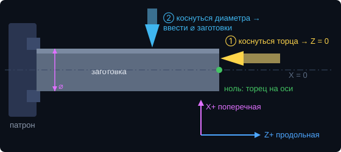

# Управление: экран и физические кнопки

Всё, чем пользуются во время работы, делается и на экране, и физическими органами управления 7e2
(переключатели режимов и подрежимов, кнопки ◀ ▶ ▲ ▼ и «Выбор», джойстик с кнопкой ускоренного хода,
кнопки упоров, ручной энкодер). Состояние общее: нажали кнопку на станке — экран обновился, и наоборот.

Только на экране — настройка станка: она делается один раз, и для неё нужен ввод чисел, которого у 7e2 нет.
Те же значения задаются в `Core/els_config.h`.

## Оси

- **Z — продольная**: вдоль оси шпинделя (суппорт едет к патрону и от него). «Z+» — от патрона.
- **X — поперечная**: поперёк (резец к оси детали и от неё). «X+» — от оси. X = 0 — ось шпинделя.
- Так называют оси в G-коде и на станках с ЧПУ (ISO 841). На экране — Z и X. У автора 7e2 (LCD2004) и на многих
  блоках DRO продольная подписана **Y** — это та же ось Z.

## Работа

| Действие | На экране | На станке |
|---|---|---|
| Режим (синхронная подача, асинхронная подача, резьба, конусы, шар, делилка) | меню режимов | переключатель режимов |
| Подрежим (Внутренний / Ручной / Наружный) | S1 / S2 / S3 в шапке | переключатель подрежимов |
| Подэкран параметров (SM1 → SM2 → SM3) | кнопка «ОК» | «Выбор» |
| Подача, шаг резьбы, съём, конус, радиус шара и т. п. | тап по значению — барабан или ▲ ▼ справа | ▲ ▼ (на нужном подэкране) |
| Число проходов | плитка «ПРОХОДЫ» | ◀ ▶ |
| Категория резьбы (метрическая → дюймовая → G → K) | плитка «ТИП» | ▲ ▼ с нажатой кнопкой ускоренного хода |
| Упоры (левый, правый, передний, задний) | — | кнопки упоров (в «Ручном» — переключателем или на экране) |
| Движение осей, запуск автоцикла | экранный джойстик (⚡ в шапке) | джойстик, кнопка ускоренного хода |
| Ручное перемещение | — | ручной энкодер (ось и шаг — переключателями) |
| Обнулить ось Z или X | двойной тап по ПОЗИЦИИ Z / X | подрежим «Ввод * Сброс осей»: ▲ — X, ▼ — Z (на LCD2004 — Y) |
| Ввести диаметр | долгое нажатие на ⌀ — клавиатура | «Ввод * Сброс осей»: ◀ ▶ (шаг — переключателем РГИ ×1/×10; с ускоренным ходом — мелкий) |
| Ввести значение оси Z или X | долгое нажатие на ПОЗИЦИЮ — клавиатура (в G-КОД ячейка X — диаметр, вводится диаметр) | нет (у 7e2 нет ввода чисел; есть сброс в 0) |
| Снять сообщение | «ОК» в сообщении | переключатель подрежима в «Ручной» |

С блоком DRO оси обнуляются и задаются на самом блоке: экранные и кнопочные «сброс» и «ввод» на них не влияют.

## Настройка — только на экране (тап по ⚠ в шапке → «НАСТРОЙКИ»)

| Раздел | Что | Где ещё |
|---|---|---|
| МЕХАНИКА | шаг винтов, шагов на оборот, микрошаг, люфт, линий энкодера | `els_config.h` |
| КАЛИБРОВКА | шаг винта и люфт — по линейкам или по индикатору | — |
| WI-FI | сеть роутера, поиск, «забыть» | `wifi_config.h` |
| ЛИНЕЙКИ | источник координат, тип и параметры линеек, доводка X, контроль шагов | `els_config.h` |
