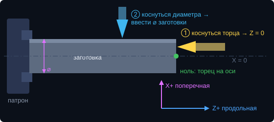

# Управление: экран и физические кнопки

Всё, чем пользуются во время работы, делается и на экране, и физическими органами управления 7e2
(переключатели режимов и подрежимов, кнопки ◀ ▶ ▲ ▼ и «Выбор», джойстик с кнопкой ускоренного хода,
кнопки упоров, ручной энкодер). Состояние общее: нажали кнопку на станке — экран обновился, и наоборот.

Только на экране — настройка станка: она делается один раз, и для неё нужен ввод чисел, которого у 7e2 нет.
Те же значения задаются в `Core/els_config.h`.

## Оси

- **Z — продольная**: вдоль оси шпинделя (суппорт едет к патрону и от него). «Z+» — от патрона.
- **X — поперечная**: поперёк (резец к оси детали и от неё). «X+» — от оси. X = 0 — ось шпинделя.
- Так называют оси в G-коде и на станках с ЧПУ (ISO 841). На экране — Z и X. У автора 7e2 (LCD2004) и на многих
  блоках DRO продольная подписана **Y** — это та же ось Z.

## Работа

| Действие | На экране | На станке |
|---|---|---|
| Режим (синхронная подача, асинхронная подача, резьба, конусы, шар, делилка) | меню режимов | переключатель режимов |
| Подрежим (Внутренний / Ручной / Наружный) | S1 / S2 / S3 в шапке | переключатель подрежимов |
| Подэкран (1 → 2 параметры → 3 ввод ⌀ → 4 дистанционные лимиты) | кнопка «ОК», двойной тап по ⌀ | «Выбор» |
| Подача, шаг резьбы, съём, конус, радиус шара и т. п. | тап по значению — барабан или ▲ ▼ справа | ▲ ▼ (на нужном подэкране) |
| Число проходов | плитка «ПРОХОДЫ» | ◀ ▶ |
| Категория резьбы (метрическая → дюймовая → G → K) | плитка «ТИП/ПРОФИЛЬ», верхний ряд | ▲ ▼ с нажатой кнопкой ускоренного хода |
| Профиль резьбы (МЕТРИЧ 60° → BSW 55° → UNF 60° → ТРАПЕЦ 30°) | плитка «ТИП/ПРОФИЛЬ», нижний ряд | «Выбор» с ускоренным ходом (резьба, подэкран 1) |
| Шар ↔ отрезание вразбежку (M6) | кнопка ШАР / ОТРЕЗАНИЕ | «Выбор» с ускоренным ходом (джойстик в нейтрали) |
| Отрезание: шаг / смещение / прорезаемый ⌀ | плитки ШАГ ⌀ / СМЕЩЕНИЕ / ПРОРЕЗ ⌀ — клавиатура | ◀ ▶ / ◀ ▶ с ускоренным ходом / ▲ ▼ (по шагу) |
| Пауза автоцикла / продолжить | ▼ «ПАУЗА» / ▲ «ДАЛЕЕ» или кнопка ДАЛЕЕ в окне | ▼ / ▲ (во время цикла) |
| Упоры (левый, правый, передний, задний) | на подэкране 4 — кнопки упоров на расстоянии | кнопки упоров (в «Ручном» — переключателем или на экране); на подэкране 4 — на расстоянии |
| Движение осей, запуск автоцикла | экранный джойстик (⚡ в шапке) | джойстик, кнопка ускоренного хода |
| Ручное перемещение | — | ручной энкодер (ось и шаг — переключателями) |
| Обнулить ось Z или X | держать ПОЗИЦИЮ Z / X 2 секунды | подэкран 1: ускоренный ход + ◀ — Z, ускоренный ход + ▶ — X (мод V3.6) |
| Ввести диаметр | тап по ⌀ — клавиатура | подэкран 3: ▲ ▼ ±0.10; ◀+▲/▼ ±0.01; ▶+▲/▼ ±1; ускоренный ход+▲/▼ ±10; ◀+▶ — 0 |
| Расстояние до дистанционного упора | подэкран 4: плитка «ДО УПОРА» — клавиатура | подэкран 4: как ⌀, мелкий шаг ◀+▲/▼ ±0.005 |
| Ввести значение оси Z или X | тап по ПОЗИЦИИ — клавиатура | нет (у 7e2 нет ввода чисел; есть сброс в 0) |
| Следующий подэкран | двойной тап по ⌀ или «ОК» справа | кнопка «Выбор» |
| Снять сообщение | «ОК» в сообщении | переключатель подрежима в «Ручной» |

С блоком DRO оси обнуляются и задаются на самом блоке: экранные и кнопочные «сброс» и «ввод» на них не влияют.

## Настройка — только на экране (тап по ⚠ в шапке → «НАСТРОЙКИ»)

| Раздел | Что | Где ещё |
|---|---|---|
| МЕХАНИКА | шаг винтов, шагов на оборот, микрошаг, люфт, линий энкодера | `els_config.h` |
| КАЛИБРОВКА | шаг винта и люфт — по линейкам или по индикатору | — |
| WI-FI | сеть роутера, поиск, «забыть» | `wifi_config.h` |
| ЛИНЕЙКИ | источник координат, тип и параметры линеек, доводка X, контроль шагов | `els_config.h` |
