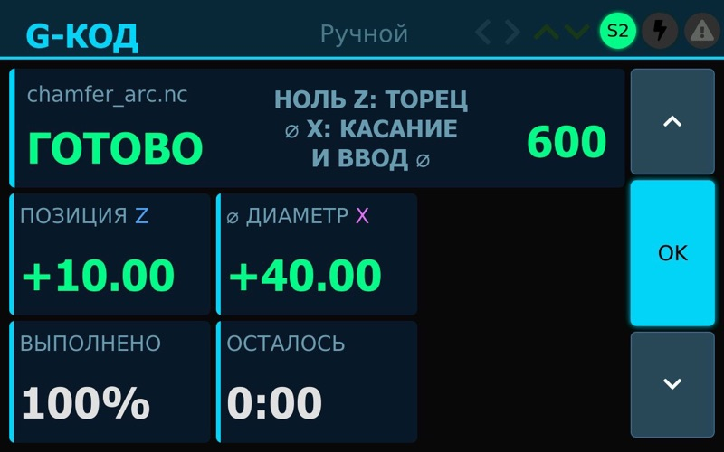
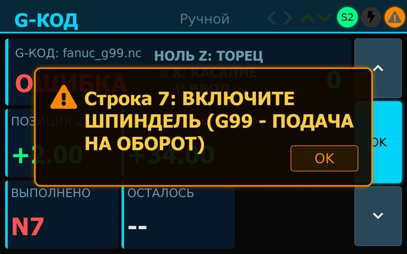
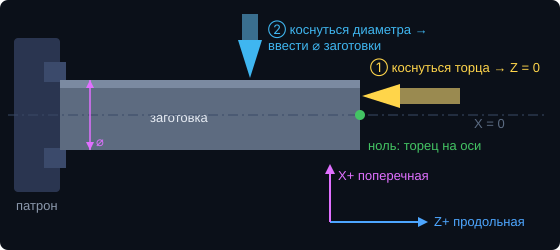
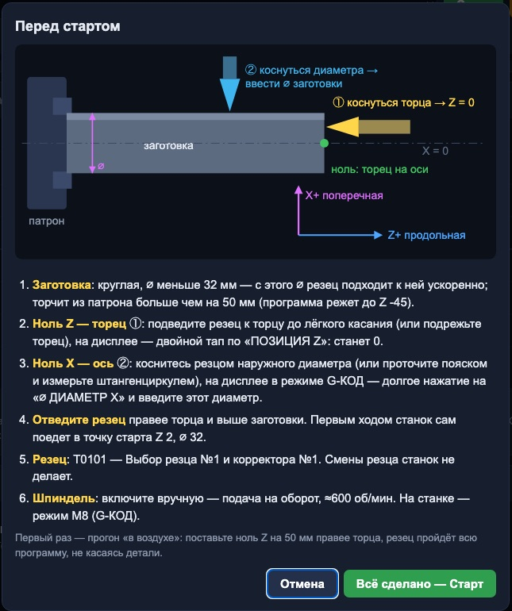

# G-код

Станок выполняет программы G-кода: файлы загружаются и запускаются с веб-страницы дисплея, движения делает
STM32. Режим — **M8 «G-КОД»** (у автора 7e2 — «Резерв»).

## Как запустить

1. Дисплей и компьютер (или телефон) — в одной сети: точка доступа дисплея (адрес на экране «НАСТРОЙКИ», тап по ⚠)
   или ваш роутер («НАСТРОЙКИ» → «WI-FI»). Откройте в браузере адрес с экрана.
2. Загрузите файл программы (`.nc`, `.gcode`, `.txt`) — список файлов, просмотр, удаление — на той же странице.
3. На станке: переключатель режимов — M8 (или «G-КОД» в меню режимов на экране). Поставьте ноль — см. «Ноль
   детали» ниже. После «Старт» на странице открывается окно «Перед стартом» с рисунком и числами вашей программы.
4. Включите шпиндель (вручную), нажмите «Старт» на веб-странице. На экране — номер строки (крупно, «N7»),
   процент выполнения, сколько осталось (мин:с) и позиции; в конце — «ГОТОВО» и 100 %. Расчётное время всей
   программы видно на странице сразу после выбора файла (подача на оборот — при текущих оборотах, без
   шпинделя — при 600 об/мин); во время работы прогноз поправляется по фактической скорости станка.

| Программа выполнена | Ошибка: строка и причина — в окне, пока не нажмёте OK |
|---|---|
|  |  |

Остановить: «Стоп» на веб-странице или любой ход джойстиком. «Пауза» — после текущей строки.

## Примеры

В `gcode_sample/` — программы для проверки (заготовка ⌀32, ноль Z — торец, X — диаметр):
`turn_steps.nc` — подрезка торца и две ступени; `chamfer_arc.nc` — фаска и галтель R3 (G2);
`fanuc_g99.nc` — стиль Fanuc, подача на оборот; `incremental.nc` — проходы в приращениях G91;
`history.nc` — черновой и чистовой проход (Fanuc); `pawn.nc` — шахматная пешка (заготовка ⌀28, циклы
G71/G70, шейка под шаром); `pawn_g71.nc` — пешка в стиле Fanuc (заготовка ⌀32). Файлы — обычный текст, расширение любое из
`.nc .gcode .ngc .tap .txt`. Перед станком — прогон «в воздухе» (резец далеко от детали).

## Ноль детали



Программа считает от торца заготовки (Z = 0) и от оси шпинделя (X = 0), X — диаметр. Перед программой:

1. **Z — торец** ①. Подведите резец к торцу до лёгкого касания (или подрежьте торец). На дисплее — двойной тап
   по «ПОЗИЦИЯ Z»: станет 0.
2. **X — по диаметру** ②. Коснитесь резцом наружного диаметра заготовки (или проточите поясок и измерьте
   штангенциркулем). На дисплее в режиме G-КОД — долгое нажатие на «⌀ ДИАМЕТР X», введите этот диаметр, например
   28.00. Теперь X = 0 — ось шпинделя, и ячейка показывает диаметр, как в программе.
3. **Отведите резец** правее торца и выше заготовки. Первым ходом станок сам поедет в точку старта программы.

То же — в окне «Перед стартом» на веб-странице (открывается кнопкой «Старт», с числами выбранной программы):



С блоком DRO ноль ставится на самом блоке (продольная там подписана Y): Z — у торца, X — касанием и вводом.

## Координаты

- Те же, что на экране: ноль — ваш ноль осей. Z — продольная, X — поперечная (рисунок выше).
- X по умолчанию — **диаметр** (G7), как принято на токарных станках; G8 — радиус.
- Дуги — в плоскости Z (по горизонтали) – X (по вертикали), G2 — по часовой стрелке. Если резец у вас
  за осью (задний резцедержатель), направление дуг зеркальное — проверьте программу на просмотре.
- С блоком DRO или линейками направление линеек прошивка узнаёт по первому ходу больше 2 мм: перед программой
  проведите оси джойстиком, иначе на экране «ПРОВЕДИТЕ ОСИ ДЖОЙСТИКОМ НА 2 ММ».

## Поддерживается

| Код | Что |
|---|---|
| G0 X Z | ускоренно (600 мм/мин, `GCODE_RAPID_MM_MIN`) |
| G1 X Z F | подача F, мм/мин |
| G2 / G3 X Z I K или R | дуга по / против часовой (центр I, K — от начала дуги; R &lt; 0 — дуга больше 180°) |
| G4 P | пауза, с |
| G7 / G8 | X — диаметр / радиус |
| G20 / G21 | дюймы / мм |
| G28 | в ноль: сначала X, потом Z. `G28 U0 W0` (Fanuc: в референтную точку станка) — на месте: такой точки нет |
| U W | приращения по X (на диаметр) и Z в любом кадре (Fanuc) |
| G71 / G70 | черновая обдирка по контуру и чистовой проход — см. ниже |
| G90 / G91 | абсолютные координаты / приращения |
| G94 / G98 | подача в мм/мин (по умолчанию) |
| G95 / G99 | подача в мм/об — пересчёт по измеренным оборотам шпинделя (шпиндель должен вращаться) |
| G50 S, G96, G97 | принимаются без действия (шпиндель — вручную) |
| M0 | пауза программы (продолжить — «Пауза» на странице) |
| M2 / M30 | конец программы |
| M3 M4 M5 M8 M9, S, T, N, O | принимаются, ничего не делают (шпиндель — вручную) |

## Циклы G71 и G70 (черновая и чистовая по контуру)

Как на Fanuc: контур детали описывается один раз (кадры `N10` … `N20`), станок сам снимает металл слоями.

```
G0 X30 Z2                    (точка старта: над заготовкой, перед торцом)
G71 U1.0 R0.5                (слой 1 мм на сторону, отскок 0.5)
G71 P10 Q20 U0.4 W0 F0.15    (контур N10…N20, припуск 0.4 на диаметр и 0 по Z, подача)
N10 G0 X0
G1 Z0
...                          (контур детали — от торца к патрону)
N20 G1 X30
G70 P10 Q20 F0.08            (чистовой проход по контуру)
```

- Черновая: проходы вдоль Z слоями глубиной U, в конце — проход по контуру с припуском, возврат в точку старта.
  Кадры контура сами по себе не исполняются. Одна строка тоже понимается: `G71 P Q U W D<глубина> F`.
- Контур — наружный, от торца к патрону: Z только убывает. Шейки и поднутрения (X уходит вниз) можно: резец
  заходит туда сверху. Резец должен туда пролезть: для поднутрения 45° — пластина 35° (VBMT/VCMT). Припуск W
  при поднутрениях — 0.
- G70 — проход по контуру с подачей F строки G70 (если нет — F из контура), возврат в точку старта.
- Разворачивает циклы дисплей (ему виден весь файл); ошибка в контуре — сообщение до первого движения.
  Веб-страница рисует все черновые проходы, как их выполнит станок.
- Нет: растачивание (G71 с U < 0), G72/G73 (торцевая обдирка, по копиру), компенсация радиуса резца G41/G42.

Не поддерживается: резьба G32/G76, G50 X/Z (смена координат), компенсация радиуса резца, G72–G76 — строка с ними
останавливает программу с сообщением.

## Безопасность

- Поставленные упоры не пересекаются: строка, которая уводит за упор, останавливает программу («ЗА УПОРОМ»).
- Компенсация люфта (если задана) работает и в G-коде.
- Скорости ограничены 8000 шагов/с на ось; разгон и торможение — на каждом отрезке.
