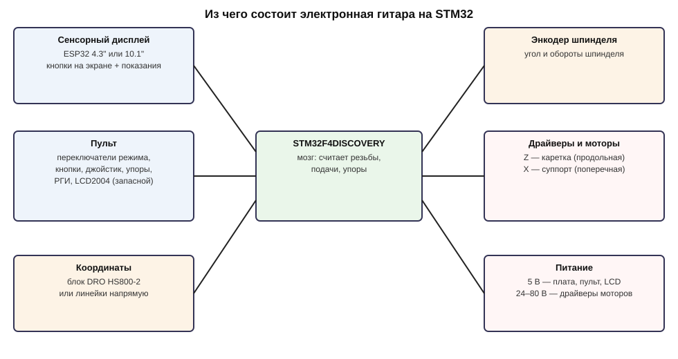
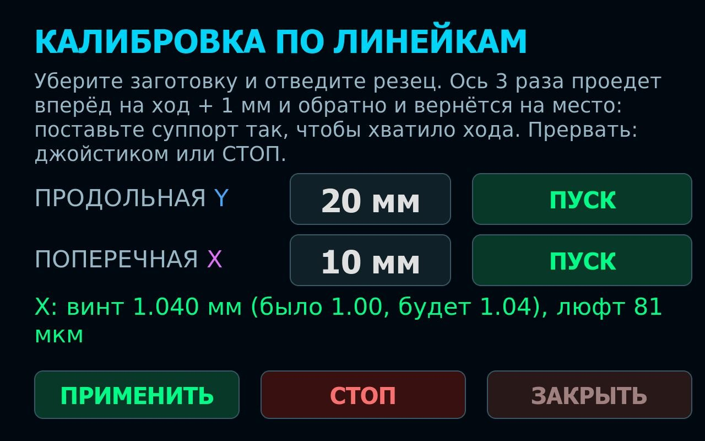
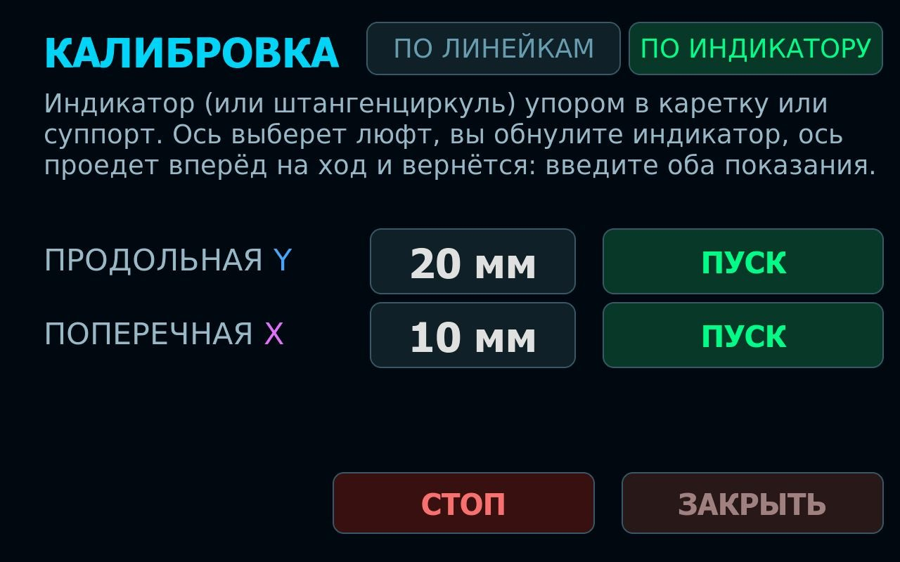
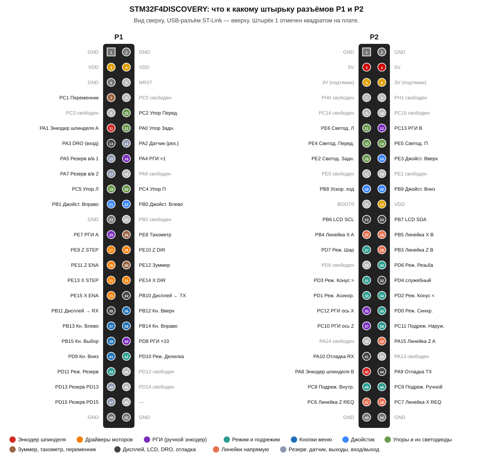
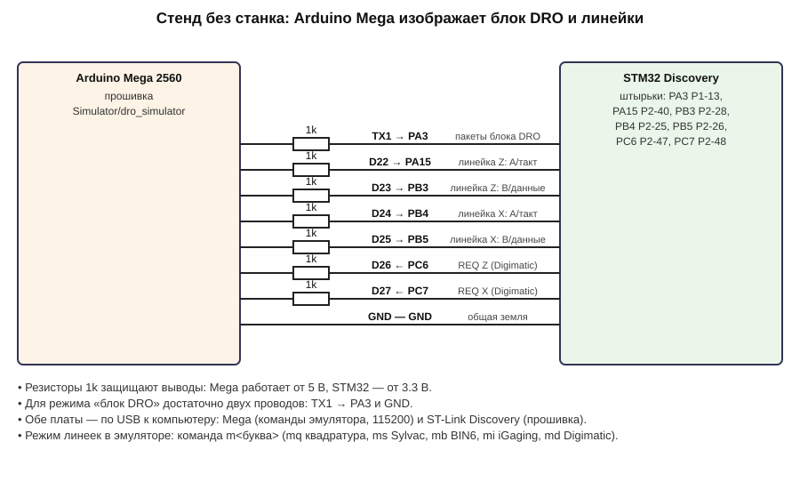

# Сборка и подключение — руководство

**Наглядная версия со всеми схемами: [index.html](index.html)** (откройте файл в браузере).
Здесь — то же самое коротко, со ссылками на картинки.

## 1. Из чего состоит

Плата **STM32F4DISCOVERY** — «мозг»: следит за энкодером шпинделя и крутит моторы осей Z (каретка)
и X (суппорт). Логика — прошивка 7e2 с форума chipmaker.ru, перенесённая с Arduino Mega без изменений
в расчётах. К плате подключаются: сенсорный дисплей (4.3" или 10.1"), пульт как у 7e2 (переключатели
режима и подрежима, кнопки меню, джойстик, упоры со светодиодами, РГИ, запасной LCD2004), источник
координат (блок DRO HS800-2 или линейки напрямую), энкодер шпинделя, драйверы моторов.

## 2. Что купить

STM32F4DISCOVERY, кабель mini-USB, дисплей JC4827W543 или JC8012P4A1C, блок питания 5 В 2 А,
резисторы 1 кОм (~40 шт.), 10 кОм (~8), 220 Ом (4), транзисторы BC547/2N2222 (7), конденсаторы
10 нФ и 1 нФ (по 2), элементы пульта. Для проверки на столе — макетка и Arduino Mega (эмулятор).
Полный список — в [index.html](index.html#buy).

## 3. Что куда прошить

| Устройство | Команда |
|---|---|
| Плата STM32 без линеек (USB в разъём ST-Link) | `pio run -e stm32f407_discovery -t upload` |
| Плата STM32 с блоком DRO HS800-2 | `pio run -e stm32f407_dro -t upload` |
| Плата STM32 с линейками напрямую | `pio run -e stm32f407_scales -t upload` |
| Дисплей 4.3" | `pio run -e jc4827w543 -t upload` |
| Дисплей 10.1" | `pio run -e jc8012p4a1c -t upload` |
| Arduino Mega — эмулятор | в `Simulator/dro_simulator`: `pio run -t upload` |

## 4. Настройка

Все настройки — в [`Core/els_config.h`](../Core/els_config.h): источник координат, тип дисплея,
механика станка (энкодер, винты, микрошаг), подачи, отскоки, РГИ, способ подключения драйверов
и зуммера, переменник подачи, монитор входов. Каждый параметр подписан в файле; простое описание —
в [index.html](index.html#config). Пины — в [`Core/e2/e2_pins.h`](../Core/e2/e2_pins.h).

**Ноль и ввод координат.** Без линеек и с линейками напрямую оси задаются на самом станке:
кнопкой «Сброс» в подрежиме «Ввод * Сброс осей» (как у автора) или на экране — двойной тап по
позиции Z, X или ⌀ ставит ноль, долгое нажатие открывает клавиатуру для ввода значения со знаком.
С блоком DRO главный — сам блок: ноль и значения задаются на нём, экран их только показывает.

**Руководство пользователя** (каждый режим с примерами, все сообщения и что делать) — [manual/README.md](manual/README.md).
Экран и физические кнопки — что чем делается: [CONTROLS.md](CONTROLS.md). G-код по Wi-Fi — [GCODE.md](GCODE.md).

**Настройки с экрана.** Тап по ⚠ в шапке открывает «НАСТРОЙКИ»: МЕХАНИКА, КАЛИБРОВКА, WI-FI (сеть роутера:
поиск, пароль, «забыть» — только точка доступа), ЛИНЕЙКИ (источник координат — без линеек, блок DRO или
линейки; тип, разрешение и направление по осям; после сохранения STM32 перезапускается). Внизу крупно —
адрес для браузера (точка доступа или роутер).

**Линейки в автоциклах** (с блоком DRO или линейками; «ЛИНЕЙКИ» → «ДОВОДКА X» / «КОНТРОЛЬ ШАГОВ», включены):
- *Доводка X.* Перед первым проходом, пока резец стоит на нуле цикла, запоминается показание линейки X. После
  каждого врезания (подача, асинхронная подача, резьба; «Внутренний»/«Наружный»), до начала прохода, суппорт
  доезжает по линейке до глубины «ноль + врезание». Глубина не зависит от люфта и стороны подвода к нулю.
- *Контроль шагов.* На каждой остановке оси шаги мотора сверяются с линейкой. Расхождение больше 0.15 мм —
  сообщение «ПРОПУСК ШАГОВ» и джойстик не двигает станок, пока его не отпустят. Пока люфт не задан (калибровка),
  ходы с разворотом не сверяются.
- Направление линейки прошивка узнаёт сама по первому ходу больше 2 мм. Перед первым циклом после включения
  проведите суппорт джойстиком — иначе на экране «ДОВОДКА X НЕ ГОТОВА». Если масштаб линейки не совпадает с
  механикой (например, блок DRO показывает X в диаметрах) — «ЛИНЕЙКА X НЕ СОВПАДАЕТ С МЕХАНИКОЙ», функции этой
  оси выключаются.

**Механика.** «МЕХАНИКА СТАНКА»: шаг винтов, шагов на
оборот, микрошаг, люфт, линий энкодера. «СОХРАНИТЬ» — STM32 проверяет значения, применяет и пишет во
флеш (только на остановленном станке: шпиндель стоит, джойстик в нейтрали). «ИЗ КОНФИГА» (держать
нажатой) — вернуть значения из `els_config.h`. Настройки — в последнем секторе флеша (11) и переживают
перепрошивку через ST-Link; полная очистка чипа возвращает значения из конфига.

**Калибровка по линейкам** (нужны линейки или блок DRO): в «МЕХАНИКА СТАНКА» — кнопка «КАЛИБРОВКА».
Уберите заготовку, отведите резец и поставьте суппорт так, чтобы хватило хода. Выберите ход (по умолчанию
Z — 20 мм, X — 10 мм) и нажмите «ПУСК»: ось 3 раза проедет вперёд на ход + 1 мм и обратно и вернётся на
место. На экране — измеренный шаг винта и люфт; «ПРИМЕНИТЬ» записывает их в настройки. Шаг винта ядро
хранит в сотых долях миллиметра, поэтому применяется округлённое значение (1.996 → 2.00). Прервать —
джойстиком или «СТОП».

**Калибровка без линеек — по индикатору или штангенциркулю** (вкладка «ПО ИНДИКАТОРУ»; без линеек и блока DRO
открывается сразу она). Упор индикатора — в каретку или суппорт. «ПУСК»: ось отходит на 1 мм и возвращается
(выбран люфт) → обнулите индикатор, «ДАЛЕЕ» → ось едет вперёд на ход → введите показание → ось возвращается →
введите показание (сколько не дошла — это люфт). На экране — шаг винта и люфт, «ПРИМЕНИТЬ» — в настройки.

> Таблицы резьб и конусов автора рассчитаны под энкодер 1800, винт Z 2 мм, винт X 1 мм, 800 шагов/об.
> При другой механике прошивка пересчитывает их сама при старте. Если какой-то шаг резьбы или конус
> на этой механике не получить (мотор не успевает за шпинделем или делитель больше 255), настройки
> не примутся, и на экране будет написано, какой именно.

## 5. Какой провод куда

Таблица всех выводов: [wiring/pins.md](wiring/pins.md).

## 6. Схемы по блокам

| Блок | Схема |
|---|---|
| Кнопки, переключатели, концевики | [input_button.svg](wiring/input_button.svg) |
| Энкодер шпинделя | [spindle_encoder.svg](wiring/spindle_encoder.svg) |
| РГИ (маховичок) | [hand_encoder.svg](wiring/hand_encoder.svg) |
| Драйверы моторов | [drivers.svg](wiring/drivers.svg) |
| Светодиоды, зуммер, тахометр, переменник | [outputs.svg](wiring/outputs.svg) |
| Дисплей, LCD2004, блок DRO, отладка | [links.svg](wiring/links.svg) |

Важно: подрежимы подключаются по прошивке автора — Внутренний PC8, Ручной PC9, Наружный PC11
(на схеме автора подписи A13/A15 перепутаны). Упоры кнопками ставятся только в подрежиме «Ручной».

## 7. Макетка без шилда

Собирайте по одному блоку и проверяйте **монитором входов**: подключите USB-UART (RX ← PA9, TX → PA10,
GND), откройте монитор порта на 115200 — каждое нажатие, поворот переключателя, щелчок РГИ и вращение
шпинделя печатается строкой `[IO] …`. Пошагово — [index.html](index.html#bench).

## 8. Стенд без станка (эмулятор на Mega)

Для блока DRO хватит двух проводов: TX1 Mega → PA3 (через 1 кОм) и GND. Режимы линеек — командами
`mq`, `ms`, `mb`, `mi`, `md` в мониторе Mega. Подробно — [index.html](index.html#emulator).

## 9. Линейки

[scales/README.md](scales/README.md) — типы линеек, как узнать свою, схемы сопряжения, настройка.

## 10. Дисплеи

[DISPLAYS.md](../DISPLAYS.md). UART к STM32: 4.3" — GPIO44 (RX) / GPIO43 (TX); 10.1" — CN2, GPIO38 (RX) /
GPIO37 (TX). TX платы STM32 (PB10) → RX дисплея, RX платы (PB11) ← TX дисплея, общий GND.

## 11. Шилд

Сборка на шилде — что купить, заказ и пайка платы, какой провод куда, первое включение по блокам:
[assembly/README.md](assembly/README.md). Схема и плата в KiCad — [hardware/shield](../hardware/shield/README.md).

## 12. Для разработчиков

- Как перенесено ядро 7e2 и что проверено: [PORT_AUDIT.md](PORT_AUDIT.md); сверка с оригиналом по пунктам — [CHECKLIST_7e2.md](CHECKLIST_7e2.md).
- Пересобрать схемы и эту документацию: `python3 tools/docs_gen/build_docs.py`.
- Проверка ядра без платы: `bash tools/run_e2_sim.sh`.
