# Сборка: что купить, шилд, что куда подключить

Как собрать контроллер на шилде: что купить, как заказать и спаять плату, какой провод куда идёт и как
проверить каждый блок при первом включении. Схемы на этой странице генерируются из описания шилда
(`hardware/shield/design.py`), поэтому подписи выводов на них совпадают с надписями на плате.

**Содержание**

1. [Что получится](#1-что-получится)
2. [Список покупок](#2-список-покупок)
3. [Шилд: заказ, пайка, проверка](#3-шилд-заказ-пайка-проверка)
4. [Что куда: разъёмы шилда](#4-что-куда-разъёмы-шилда)
5. [Подключение по блокам](#5-подключение-по-блокам)
6. [Первое включение — по одному блоку](#6-первое-включение--по-одному-блоку)

Как работать на собранном станке — [руководство пользователя](../manual/README.md). Без шилда, на макетке —
[docs/README.md](../README.md), раздел 7.

---

## 1. Что получится

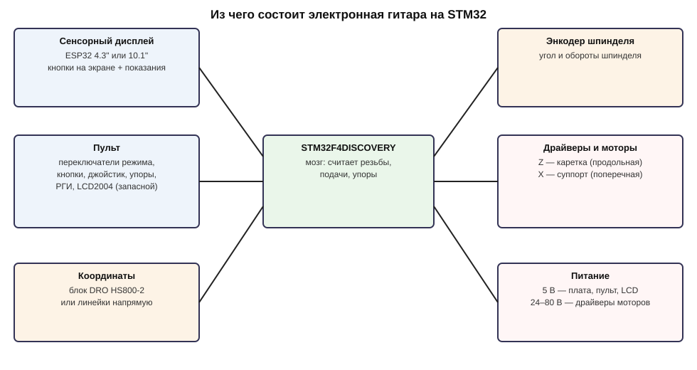

- **Плата STM32F4DISCOVERY** вставляется сверху в шилд и считает всё: резьбу, подачи, упоры.
- **Шилд** — плата 96×126 мм. На ней резисторы, транзисторы и разъёмы для всех проводов, Discovery стоит на ней в
  гнёздах.
- **Сенсорный дисплей** (10.1" или 4.3") — экран, кнопки и веб-страница для G-кода. Соединяется с шилдом
  4 проводами.
- **Пульт** — переключатели режимов, кнопки, джойстик, упоры, маховичок.
- **Станок** — энкодер на шпинделе, два шаговых мотора с драйверами, по желанию линейки или блок DRO.

## 2. Список покупок

Цены и магазины не указаны — всё продаётся на AliExpress, в «Чип и Дип», LCSC и т. п. Колонка «Что искать» —
что вбить в поиск и на что смотреть.

### Электроника — обязательно

| Что | Сколько | Что искать / на что смотреть |
|---|---|---|
| Плата STM32F4DISCOVERY | 1 | «STM32F407G-DISC1» или «STM32F4DISCOVERY» (MB997). Плата с STM32F407VG, двумя рядами штырей 2×25 |
| Кабель USB A — mini-USB | 1 | для прошивки Discovery (разъём ST-LINK) |
| Сенсорный дисплей | 1 | «JC8012P4A1C» (10.1", ESP32-P4) или «JC4827W543» (4.3", ESP32-S3), Guition. Версия с ёмкостным тачем |
| Кабель к дисплею | 1 | 10.1": «MX1.25 4P» (шаг 1.25 мм, 4 провода) — часто в комплекте дисплея; 4.3" — по разъёму P1 |
| Кабель USB-C | 1 | для прошивки дисплея |
| Блок питания 5 В | 1 | 5 В, от 2 А; с дисплеем 10.1" — 3 А. Mean Well RS-15-5, LRS-35-5 или аналог в корпусе |
| Плата шилда | 1 (заказ — от 5) | заказ по Gerber-файлам — [раздел 3](#3-шилд-заказ-пайка-проверка) |
| Детали шилда | 1 комплект | ниже, «Шилд» |

### Шилд

Полный список по позициям на плате — [hardware/shield/bom.md](../../hardware/shield/bom.md). Мелочь берите с
запасом: резисторы и конденсаторы 0805 продаются лентами по 50–100 штук, и при ручной пайке пара деталей обычно
теряется.

| Что | Сколько | Что искать / на что смотреть |
|---|---|---|
| Резистор 1 кОм, 0805 | 40 | «0805 1K 5%» |
| Резистор 10 кОм, 0805 | 7 | «0805 10K» |
| Резистор 470 Ом, 0805 | 6 | «0805 470R» |
| Резистор 220 Ом, 0805 | 4 | «0805 220R» |
| Резистор 100 Ом, 0805 | 1 | «0805 100R» |
| Конденсатор 100 нФ, 0805 | 3 | «0805 104 X7R 50V» |
| Конденсатор 10 нФ, 0805 | 2 | «0805 103 X7R» |
| Конденсатор 1 нФ, 0805 | 2 | «0805 102 X7R» |
| Конденсатор 22 мкФ, 1206 | 1 | «1206 22uF 10V X5R» (или 16 В) |
| Транзистор MMBT3904, SOT-23 | 7 | «MMBT3904» (маркировка на корпусе — 1A); аналог MMBT2222A |
| Диод Шоттки B5819W, SOD-123 | 1 | «B5819W» или «1N5819W», 1 А 40 В |
| Гнездо 2×25, шаг 2.54 мм, прямое | 2 | «female header 2x25 2.54» — под Discovery |
| Вилка KF2510 (KK-254), прямая | 3 × 2P, 3 × 3P, 5 × 4P, 5 × 5P, 4 × 6P | «KF2510 straight pin header»; ответные корпуса и контакты — ниже |
| Вилка IDC 2×5 в корпусе | 1 | «IDC box header 10 pin 2.54» (DC3-10P) |
| Стойки M3 и винты | 4 | под крепёжные отверстия шилда |

### Разъёмы и провода

| Что | Сколько | Что искать / на что смотреть |
|---|---|---|
| Корпуса KF2510 (ответные) | 3 × 2P, 3 × 3P, 5 × 4P, 5 × 5P, 4 × 6P | «KF2510 housing», под те же вилки |
| Контакты KF2510 под обжим | 100 | «KF2510 terminal» (нужно 84, остальное — запас) |
| Розетка IDC-10 под шлейф | 2 | «IDC 10 pin female 2.54» (FC-10P) — к галетнику режимов |
| Плоский шлейф 10 жил | 1 м | «flat ribbon cable 10 pin 1.27» |
| Кабель экранированный 4–5 жил | по месту | энкодер шпинделя, маховичок, линейки |
| Провод многожильный 0.2–0.35 мм² | 10–20 м | пульт: кнопки, переключатели, светодиоды |
| Провод 0.75 мм² (красный, чёрный) | 2 м | питание 5 В |
| Витая пара (кабель UTP) | по месту | драйверы моторов (PUL, DIR, ENA) |
| Термоусадка, стяжки | — | — |

### Станок

| Что | Сколько | Что искать / на что смотреть |
|---|---|---|
| Энкодер шпинделя | 1 | «E6B2-CWZ6C 1800P/R» или Autonics E40S; выход NPN «открытый коллектор», питание 5–24 В. 1800 линий — как у автора 7e2 (другое число задаётся в настройках) |
| Муфта или зубчатый ремень к энкодеру | 1 | энкодер вращается со шпинделем 1:1 и без проскальзывания |
| Драйвер шагового мотора | 2 | «DM542» (или DM556, TB6600), входы PUL/DIR/ENA с оптронами |
| Шаговый мотор | 2 | NEMA 23 (или 17) 1.8°, момент — под ваш станок (обычно 1.2–3 Н·м) |
| Блок питания для драйверов | 1 | 24–48 В, по мощности — двум моторам (обычно 36 В 10 А) |
| Координаты (по желанию) | — | блок DRO HS800-2 с линейками **или** линейки напрямую к шилду — [docs/scales](../scales/README.md) |

### Пульт

| Что | Сколько | Что искать / на что смотреть |
|---|---|---|
| Галетный переключатель на 8 положений | 1 | «rotary switch 1P8T» (или 1P12T с ограничителем на 8) — режимы M1…M8 |
| Переключатель на 3 положения | 1 | галетный «1P3T» или тумблер ON-ON-ON — подрежимы. Тумблер ON-OFF-ON не подходит |
| Кнопки без фиксации | 9 | 5 — меню, 4 — упоры; нормально разомкнутые («momentary NO») |
| Светодиоды 3–5 мм | 4 | красные, жёлтые или зелёные (синие и белые от 3.3 В не загорятся) |
| Джойстик на 4 положения с самовозвратом | 1 | «joystick switch 4 position momentary» — 4 микровыключателя |
| Кнопка ускоренного хода | 1 | на ручке джойстика или рядом |
| Маховичок (РГИ) | 1 | «MPG handwheel 100 PPR 5V», 60 мм; выходы A, B |
| Переключатель оси РГИ | 1 | тумблер ON-OFF-ON: Z — выкл — X |
| Переключатель масштаба РГИ | 1 | тумблер ON-ON: ×1 / ×10 |
| Зуммер активный 5 В | 1 | «active buzzer 5V» (со встроенным генератором) |
| LCD2004 с I2C-модулем | 1, по желанию | запасной текстовый экран, как у автора 7e2 |
| Переменный резистор 10 кОм | 1, по желанию | «B10K» — подача ручкой |
| Корпус пульта | 1 | под ваш станок |

### Инструмент

Паяльник с регулировкой температуры: тонкое жало для SMD 0805 и мощное (от 40 Вт) для выводов земли — они
припаяны к сплошной меди. Ещё понадобятся припой 0.5 мм, флюс, пинцет и лупа (или очки с увеличением), обжимка
для контактов KF2510 («SN-28B» или «IWISS SN-28B») и мультиметр. Для розетки IDC — тиски или специальный пресс.

## 3. Шилд: заказ, пайка, проверка

### Заказ платы

Файлы для заказа — [hardware/shield/els_shield_gerbers.zip](../../hardware/shield/els_shield_gerbers.zip)
(медь, маска, шелкография с двух сторон, контур, сверловка). На JLCPCB (или PCBWay и т. п.):

1. «Order now» → загрузите zip целиком. Размер (96×126 мм) и 2 слоя сайт определит сам.
2. Толщина 1.6 мм, покрытие HASL (с свинцом или без — без разницы), цвет любой. Остальное — по умолчанию:
   дорожки и зазоры на плате не меньше 0.2 мм, это стандарт без доплаты.
3. Минимальный заказ — 5 плат.

Перед заказом — две проверки из [README шилда](../../hardware/shield/README.md#состояние): распечатайте слой меди
в масштабе 1:1 и приложите Discovery (совпадают ли гнёзда), и посмотрите снизу Discovery — нет ли там высоких
деталей над местом SMD-мелочи.

### Пайка — по порядку

Сначала низкие детали, потом высокие. Плата спаяна правильно, если каждая деталь стоит на свою подпись:
у мелочи на шелкографии — номинал («1k», «10k», «3904»), у разъёмов — назначение выводов.

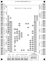

1. **Резисторы и конденсаторы 0805.** Каплю припоя — на одну площадку, деталь пинцетом, прогреть, потом вторую
   сторону. Резисторы: 1k — 40 шт., 10k — 7, 470 — 6, 220 — 4, 100 — 1. Конденсаторы — по подписям.
2. **Транзисторы MMBT3904** (7 шт.) — три вывода, ошибиться нельзя: корпус ложится только одним образом.
3. **Диод D1** — полоска на корпусе (катод) — к метке катода на шелкографии. Перевёрнутый диод не даст Discovery
   питаться от блока.
4. **Конденсатор C8** (22 мкФ, 1206).
5. **Проверка мультиметром** (прозвонка): +5V–GND и +3V–GND не замкнуты. Точки — выводы J3 (+5V, GND) и J12
   (+3V, вывод 1) против любого GND.
6. **Разъёмы KF2510** — защёлкой к контуру на шелкографии, ровно, без перекоса. Выводы GND — дольше и мощным
   жалом: они на сплошной меди.
7. **Вилка IDC J7** — вырез (ключ) корпуса — к краю платы, как на шелкографии.
8. **Гнёзда J1, J2 под Discovery — последними.** Вставьте гнёзда в шилд, сверху наденьте Discovery и только
   потом паяйте: так гнёзда встанут ровно по её штырям.
9. Промойте плату от флюса (спирт или очиститель), просушите.

### Проверка перед установкой Discovery

1. Discovery снята. Блок питания 5 В — на J3 (+5V и GND — по подписям на плате).
2. Мультиметр: на J3 — 4.9…5.2 В. На J19 выводы GND и +5V — то же.
3. На гнезде J2 выводы 3 и 4 (5V Discovery, после диода D1) — 4.5…4.9 В.
4. Блок выключить. Discovery — в гнёзда, лицом вверх, USB ST-LINK — к верхнему краю платы (рисунок ниже), вывод 1
   к выводу 1. Перекос на ряд сожжёт плату — проверьте до включения.

## 4. Что куда: разъёмы шилда

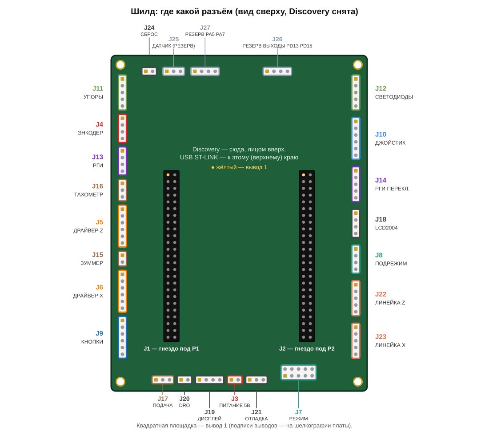

| Разъём | Подключается | Нужен? | Схема |
|---|---|---|---|
| J3 ПИТАНИЕ 5В | блок питания 5 В | да | [питание](#питание--j3) |
| J4 ЭНКОДЕР | энкодер шпинделя | да | [энкодер](#энкодер-шпинделя--j4) |
| J5 ДРАЙВЕР Z, J6 ДРАЙВЕР X | драйверы моторов | да | [драйверы](#драйверы-моторов--j5-j6) |
| J7 РЕЖИМ, J8 ПОДРЕЖИМ | галетник режимов, переключатель подрежимов | да (режим можно и с экрана) | [режимы](#режимы-и-подрежимы--j7-j8) |
| J9 КНОПКИ, J10 ДЖОЙСТИК | кнопки меню, джойстик, ускоренный ход | да | [кнопки](#кнопки-и-джойстик--j9-j10) |
| J11 УПОРЫ, J12 СВЕТОДИОДЫ | кнопки упоров и их светодиоды | да | [упоры](#упоры--j11-j12) |
| J13 РГИ, J14 РГИ ПЕРЕКЛ. | маховичок и его переключатели | по желанию | [РГИ](#маховичок-рги--j13-j14) |
| J15 ЗУММЕР, J16 ТАХОМЕТР, J17 ПОДАЧА | зуммер, тахометр, переменник подачи | зуммер — да, остальное — по желанию | [выходы](#зуммер-тахометр-переменник--j15j17) |
| J19 ДИСПЛЕЙ | сенсорный дисплей | да | [связь](#дисплей-lcd-блок-dro-отладка--j18j21) |
| J18 LCD2004, J20 DRO, J21 ОТЛАДКА | LCD, блок DRO, USB-UART | по желанию | [связь](#дисплей-lcd-блок-dro-отладка--j18j21) |
| J22 ЛИНЕЙКА Z, J23 ЛИНЕЙКА X | линейки напрямую | по желанию | [линейки](#линейки-напрямую--j22-j23) |

Все входы (кнопки, переключатели, джойстик) замыкаются на GND — подтяжки 1 кОм к 3.3 В уже на шилде. Какой
вывод STM32 стоит за каждым контактом — [docs/wiring/pins.md](../wiring/pins.md), колонка «Шилд».

## 5. Подключение по блокам

На каждой схеме: слева — разъём шилда с подписями, как на плате (вывод 1 — квадратный), справа — модуль и его
клеммы. Провод соединяет одинаковые по смыслу выводы.

### Питание — J3

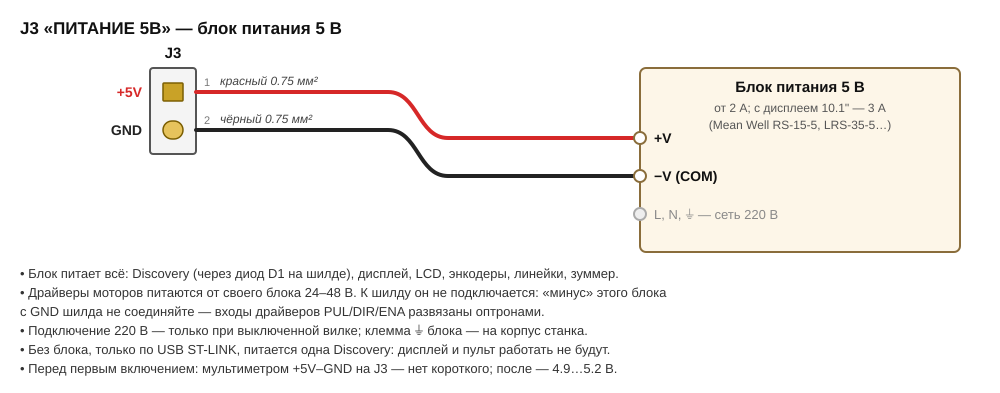

### Энкодер шпинделя — J4

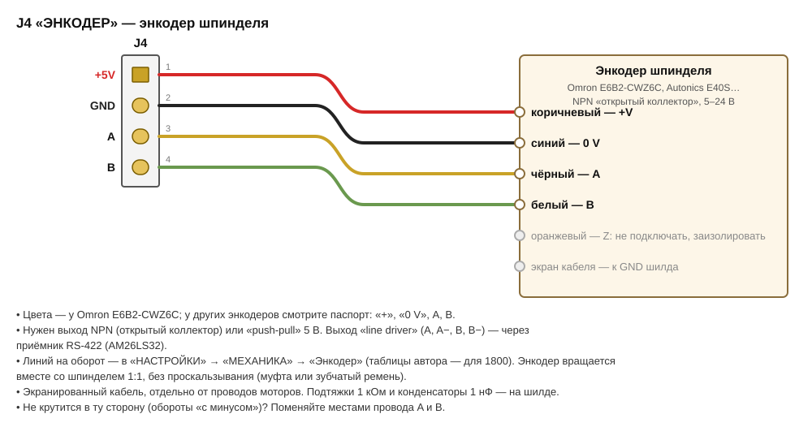

### Драйверы моторов — J5, J6

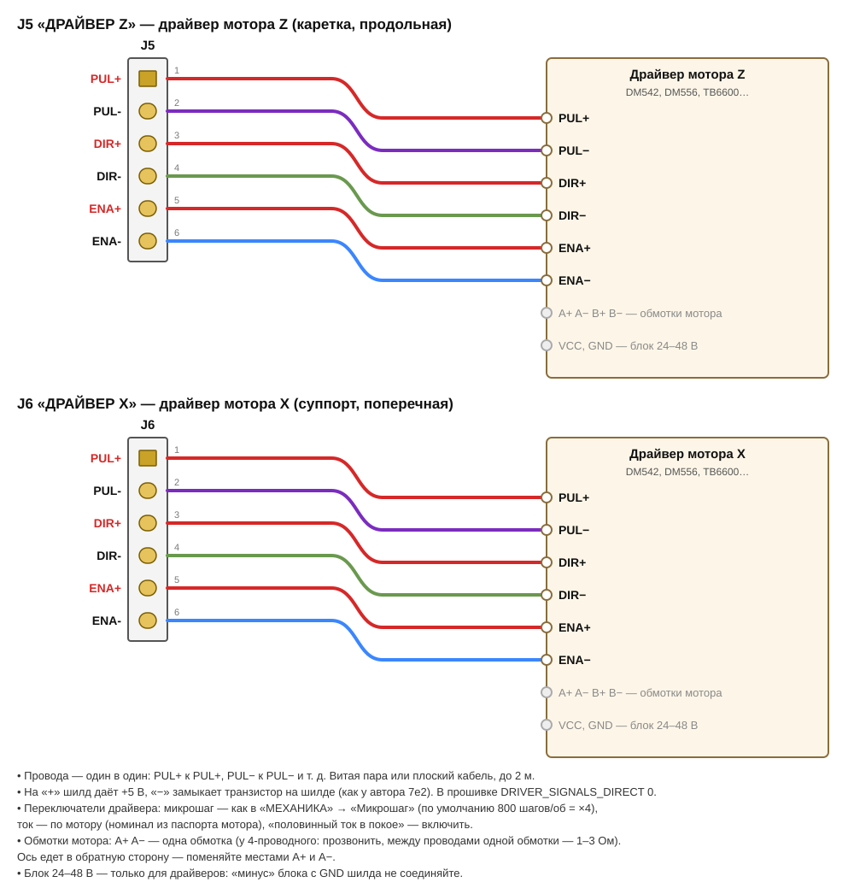

### Режимы и подрежимы — J7, J8

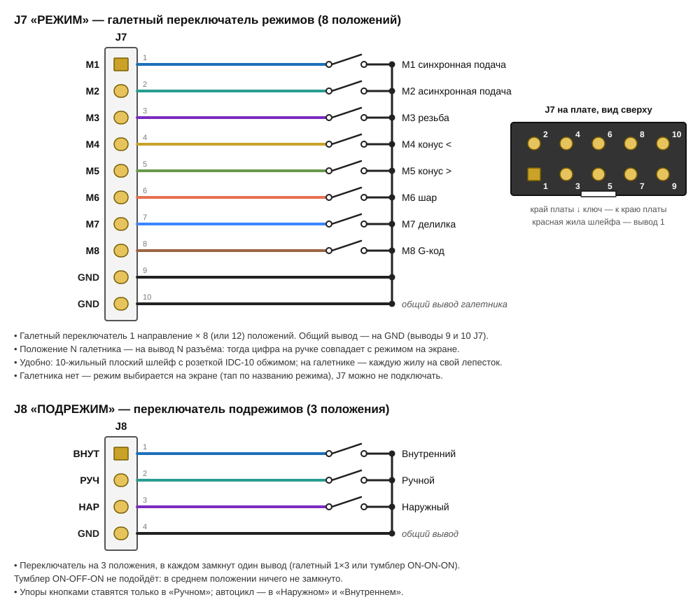

### Кнопки и джойстик — J9, J10

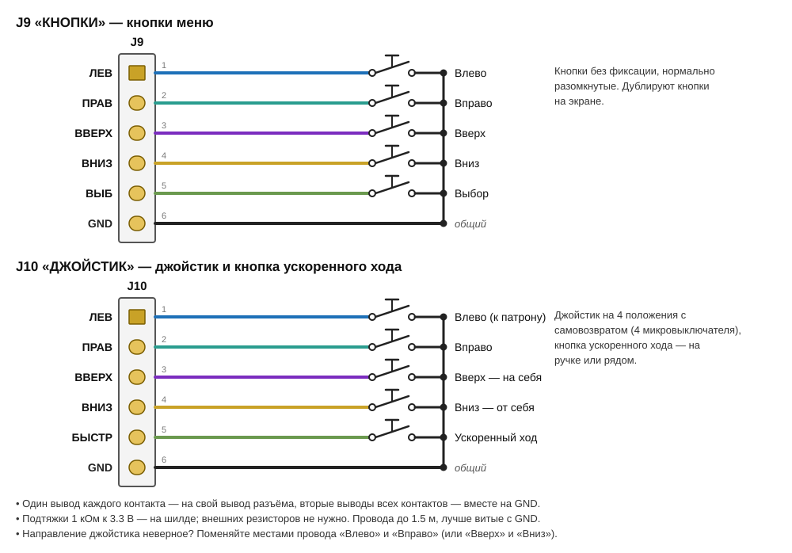

### Упоры — J11, J12

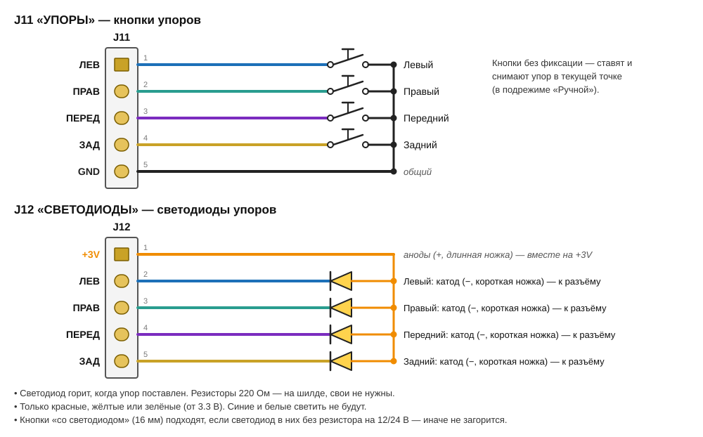

### Маховичок РГИ — J13, J14

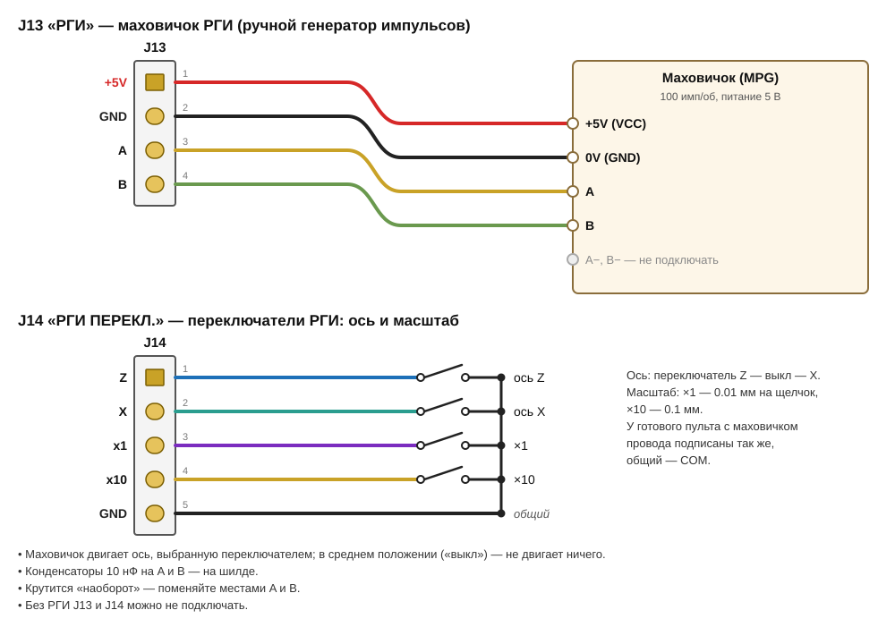

### Зуммер, тахометр, переменник — J15…J17

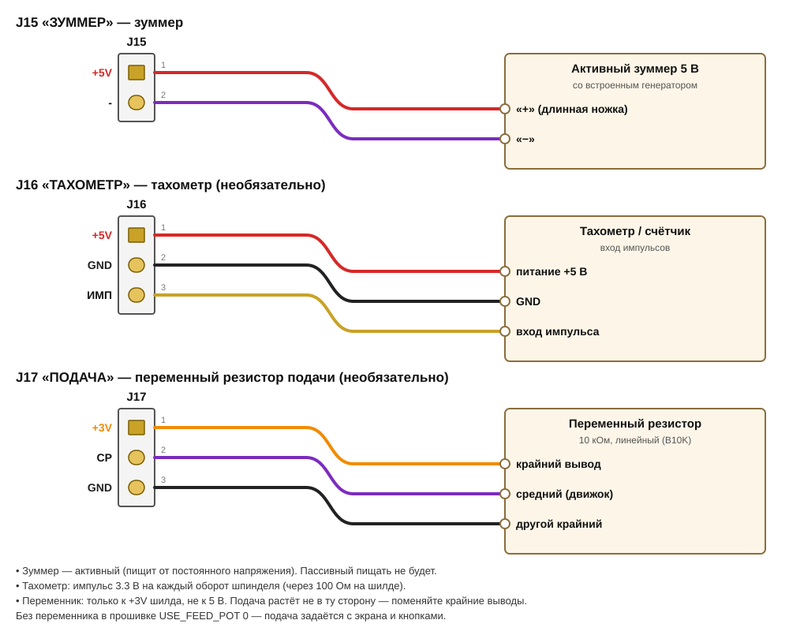

### Дисплей, LCD, блок DRO, отладка — J18…J21

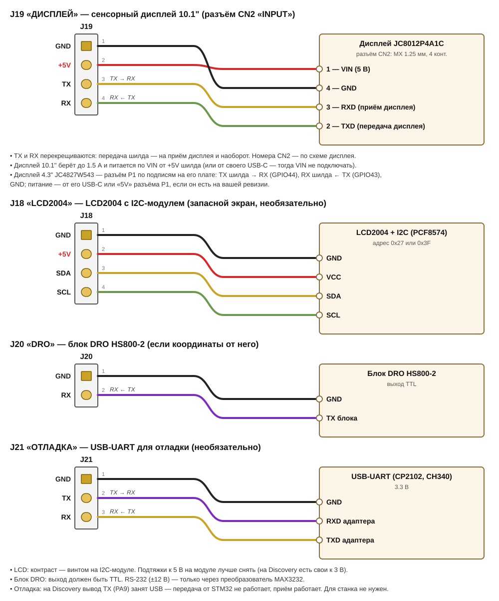

### Линейки напрямую — J22, J23

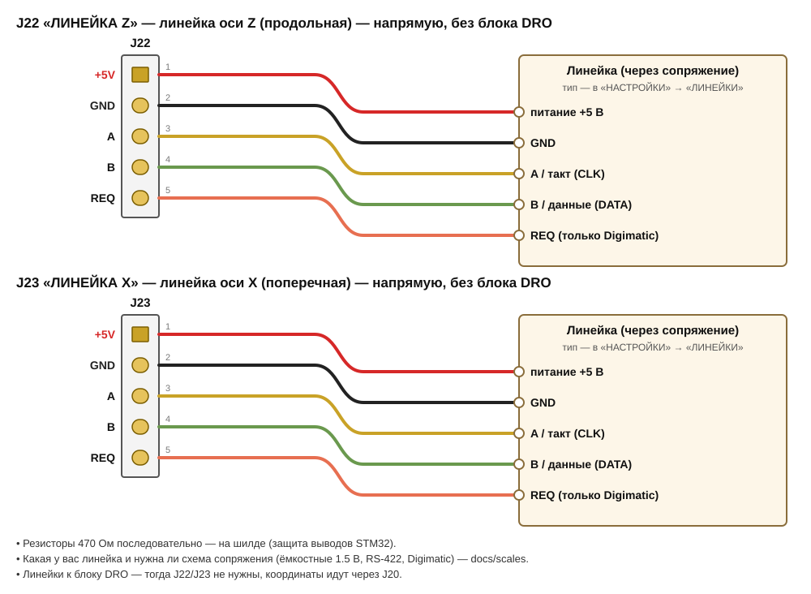

## 6. Первое включение — по одному блоку

Подключайте по одному блоку и сразу проверяйте: если что-то не так, понятно, где искать. Всё подключение — при
выключенном питании.

| # | Что сделать | Как проверить |
|---|---|---|
| 1 | Прошить Discovery: mini-USB в разъём ST-LINK, `pio run -e stm32f407_discovery -t upload` (с блоком DRO — `stm32f407_dro`, с линейками — `stm32f407_scales`) | PlatformIO пишет «SUCCESS» |
| 2 | Прошить дисплей: USB-C дисплея, `pio run -e jc8012p4a1c -t upload` (4.3" — `jc4827w543`) | на дисплее — главный экран |
| 3 | Дисплей → J19, блок 5 В → J3, включить | экран показывает режим и позиции, тап по ⚠ → «МЕХАНИКА» — числа из STM32 (если связи нет — «НЕТ ДАННЫХ ОТ STM32»: проверьте TX/RX, они перекрёстные) |
| 4 | Галетник → J7, подрежим → J8 | поворот галетника меняет режим на экране (M1…M8), подрежим — в шапке |
| 5 | Кнопки → J9, джойстик → J10 | кнопки работают как стрелки и «Выбор» на экране; джойстик — позиция на экране меняется (моторов ещё нет — так и должно быть) |
| 6 | Драйверы → J5, J6, моторы, блок 24–48 В (на драйверах — микрошаг и ток) | джойстик влево — каретка к патрону, вверх — суппорт на себя. Не туда — поменять A+ и A− мотора |
| 7 | Энкодер → J4 | крутите шпиндель рукой — на экране обороты; «минус» или 0 — поменять A и B |
| 8 | Упоры → J11, J12 | в «Ручном» кнопка упора ставит упор: горит его светодиод и значок в шапке |
| 9 | РГИ → J13, J14 | ось Z или X выбрана — маховичок двигает её, ×10 — в 10 раз быстрее |
| 10 | Зуммер → J15 (и, по желанию, J16, J17, J18) | зуммер пищит на сообщениях; LCD показывает режим и позиции |
| 11 | Координаты: блок DRO → J20 или линейки → J22, J23 | позиции идут от линеек: проведите ось джойстиком на 2–3 мм; «НЕТ СВЯЗИ С ЛИНЕЙКОЙ» — смотрите разъём и тип в «ЛИНЕЙКИ» |
| 12 | Настройки: механика, затем калибровка | [руководство, раздел 7](../manual/README.md#7-настройки) — калибровка по шагам для линеек, DRO и без них |

Дальше — [руководство пользователя](../manual/README.md): первое включение, ноль, упоры, режимы.
