# Руководство пользователя

Это руководство — для того, кто первый раз подходит к станку с этим контроллером. Ничего не нужно знать заранее:
что такое режим, упор, проход и подача — объясняется по ходу. Снимки — с настоящего экрана 10.1" (на 4.3"
всё так же, только мельче). Красные кружки с номерами на снимках — «куда смотреть и куда нажимать», под снимком —
что означает каждый номер.

**Содержание**

1. [Станок и оси](#1-станок-и-оси)
2. [Пульт: кнопки, переключатели, джойстик](#2-пульт-кнопки-переключатели-джойстик)
3. [Экран](#3-экран)
4. [Первое включение и ноль](#4-первое-включение-и-ноль)
5. [Упоры и автоцикл — главное, что нужно понять](#5-упоры-и-автоцикл--главное-что-нужно-понять)
6. [Режимы](#6-режимы): [M1 Синхронная подача](#m1--синхронная-подача) · [M2 Асинхронная](#m2--асинхронная-подача) ·
   [M3 Резьба](#m3--резьба) · [M4/M5 Конус](#m4-и-m5--конус) · [M6 Шар](#m6--шар) · [M7 Делилка](#m7--делилка) ·
   [M8 G-код](#m8--g-код)
7. [Настройки](#7-настройки): [Механика](#механика) · [Калибровка по шагам](#калибровка) · [Wi-Fi](#wi-fi) · [Линейки](#линейки)
8. [Сообщения и ошибки — что значит и что делать](#8-сообщения-и-ошибки--что-значит-и-что-делать)
9. [Частые вопросы](#9-частые-вопросы)

> **Безопасность.** Первый раз любую операцию делайте «в воздухе»: резец отведён от детали, шпиндель крутится
> медленно. Автоцикл можно остановить в любой момент — отпустите джойстик. Аварийная остановка станка — его
> собственной кнопкой «Стоп», не экраном.

---

## 1. Станок и оси

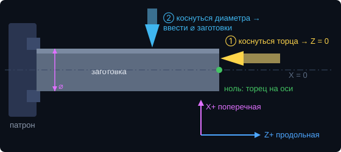

- **Z — продольная ось**: суппорт едет вдоль детали, к патрону и от него. «Z+» — от патрона.
- **X — поперечная ось**: резец едет поперёк детали, к её оси и от неё. «X+» — от оси.
- **Ноль Z** обычно ставят на торец детали, **ноль X** — на ось шпинделя (тогда X удвоенный — это диаметр).
- На блоке DRO и на маленьком экране LCD2004 продольная ось подписана **Y** — это та же Z.

## 2. Пульт: кнопки, переключатели, джойстик

Всё, что есть на экране, есть и на пульте (подробная таблица соответствия — [CONTROLS.md](../CONTROLS.md)).

| Орган | Что делает |
|---|---|
| **Переключатель режимов** (8 положений) | M1…M8: синхронная подача, асинхронная, резьба, конус <, конус >, шар, делилка, G-код |
| **Переключатель подрежимов** (3 положения) | **Внутренний** — автоцикл внутри детали (расточка); **Ручной** — обычная работа; **Наружный** — автоцикл снаружи |
| **Джойстик** (4 направления) | Влево/вправо — суппорт по Z, вперёд/назад — резец по X. В автоцикле — «пока держишь, цикл идёт» |
| **Кнопка на джойстике** (ускоренный ход) | Пока нажата — суппорт едет быстро. С кнопками меню — шаг изменения крупнее |
| **Кнопки ◀ ▶ ▲ ▼** | Менять числа на экране (что именно — зависит от режима и подэкрана) |
| **Кнопка «Выбор»** | Следующий подэкран параметров (1 → 2 → 3 → 1) |
| **Кнопки упоров** (левый, правый, передний, задний) | Поставить упор там, где сейчас суппорт; повторное нажатие — снять. Только в подрежиме «Ручной» |
| **Светодиоды упоров** | Горит — упор стоит |
| **Ручной энкодер (маховичок, РГИ)** | Точное перемещение: переключатель оси Z / выкл / X и масштаба ×1 / ×10 |
| **Переменник подачи** | Плавно меняет подачу в режимах подачи |

## 3. Экран

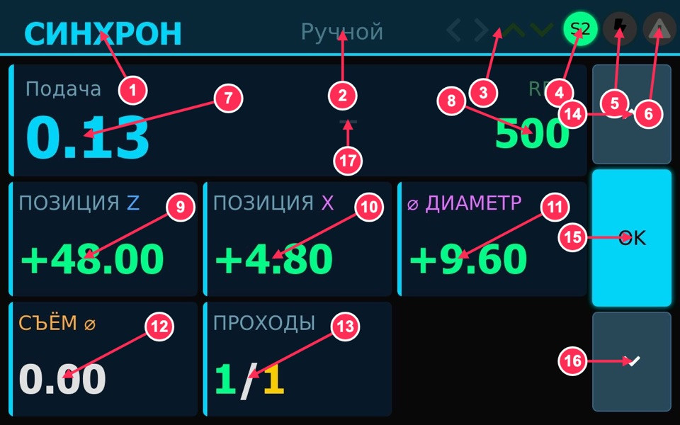

1. **Режим** — тап открывает выбор режима (то же, что переключатель режимов).
2. **Подрежим**: Ручной / Внутренний / Наружный.
3. **Упоры**: стрелки ◀ ▶ ▲ ▼ загораются, когда стоит левый / правый / передний / задний упор.
4. **S1 / S2 / S3** — подрежим с экрана (Внутренний / Ручной / Наружный).
5. **⚡ — экранный джойстик** (если механического нет под рукой).
6. **⚠ — настройки** (механика, калибровка, Wi-Fi, линейки). Оранжевый — есть сообщение.
7. **Главное значение режима**: здесь подача, мм на оборот шпинделя. Тап — барабан для выбора.
8. **Обороты шпинделя** (об/мин).
9. **Позиция Z**, мм. Двойной тап — обнулить, долгое нажатие — ввести своё значение.
10. **Позиция X**, мм (радиус). Двойной тап — обнулить, долгое нажатие — ввести.
11. **Диаметр** — ⌀ детали под резцом. Долгое нажатие — ввести диаметр (после касания заготовки).
12. **Съём** — сколько снять за проход (здесь — на диаметр).
13. **Проходы** — текущий / всего.
14. **▲**, 16. **▼** — то же, что кнопки ▲ ▼ пульта.
15. **OK** — то же, что кнопка «Выбор»: следующий подэкран (при выборе значения на барабане — подтвердить).
17. **Подэкран**: «--» — первый; «ПАРАМЕТРЫ» — второй; «ВВОД ⌀ СБРОС ОСЕЙ» — третий (или второй в M1).

Выбор режима (тап по названию режима):

Цифры вводятся на такой клавиатуре (появляется при долгом нажатии на число):

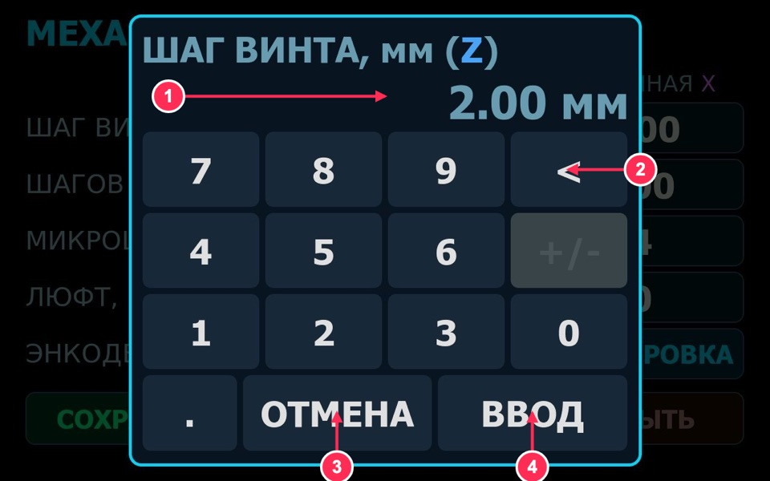

1. Что вводим. 2. Стереть цифру. 3. «ОТМЕНА» — ничего не менять. 4. «ВВОД» — сохранить.

## 4. Первое включение и ноль

1. Включите блок питания 5 В (шилд). Дисплей показывает режим, который стоит на переключателе.
2. Переключатель подрежимов — в **«Ручной»**. Джойстик — в середине (иначе сообщение «Установите джойстик в
   нейтральное положение»).
3. Ноль осей:
   - **Z**: подведите резец к торцу детали до лёгкого касания → **двойной тап по «ПОЗИЦИЯ Z»** → 0.
   - **Диаметр**: коснитесь резцом наружного диаметра (или проточите поясок и измерьте штангенциркулем) →
     **долгое нажатие на «⌀ ДИАМЕТР»** → введите диаметр → «ВВОД».
   - Если координаты даёт **блок DRO** — ноль и ввод делаются на самом блоке (экран скажет «ОСИ ЗАДАЮТСЯ НА БЛОКЕ DRO»).
4. Теперь «ПОЗИЦИЯ Z» показывает расстояние от торца, «⌀ ДИАМЕТР» — диаметр под резцом.

## 5. Упоры и автоцикл — главное, что нужно понять

**Упор** — это точка, дальше которой суппорт не поедет. Упоры ставятся кнопками упоров там, где сейчас стоит
суппорт, только в подрежиме **«Ручной»**. Светодиод и стрелка на экране горят — упор стоит. Повторное нажатие —
снять упор.

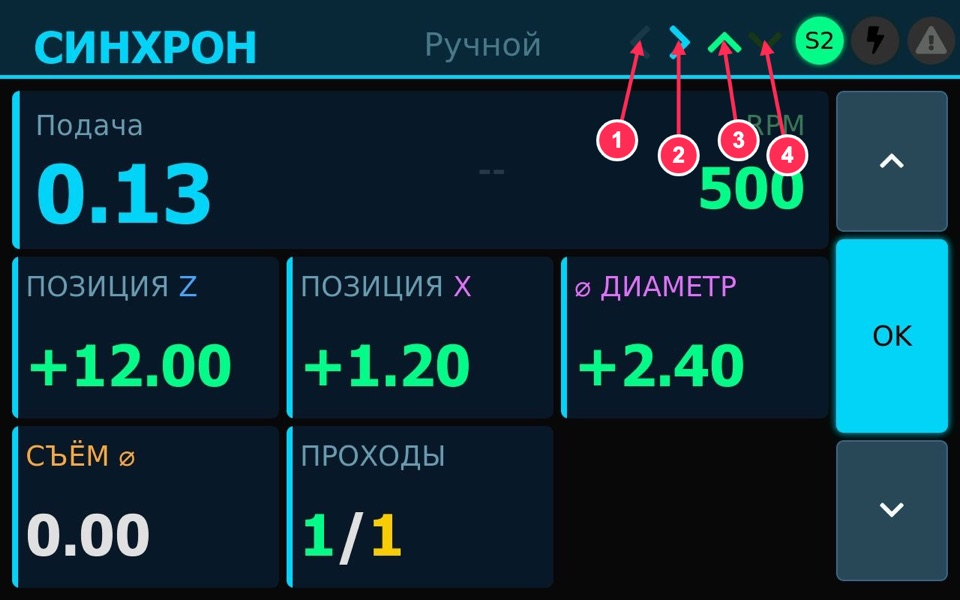

1. Левый упор (◀) — не горит. 2. Правый (▶) — стоит. 3. Передний (▲) — стоит. 4. Задний (▼) — не горит.

**Автоцикл** — станок сам делает все проходы: врезается на съём, проходит до упора, отходит, возвращается,
врезается глубже — и так до последнего прохода. Как запустить:

1. В «Ручном» поставьте **два упора по одной оси** (обычно правый и левый — начало и конец обработки).
2. Поставьте суппорт **на упор** (точку начала): джойстиком к упору — суппорт остановится на нём сам.
3. Переключатель подрежимов → **«Наружный»** (снаружи детали) или **«Внутренний»** (расточка внутри).
   Если упоров нет — «УСТАНОВИТЕ УПОРЫ!»; если суппорт не на упоре — «УСТАНОВИТЕ СУППОРТ В ИСХОДНУЮ ПОЗИЦИЮ!».
4. Включите шпиндель и **держите джойстик в сторону обработки** (к патрону — влево). Пока держите — цикл идёт;
   отпустили — остановился; снова держите — продолжает.
5. Конец: длинный сигнал и «ОПЕРАЦИЯ ЗАВЕРШЕНА!». Отпустите джойстик, переключатель — в «Ручной», снимите упоры.

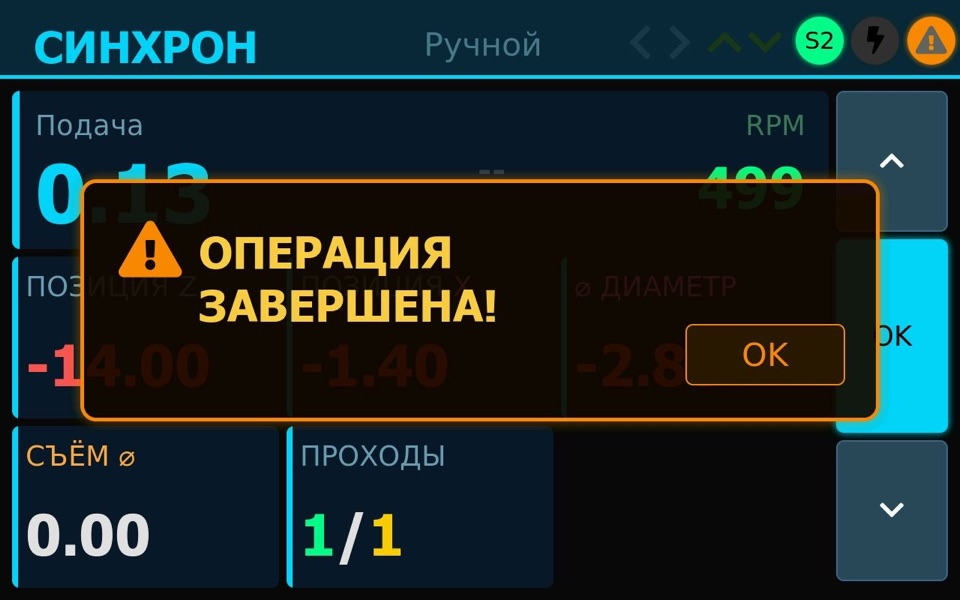

## 6. Режимы

Подэкраны каждого режима листаются кнопкой **«Выбор»** (или «OK» на экране). Что на каком подэкране — ниже.

### M1 — Синхронная подача

Резец движется **на заданную долю миллиметра за каждый оборот шпинделя** (мм/об): медленнее шпиндель — медленнее
подача, чистота поверхности одинаковая. Для обычной проточки.

- **Подача** (7 на рисунке) — тап по значению или переменник; 0.01…0.25 мм/об.
- **Съём ⌀** (12) — ▲ ▼: на 0.02 мм (с кнопкой ускоренного хода — на 0.10); снимается **с диаметра** за проход.
- **Проходы** (13) — ◀ ▶.
- Подэкран 2 — ввод и сброс осей:

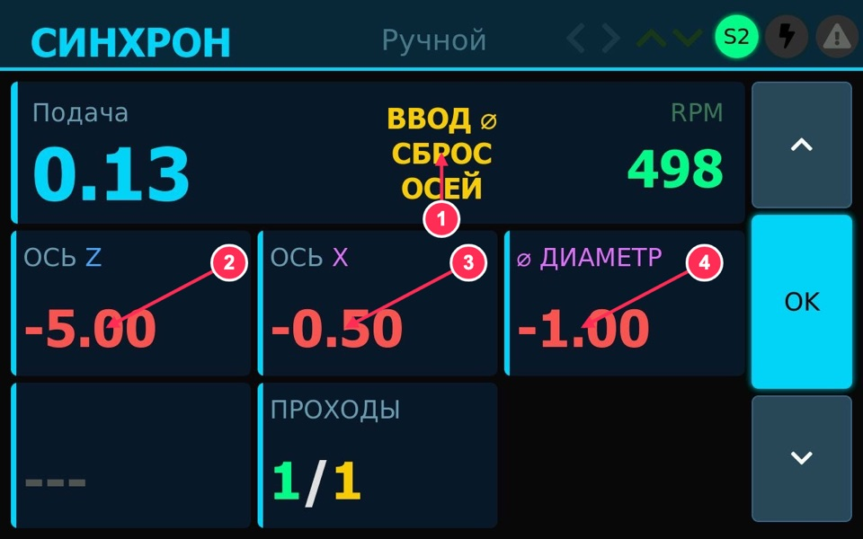

1. Подэкран «ВВОД ⌀ СБРОС ОСЕЙ». 2. Ось Z — ▼ обнуляет. 3. Ось X — ▲ обнуляет. 4. Диаметр — ◀ ▶ вводят по шагам
(шаг — переключатель РГИ ×1 / ×10).

- Подэкран 3 — отскок и натяг Z (как у автора 7e2: отход резца перед возвратом и выбор люфта).

**Пример: проточить вал с ⌀30 до ⌀28 на длине 50 мм**

1. Режим **M1**, подрежим **«Ручной»**. Подача — **0.13** мм/об.
2. Подведите резец к правому концу заготовки, в 2–3 мм от торца, и коснитесь им поверхности ⌀30 (резец
   касается — это «нулевой» проход).
3. Нажмите **упор правый** — здесь начало.
4. Джойстиком влево (с кнопкой ускоренного хода — быстрее) отведите суппорт на 50 мм — смотрите «ПОЗИЦИЯ Z»
   (если ноль Z на торце — до −50.00). Нажмите **упор левый** — здесь конец.
5. Джойстиком вправо — суппорт сам остановится на правом упоре.
6. Снять надо 2 мм с диаметра. **Съём ⌀ = 0.50** (▲ 25 раз, или с кнопкой ускоренного хода 5 раз), **проходы = 4**
   (▶). 4 × 0.50 = 2.00 мм.
7. Включите шпиндель. Переключатель подрежимов → **«Наружный»**.
8. **Держите джойстик влево.** Станок сделает 4 прохода и скажет «ОПЕРАЦИЯ ЗАВЕРШЕНА!».
9. Переключатель → «Ручной», снимите упоры (нажмите левый и правый ещё раз). Измерьте — ⌀28.

### M2 — Асинхронная подача

Резец движется **с заданной скоростью в мм/мин**, не зависит от оборотов шпинделя. Для подрезки торца, отрезки,
работы при выключенном шпинделе.

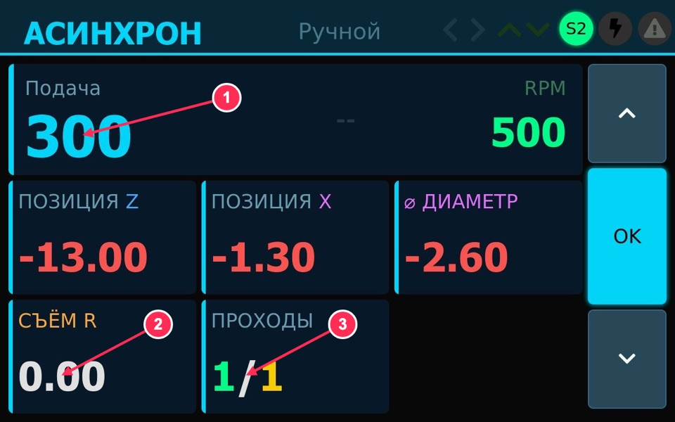

1. Подача, мм/мин (тап — барабан; 10…400). 2. Съём R — **на радиус** за проход (▲ ▼ по 0.01, с ускоренным — 0.05).
3. Проходы (◀ ▶). Подэкран 2 — делитель (число делений, метка), подэкран 3 — ввод и сброс осей. Автоцикл — как в M1.

### M3 — Резьба

Резец движется **ровно на шаг резьбы за оборот** и каждый проход начинает **с той же нитки** (по метке энкодера
шпинделя). Глубина каждого прохода считается сама по профилю 60°: первые проходы глубже, последние — тоньше.

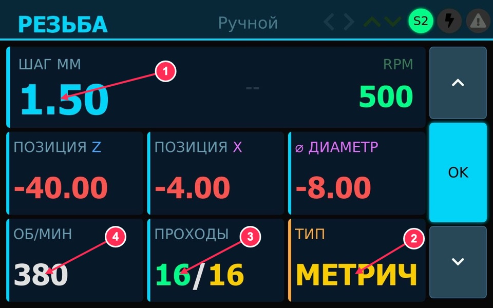

1. **Шаг резьбы**, мм (▲ ▼ — по таблице). 2. **Тип**: метрическая, дюймовая, трубная G и K — тап открывает выбор.
3. **Проходы** — сколько рабочих проходов (по таблице для шага; ◀ ▶ — добавить). 4. **Наибольшие обороты** для этого
шага — шпиндель не должен крутиться быстрее (иначе мотор не успеет).

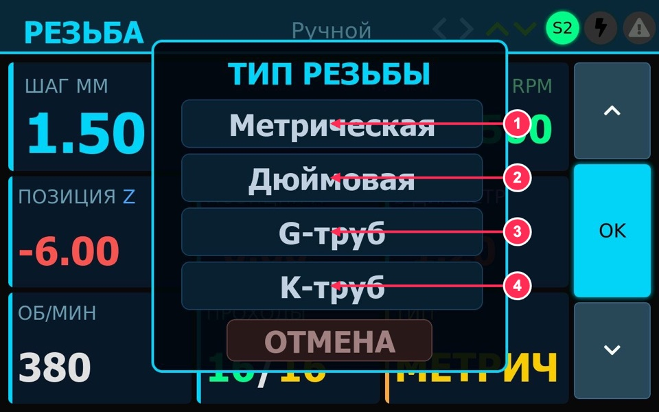

Подэкран 2 — параметры резьбы:

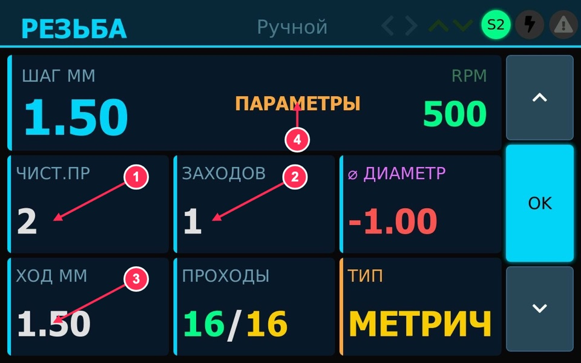

1. **Чистовые проходы** — проходы без врезания в конце (◀ ▶). 2. **Заходов** — многозаходная резьба (▲ ▼).
3. **Ход** — шаг × число заходов. 4. Подэкран «ПАРАМЕТРЫ».

**Пример: нарезать наружную резьбу M20×1.5 длиной 80 мм**

1. Проточите заготовку до ⌀20 и снимите фаску. Резец — резьбовой 60°, ровно по оси.
2. Режим **M1** или **M3**, подрежим **«Ручной»**.
3. Подведите резец правее торца на 3–5 мм (разгон) и **коснитесь им поверхности ⌀20** — это начало, с него
   считается глубина.
4. Нажмите **упор правый**.
5. Джойстиком влево отведите суппорт до конца резьбы — 80 мм от торца плюс разгон (если ноль Z на торце —
   «ПОЗИЦИЯ Z» −80.00). Нажмите **упор левый**.
6. Джойстиком вправо — суппорт остановится на правом упоре.
7. Режим **M3 «Резьба»**. Шаг — **1.50** (▲ ▼ или тап). Экран покажет **16 проходов** + **2 чистовых** и **380 об/мин**
   наибольшие обороты.
8. Включите шпиндель **не быстрее 380 об/мин** (для первого раза — 150–200).
9. Переключатель подрежимов → **«Наружный»**.
10. **Держите джойстик влево.** Каждый проход: врезание → нарезка до левого упора → отвод резца → возврат вправо →
    следующий проход глубже. Отпустили джойстик — пауза, снова держите — продолжит в ту же нитку.
11. «ОПЕРАЦИЯ ЗАВЕРШЕНА!» — переключатель в «Ручной», снимите упоры. Проверьте резьбу гайкой; туго — ◀ ▶ добавьте
    проход и повторите цикл.

Внутренняя резьба — то же, но резец расточной и подрежим **«Внутренний»**.

### M4 и M5 — Конус

Суппорт идёт по Z, а резец одновременно по X — получается конус. **«Конус <»** сужается к патрону, **«Конус >»** —
к задней бабке (обычный наружный конус, например, под центр).

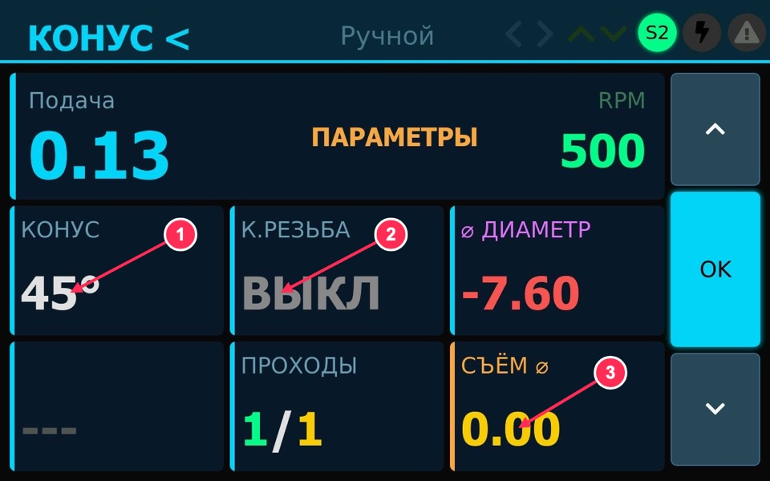

1. **Конус** — угол или конусность (◀ ▶): градусы, 1:N, Морзе. 2. **Конусная резьба** — вкл/выкл (▲ ▼; резьба на конусе).
3. **Съём** на проход. Подэкран 1 — подача, съём, проходы; подэкран 3 — ввод и сброс осей. Автоцикл — как в M1.

### M6 — Шар

Резец описывает дугу — получается шар (сфера) на конце детали.

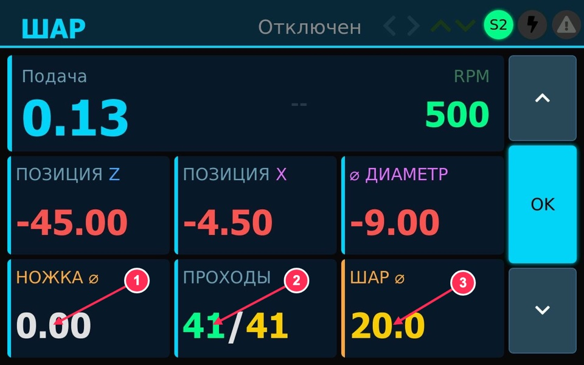

1. **Ножка** — диаметр шейки под шаром (◀ ▶). 2. **Проходы** (считаются сами). 3. **Шар** — диаметр шара (▲ ▼).

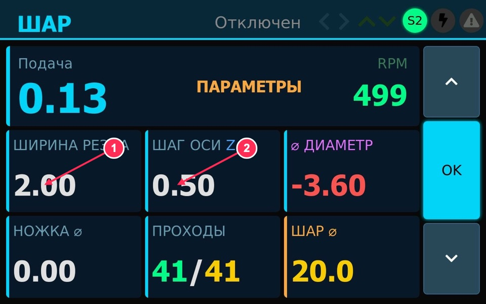

1. **Ширина резца** (▲ ▼). 2. **Шаг по Z** между врезаниями (◀ ▶; меньше — глаже). Подрежим «Внутренний» в шаре невозможен —
будет «Режим невозможен!».

### M7 — Делилка

Делит окружность на равные части: показывает угол шпинделя и угол следующей метки. Для разметки граней, отверстий
по окружности (шпиндель поворачивают рукой).

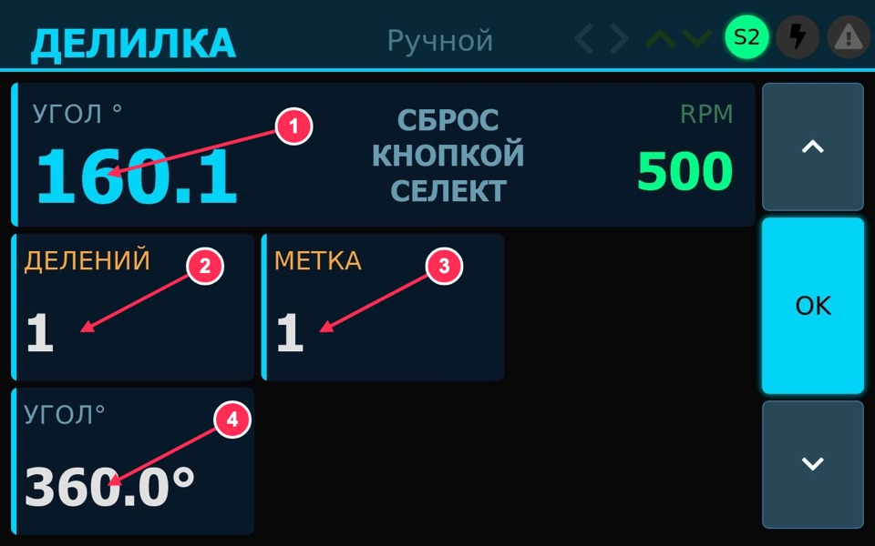

1. **Угол** шпинделя сейчас. 2. **Делений** — на сколько частей. 3. **Метка** — номер текущей. 4. **Угол метки** —
куда повернуть шпиндель. Делений и метку задают тапом по значению (или кнопками в M2 на подэкране 2); кнопка
«Выбор» — обнулить угол (взять текущее положение за 0°).

Пример: 6 граней под ключ — делений 6; поверните шпиндель до угла метки 1 (60°), разметьте, метка 2 (120°) …

### M8 — G-код

Станок выполняет программу из файла, как 3D-принтер. Файлы загружают и запускают на веб-странице дисплея с
телефона или компьютера по Wi-Fi. Что понимает станок и как писать программы — [GCODE.md](../GCODE.md).
Ниже — пример с файлом `pawn_g71.nc` (шахматная пешка из заготовки ⌀32) от файла до готовой детали.

**Шаг 1. Откройте страницу.** Телефон или компьютер — в той же сети, что и дисплей. Адрес — крупно внизу экрана
«НАСТРОЙКИ» (тап по ⚠). Без роутера дисплей сам создаёт точку доступа: подключитесь к ней, адрес — там же.
Страницу удобно сохранить в закладки.

**Шаг 2. Загрузите файл и проверьте программу.**

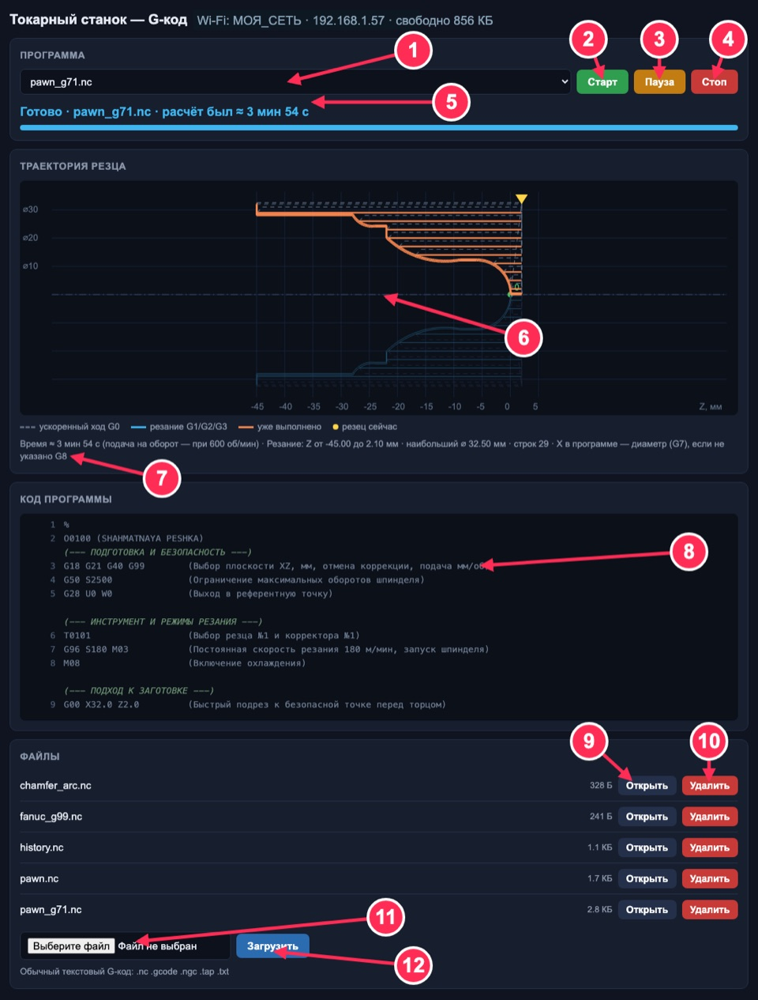

1. **Список программ** — выберите файл. 2. **Старт**. 3. **Пауза** — остановиться после текущей строки, повторное
нажатие — дальше. 4. **Стоп** — сразу. 5. **Состояние**: «Нет программы», «Выполняется», «Готово», «Ошибка»
(здесь — «Готово» от прошлого запуска). 6. **Траектория резца**: синим — резание, пунктиром — ускоренные ходы,
снизу — деталь зеркально. Посмотрите на неё до запуска: нет ли хода сквозь деталь или в патрон. 7. **Время** и
размеры: сколько займёт программа, от какого до какого Z режет, наибольший ⌀ (должен быть не больше заготовки).
8. **Код программы** с номерами строк. 9. **Открыть** — показать файл. 10. **Удалить**. 11. **Выберите файл**
на телефоне или компьютере → 12. **Загрузить**: файл появится в списке. Подходят `.nc .gcode .ngc .tap .txt`.

**Шаг 3. Подготовьте станок.** Переключатель режимов — в **M8**. Заготовка в патроне, резец в резцедержателе.
Ноль — как в [разделе 4](#4-первое-включение-и-ноль): Z — торец, диаметр — касанием и вводом ⌀.

**Шаг 4. Старт.** Нажмите «Старт» на странице. Откроется окно «Перед стартом» с числами вашей программы:

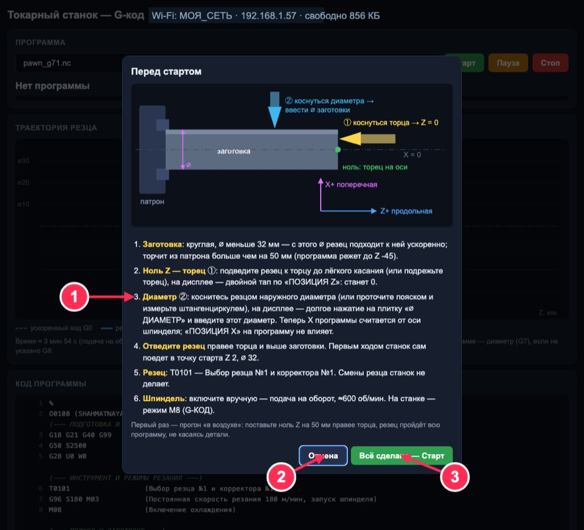

1. **Что проверить**: какой нужен диаметр заготовки и вылет из патрона, как поставить ноль, куда отвести
резец, какой резец, нужен ли шпиндель и на каких оборотах. 2. **Отмена**. 3. **Всё сделано — Старт**.
Включите шпиндель вручную (если в программе подача на оборот, G95/G99 — без шпинделя станок не поедет) и
нажмите «Старт». Первый раз — прогон «в воздухе»: ноль Z на 50 мм правее торца, резец пройдёт всю программу,
не касаясь детали.

**Шаг 5. Программа идёт.** На странице:

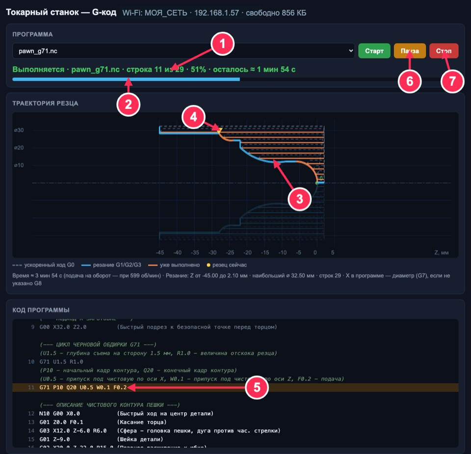

1. **Строка, процент и сколько осталось** (время уточняется по ходу). 2. **Полоса хода**. 3. **Пройденный путь**
— оранжевым. 4. **Резец сейчас** — жёлтый треугольник. 5. **Текущая строка** — подсвечена в коде.
6. **Пауза**. 7. **Стоп**.

На экране станка — то же:

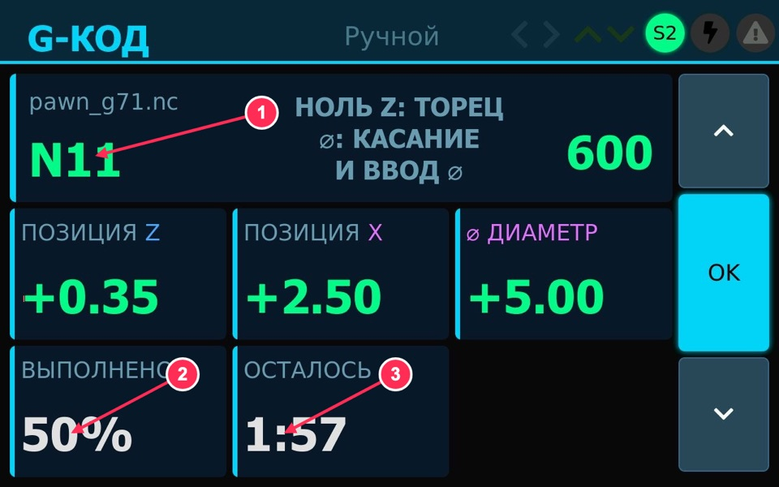

1. **Номер строки** (над ним — имя файла). 2. **Выполнено**, %. 3. **Осталось**, минуты:секунды.

Остановить можно и без страницы: любой ход джойстиком — программа остановится («ОСТАНОВЛЕНО»).

**Шаг 6. Готово.** Страница пишет «Готово» и сколько было по расчёту, путь — весь оранжевый. На экране — «ГОТОВО»
и 100 %.

| Страница | Экран |
|---|---|
| 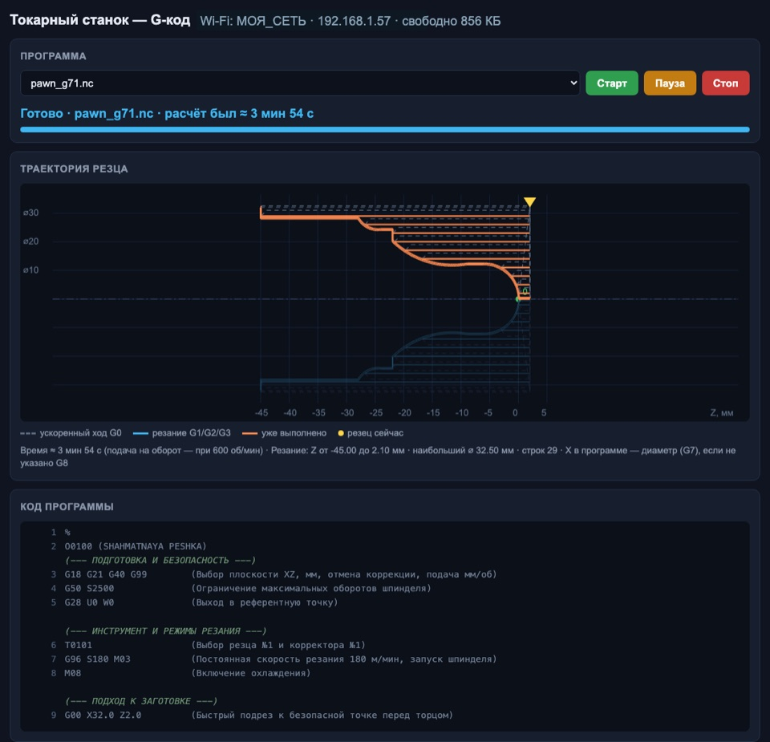 |  |

Если в программе ошибка, станок остановится и покажет номер строки и причину — окно не закроется, пока не
нажмёте OK. Что значит каждая ошибка — [раздел 8](#8-сообщения-и-ошибки--что-значит-и-что-делать), «G-код».

Ссылки на страницу с готовым выбором: `http://<адрес>/#file=pawn_g71.nc` — сразу открыть файл,
`http://<адрес>/#start=pawn_g71.nc` — сразу окно «Перед стартом».

## 7. Настройки

Тап по **⚠** в шапке → «НАСТРОЙКИ».

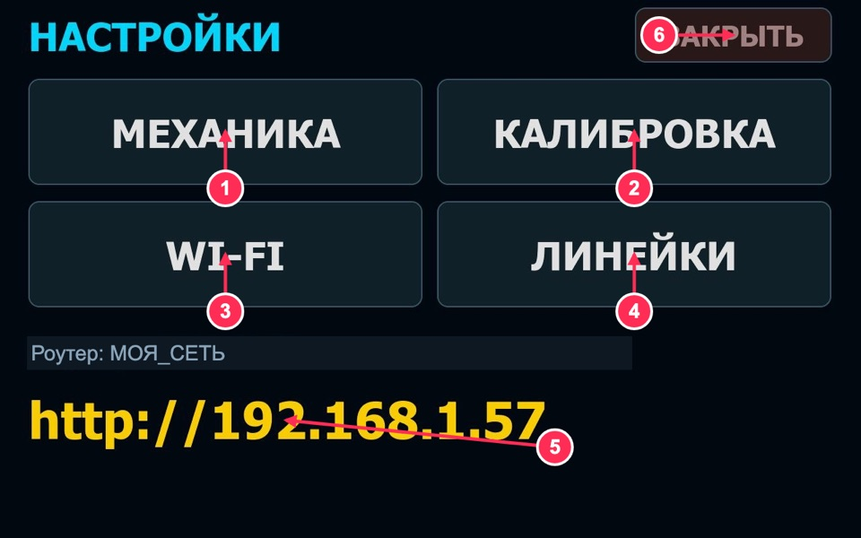

1. **Механика** — винты, шаги, микрошаг, люфт, энкодер. 2. **Калибровка** — уточнить шаг винта и люфт.
3. **Wi-Fi** — подключить к роутеру. 4. **Линейки** — откуда брать координаты. 5. **Адрес веб-страницы** (G-код,
файлы). 6. Закрыть.

### Механика

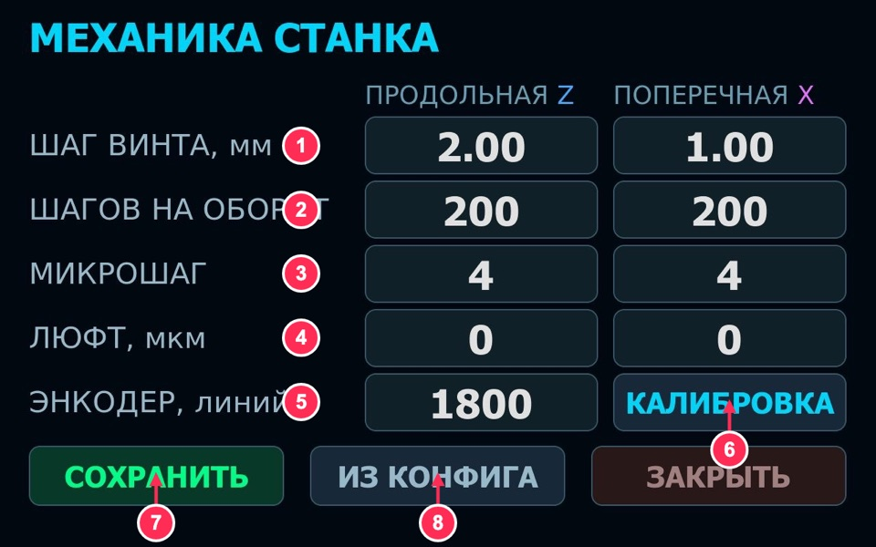

1. **Шаг винта**, мм — у ходового винта оси. 2. **Шагов на оборот** мотора (200 для 1.8°). 3. **Микрошаг** — как
на переключателях драйвера. 4. **Люфт**, мкм — выбирается при смене направления. 5. **Энкодер** — линий на оборот
шпинделя. 6. **Калибровка**. 7. **Сохранить** (STM32 перезапустится). 8. **Из конфига** — вернуть заводские.

Ввод чисел — тап по полю → клавиатура.

### Калибровка

Калибровка уточняет **шаг винта** (по паспорту 2.00 мм, а на деле может быть 2.01) и **люфт** — сколько
каретка не доходит при смене направления. От этих двух чисел зависит, совпадёт ли размер детали с экраном.
Калибровка — после того как заполнена «Механика» (винт, шаги, микрошаг). Делается один раз и после ремонта
винтов. Открыть: ⚠ → «НАСТРОЙКИ» → «КАЛИБРОВКА» (или кнопка «КАЛИБРОВКА» в «Механике»).

Как калибровать — зависит от того, откуда станок берёт координаты:

| Что стоит на станке | Способ | Раздел |
|---|---|---|
| Линейки, подключённые к шилду | По линейкам — станок меряет сам | [А](#а-по-линейкам-линейки-подключены-напрямую) |
| Блок DRO (HS800-2) с линейками | По линейкам — так же, через блок | [Б](#б-по-линейкам-через-блок-dro) |
| Нет ни линеек, ни DRO | По индикатору (или штангенциркулю) | [В](#в-без-линеек-по-индикатору) |

Общее для всех способов: **шпиндель стоит**, джойстик в середине (иначе «ОСТАНОВИТЕ ШПИНДЕЛЬ И ДВИЖЕНИЕ»),
заготовка снята или резец отведён от неё. Калибровка прерывается **любым ходом джойстика** или кнопкой «СТОП».

#### А. По линейкам (линейки подключены напрямую)

1. **Линейки настроены.** «НАСТРОЙКИ» → «ЛИНЕЙКИ»: источник — линейки, тип и «мкм на импульс» по каждой оси
   ([раздел «Линейки»](#линейки), [docs/scales](../scales/README.md)) → «Сохранить» (STM32 перезапустится).
2. **Линейки считают правильно.** Проведите каждую ось джойстиком на 2–3 мм: экран узнаёт направление линейки.
   Проверьте грубо: каретка проехала по метке на станине 10 мм — «ПОЗИЦИЯ Z» изменилась примерно на 10.
3. **Место для хода.** Поставьте каретку так, чтобы в обе стороны было свободно больше хода калибровки на
   2–3 мм. Ось сначала отходит на 1 мм — выбирает люфт.
4. Откройте «КАЛИБРОВКА» → вкладка **«ПО ЛИНЕЙКАМ»**.

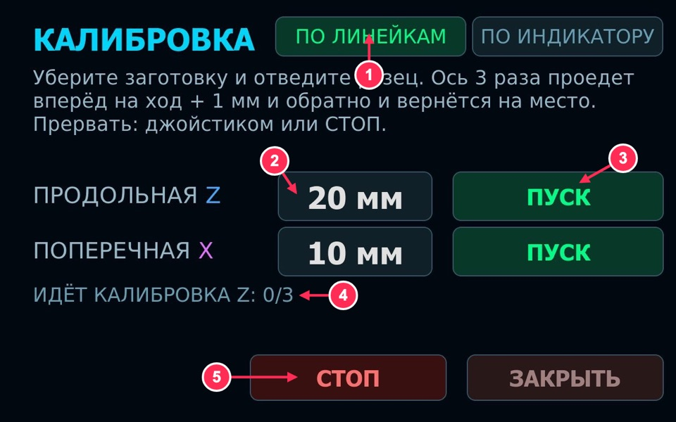

1. **Вкладка «ПО ЛИНЕЙКАМ».** 2. **Ход**, мм — тап, ввести число. По умолчанию Z — 20 мм, X — 10 мм; чем
длиннее ход, тем точнее шаг винта (Z — 50–100 мм, если позволяет станок). 3. **ПУСК** в строке оси.
4. **Ход калибровки**: «ИДЁТ КАЛИБРОВКА Z: 1/3» — ось 3 раза проезжает вперёд и назад и возвращается на место.
5. **СТОП** — прервать.

5. Через полминуты–минуту — итог:

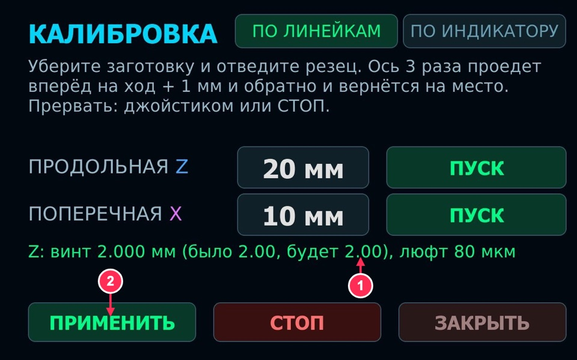

1. **Итог**: «Z: винт 2.000 мм (было 2.00, будет 2.00), люфт 80 мкм». Шаг винта станок хранит в сотых мм —
   «будет» — это округлённое значение. 2. **ПРИМЕНИТЬ** — записать шаг винта и люфт в «Механику».

6. Повторите для оси X (строка «ПОПЕРЕЧНАЯ X»).
7. **Проверка.** Запустите калибровку ещё раз: шаг винта должен совпасть («было» = «будет»), люфт — в пределах
   10–20 мкм от прошлого. Если сильно скачет — разболтаны клинья или гайка винта.

Если в итоге оранжевая строка **«ОТЛИЧАЕТСЯ БОЛЕЕ 20%: ПРОВЕРЬТЕ ЛИНЕЙКУ (ДИАМЕТР/РАДИУС)»** — «ПРИМЕНИТЬ» не
нажимайте: неверно «мкм на импульс» линейки, микрошаг или шаг винта в «Механике», либо X считается в диаметрах.

#### Б. По линейкам через блок DRO

Всё как в [А](#а-по-линейкам-линейки-подключены-напрямую), отличия:

1. «НАСТРОЙКИ» → «ЛИНЕЙКИ»: источник — **блок DRO**.
2. **На самом блоке DRO:** миллиметры (не дюймы), ось X — **в радиусе**, не в диаметре. Если X в диаметре,
   блок показывает вдвое больше, чем проехал суппорт, — будет «ЛИНЕЙКА X НЕ СОВПАДАЕТ С МЕХАНИКОЙ» или «ОТЛИЧАЕТСЯ
   БОЛЕЕ 20%». Продольная ось на блоке подписана **Y** — это Z.
3. Компенсацию люфта и коррекцию линейки на самом блоке выключите: их делает станок.
4. Дальше — шаги 2–7 из [А](#а-по-линейкам-линейки-подключены-напрямую).

#### В. Без линеек: по индикатору

Нужен **индикатор часового типа** (цена деления 0.01 мм) на магнитной стойке. Ход индикатора ограничивает ход
калибровки: у обычного индикатора 10 мм — ставьте ход 8 мм. Вместо индикатора можно штангенциркулем
(глубиномером между кареткой и упором) — тогда ход 50–100 мм, точность ниже.

1. **Индикатор.** Стойка — на станину (для X — на каретку), ножка индикатора упирается в каретку (для X — в
   суппорт) **вдоль оси**. Дайте натяг: ножка утоплена на 1–2 мм, чтобы хватило хода в обе стороны.
2. Откройте «КАЛИБРОВКА». Без линеек и блока DRO сразу открыта вкладка **«ПО ИНДИКАТОРУ»**.
3. **Ход** — тап по «20 мм», введите ход меньше хода индикатора (8 мм).
4. **ПУСК** в строке оси. Ось отойдёт на 1 мм и вернётся — выберет люфт.

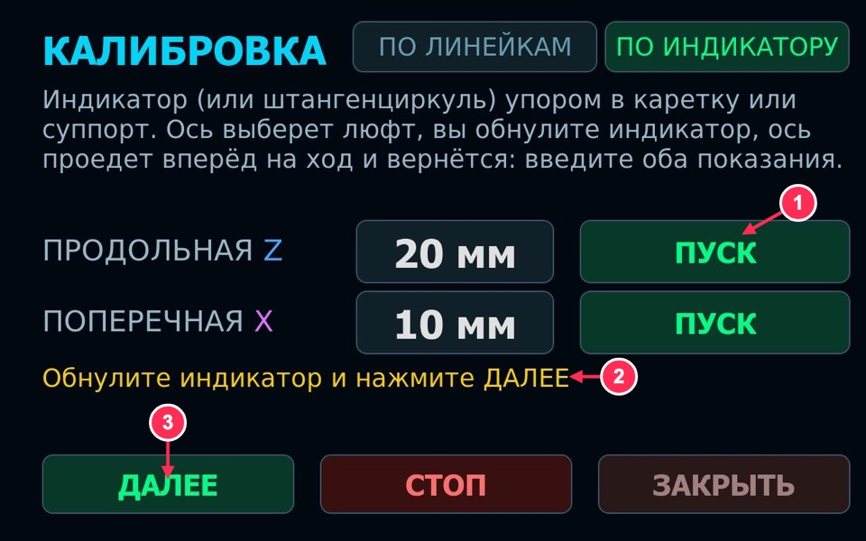

1. **ПУСК** в строке оси. 2. **Подсказка**: «Обнулите индикатор и нажмите ДАЛЕЕ». 3. **ДАЛЕЕ**.

5. **Обнулите индикатор** (поверните шкалу на 0) и нажмите «ДАЛЕЕ». Ось проедет вперёд ровно на ход — по шагам
   мотора.
6. **Введите показание индикатора**, например 8.04:

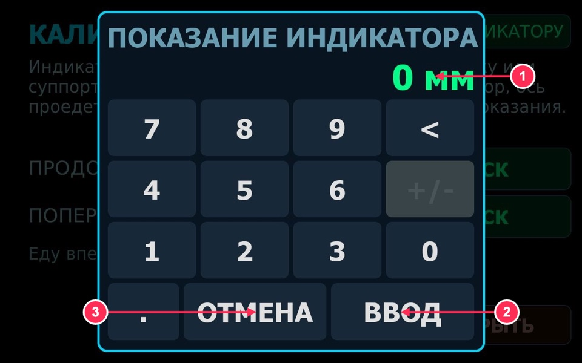

1. **Показание** — набирается кнопками. 2. **ВВОД**. 3. **ОТМЕНА** — прервать без расчёта.

7. Ось вернётся назад на тот же ход. Окно «ПОКАЗАНИЕ ПОСЛЕ ВОЗВРАТА» — введите, что показывает индикатор
   **сейчас**, например 0.06: столько каретка не дошла до нуля — это люфт. Знак не важен.
8. Итог — как в способе А: «Z: винт 2.010 мм (было 2.00, будет 2.01), люфт 60 мкм» → **ПРИМЕНИТЬ**.
   Как считается: винт × показание / ход = 2.00 × 8.04 / 8 = 2.01 мм.
9. Повторите для X и ещё раз для проверки — числа должны совпасть.

**Если нет и индикатора** — оставьте шаг винта из паспорта станка и люфт 0. Станок будет работать, но размер
может уходить на величину люфта (обычно 0.03–0.2 мм) при смене направления подачи.

### Wi-Fi

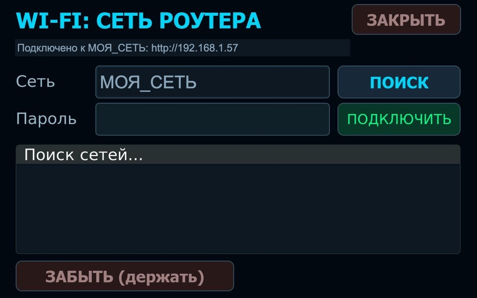

Сеть — выберите из списка («Поиск») или впишите, пароль, «Подключить». После перезагрузки дисплей подключается
сам. «Забыть (держать)» — стереть сеть. Без роутера дисплей сам создаёт свою точку доступа — её адрес на экране
«НАСТРОЙКИ».

### Линейки

Откуда координаты: **без линеек** (по шагам моторов), **блок DRO** (HS800), **линейки напрямую** (к STM32). Для
линеек — тип, мкм на импульс, направление, сигнал; **доводка X** — довести врезание по линейке; **контроль шагов** —
остановка, если мотор пропустил шаги. Подробно о линейках — [docs/scales](../scales/README.md).

## 8. Сообщения и ошибки — что значит и что делать

Сообщение всплывает в окне; «OK» — закрыть. Кружок ⚠ в шапке оранжевый, пока сообщение не прочитано.

| Сообщение | Что значит | Что делать |
|---|---|---|
| 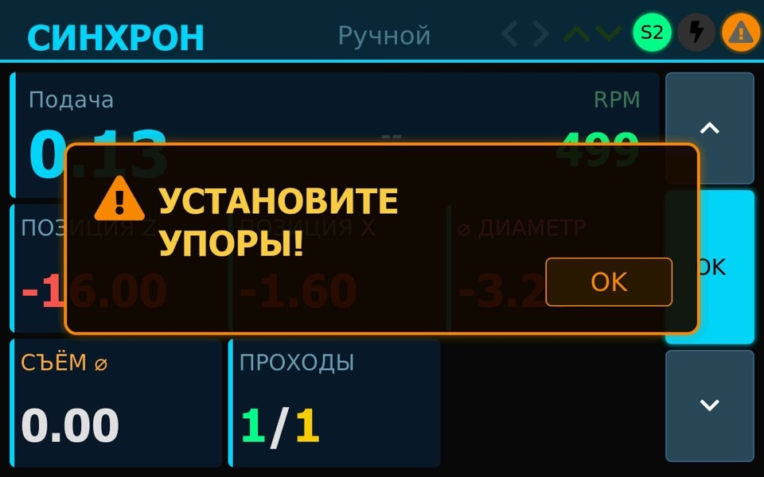 **УСТАНОВИТЕ УПОРЫ!** | Переключили в «Внутренний»/«Наружный», а двух упоров по одной оси нет | В «Ручном» поставьте два упора ([раздел 5](#5-упоры-и-автоцикл--главное-что-нужно-понять)) |
| 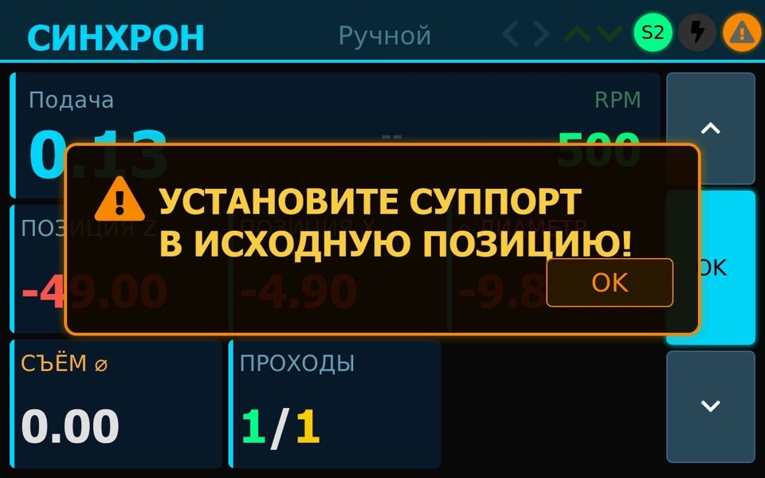 **УСТАНОВИТЕ СУППОРТ В ИСХОДНУЮ ПОЗИЦИЮ!** | Автоцикл начинается только с упора | Переключатель в «Ручной», джойстиком к упору начала, снова «Наружный» |
|  **ОПЕРАЦИЯ ЗАВЕРШЕНА!** | Автоцикл сделал все проходы | Отпустите джойстик, переключатель — в «Ручной» |
| 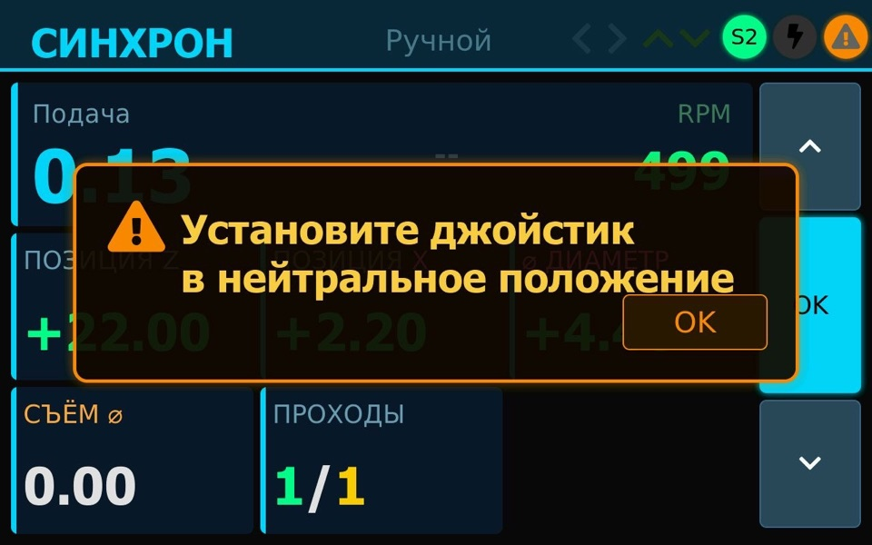 **Установите джойстик в нейтральное положение** | При включении или смене режима джойстик был отклонён | Отпустите джойстик в середину |
| **Режим невозможен!** | Подрежим «Внутренний» в режиме «Шар» | Переключатель — в «Ручной» или «Наружный» |
| 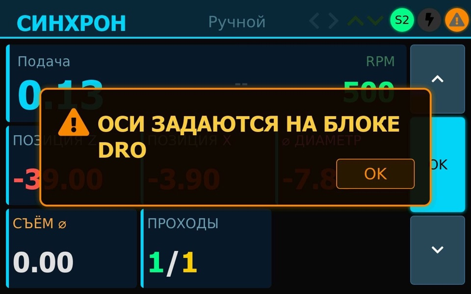 **ОСИ ЗАДАЮТСЯ НА БЛОКЕ DRO** | Координаты дают блок DRO — экран их только показывает | Ноль и ввод — кнопками блока DRO |
| 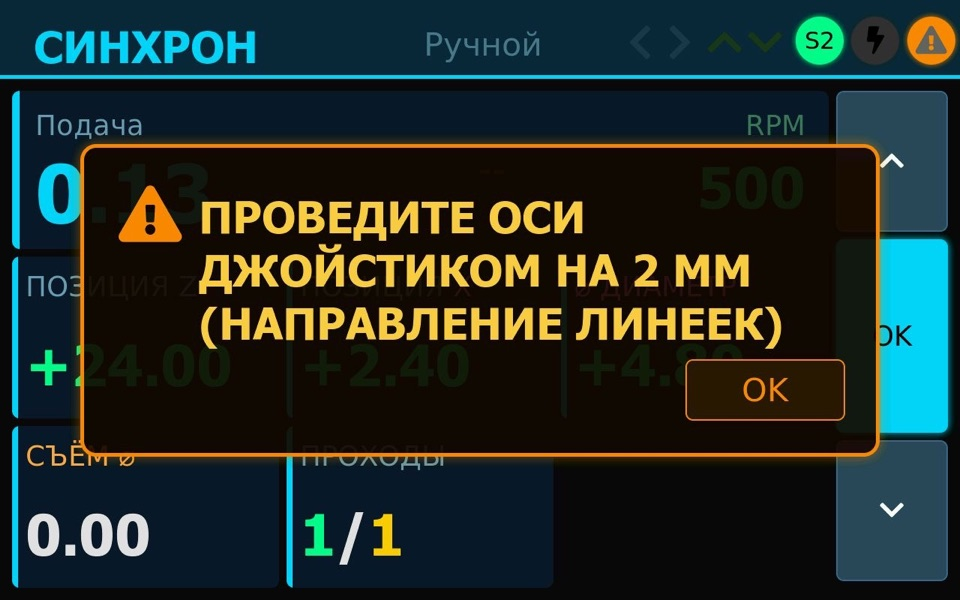 **ПРОВЕДИТЕ ОСИ ДЖОЙСТИКОМ НА 2 ММ (НАПРАВЛЕНИЕ ЛИНЕЕК)** | Прошивка ещё не знает, в какую сторону считают линейки | Проведите каждую ось джойстиком на 2–3 мм в любую сторону |
| 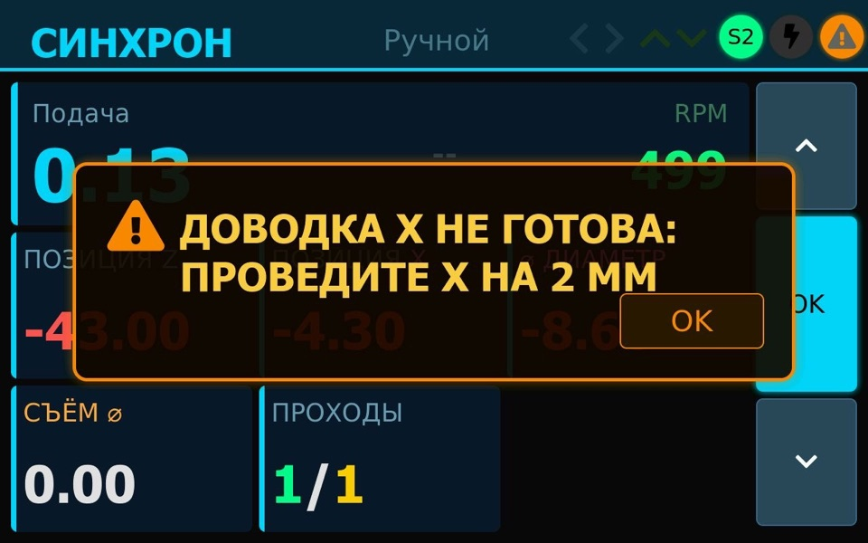 **ДОВОДКА X НЕ ГОТОВА: ПРОВЕДИТЕ X НА 2 ММ** | То же для доводки врезания по линейке X | Проведите X джойстиком на 2–3 мм |
| 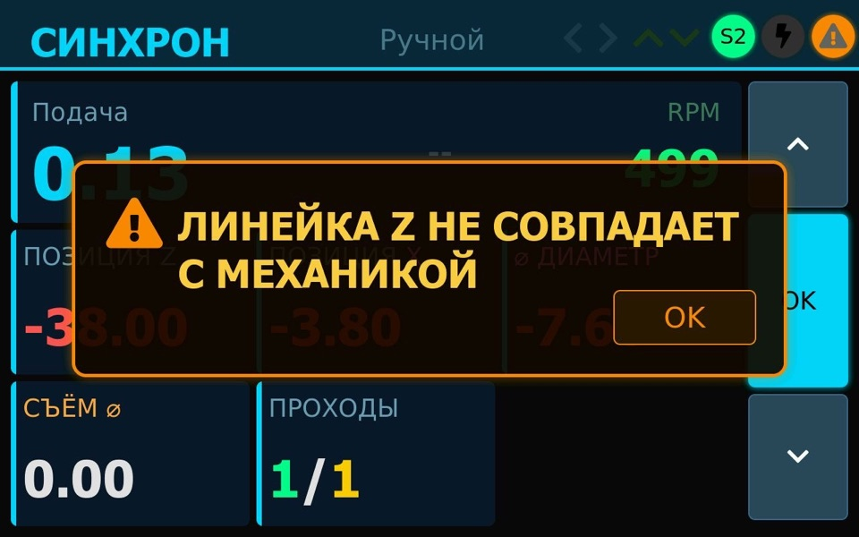 **ЛИНЕЙКА Z (X) НЕ СОВПАДАЕТ С МЕХАНИКОЙ** | Мотор проехал одно, линейка показала другое (в 2 раза, в другую сторону) | Проверьте «мкм на импульс» и направление линейки, шаг винта и микрошаг; калибровка |
| 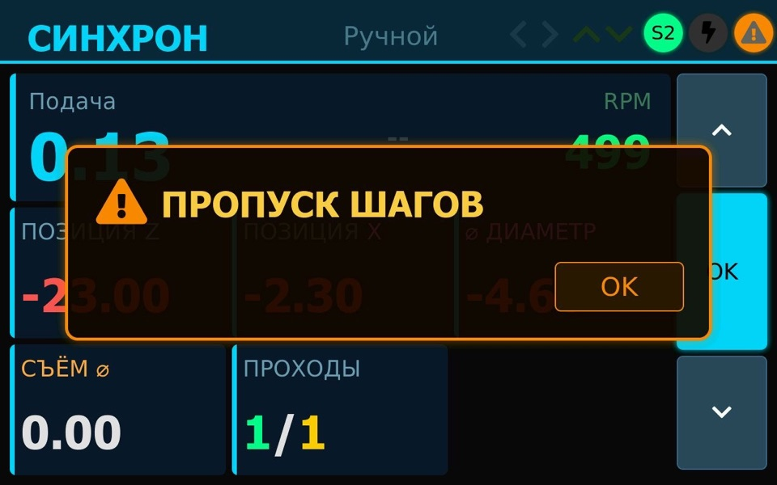 **ПРОПУСК ШАГОВ** | Линейка показала меньше, чем должен был проехать мотор: мотор пропустил шаги, автоцикл остановлен | Меньше подача/съём, проверьте ток драйвера, затяжку муфты, клин; отпустите джойстик |
| 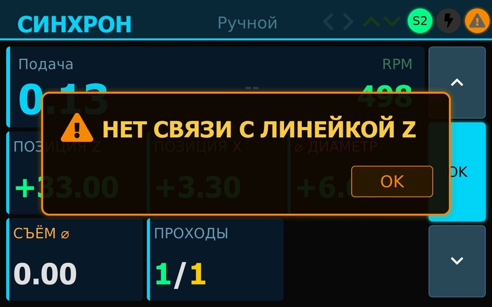 **НЕТ СВЯЗИ С ЛИНЕЙКОЙ Z (X)** | От линейки не приходят данные | Проверьте разъём, питание линейки, тип в настройках |
| 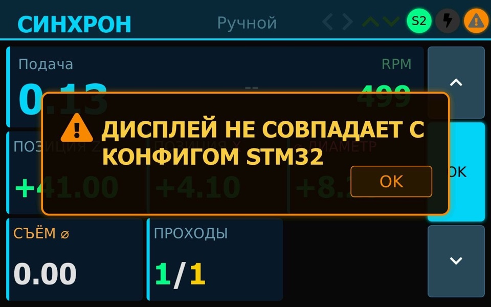 **ДИСПЛЕЙ НЕ СОВПАДАЕТ С КОНФИГОМ STM32** | Прошивка STM32 собрана под другой дисплей | Прошейте STM32 и дисплей из одного выпуска |
| **РАСХОЖДЕНИЕ ЛИНЕЙКИ** | При доводке X по линейке разница с заданной глубиной слишком велика — автоцикл остановлен | Как при пропуске шагов; проверьте линейку X и люфт |

**Калибровка** (красная строка на экране калибровки):

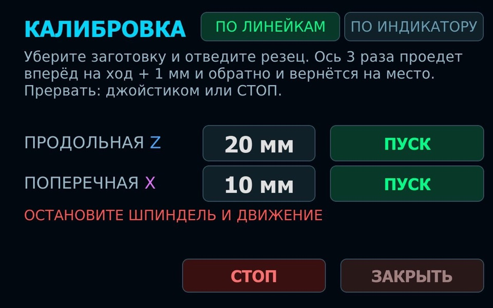

| Сообщение | Что делать |
|---|---|
| ОСТАНОВИТЕ ШПИНДЕЛЬ И ДВИЖЕНИЕ | Выключите шпиндель, отпустите джойстик |
| НУЖНЫ ЛИНЕЙКИ ИЛИ БЛОК DRO / НА ЭТОЙ ОСИ НЕТ ЛИНЕЙКИ | Калибровка «по линейкам» — только с линейками; иначе вкладка «По индикатору» |
| ЛИНЕЙКА НЕ ДВИЖЕТСЯ | Ось ехала, а линейка не изменилась — проверьте линейку и её крепление |
| СЛИШКОМ КОРОТКИЙ ХОД | Увеличьте ход (от 5 мм) |
| ПРЕРВАНО | Калибровку остановили джойстиком или «СТОП» — запустите снова |

**Настройки механики и линеек** (при «Сохранить» значение вне допустимого — не сохраняется):

| Сообщение | Допустимо |
|---|---|
| ЭНКОДЕР: 100-10000 ЛИНИЙ | 100…10000 |
| ШАГ ВИНТА: 0.25-10 ММ | 0.25…10 мм |
| ШАГОВ НА ОБОРОТ: 50-1000 | 50…1000 |
| МИКРОШАГ: 1, 2, 4 ... 128 | степень двойки до 128 |
| ЛЮФТ: 0-2000 МКМ | 0…2000 мкм |
| РАЗРЕШЕНИЕ ЛИНЕЙКИ: 10-100000 НМ | 10 нм…100 мкм на импульс |
| ДОПУСК ПРОПУСКА ШАГОВ: 20-2000 МКМ | 20…2000 мкм |
| MAX_FEED / MIN_FEED / MAX_aFEED / MIN_aFEED: ДЕЛИТЕЛЬ … | Подача вне возможностей таймера при такой механике — уменьшите микрошаг или пределы подачи в `els_config.h` |

**G-код** — ошибки показываются на экране станка и на веб-странице, с номером строки:

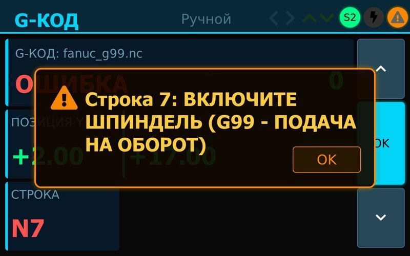

| Сообщение | Что делать |
|---|---|
| ВКЛЮЧИТЕ РЕЖИМ M8 (G-КОД) | Переключатель режимов — в M8 |
| ОТПУСТИТЕ ДЖОЙСТИК | Джойстик в середину |
| ВКЛЮЧИТЕ ШПИНДЕЛЬ (G99 - ПОДАЧА НА ОБОРОТ) | Программа с подачей на оборот — включите шпиндель |
| ЗА УПОРОМ | Программа выводит суппорт за поставленный упор — снимите упор или проверьте ноль |
| ОСТАНОВЛЕНО | Остановили «Стоп» на странице или джойстиком |
| G… НЕ ПОДДЕРЖИВАЕТСЯ, G50 X/Z …, ДУГА … , F <= 0 | Команда, которую станок не выполняет, или ошибка в программе — см. [GCODE.md](../GCODE.md) |
| G71/G70: … | Ошибка в контуре цикла (нет кадра N, контур не от торца к патрону, нет подачи) — текст подскажет |

## 9. Частые вопросы

**Двигатель гудит, но не крутится / пропускает шаги.** Слишком большая подача или обороты для резьбы (смотрите
«наибольшие обороты»), мал ток драйвера, туго идёт суппорт. Уменьшите подачу, проверьте клинья и смазку.

**Ось едет не в ту сторону.** В «НАСТРОЙКИ» → «ЛИНЕЙКИ» — направление; для мотора — поменяйте местами провода
одной обмотки или DIR в настройках драйвера.

**Размер уходит на десятки микрон.** Люфт или неточный шаг винта — сделайте [калибровку](#калибровка).

**Резьба не попадает в нитку при повторном проходе.** Не трогайте маховичок суппорта между проходами; энкодер
шпинделя должен быть закреплён без проскальзывания.

**Веб-страница не открывается.** Компьютер и станок в одной сети; адрес — на экране «НАСТРОЙКИ». Без роутера —
подключитесь к точке доступа дисплея.

**Экранный джойстик и механический — одно и то же?** Да. Механический удобнее; экранный — «⚡» в шапке.

**Что делать, если что-то пошло не так в автоцикле?** Отпустите джойстик — движение остановится. Переключатель
подрежимов в «Ручной» — автоцикл отменится.
