# Руководство пользователя

Это руководство — для того, кто первый раз подходит к станку с этим контроллером. Ничего не нужно знать заранее:
что такое режим, упор, проход и подача — объясняется по ходу. Снимки — с настоящего экрана 10.1" (на 7"
всё так же, только мельче; 4.3" не поддерживается после v0.4.1). Красные кружки с номерами на снимках — «куда смотреть и куда нажимать», под снимком —
что означает каждый номер.

**Содержание**

1. [Станок и оси](#1-станок-и-оси)
2. [Пульт: кнопки, переключатели, джойстик](#2-пульт-кнопки-переключатели-джойстик)
3. [Экран](#3-экран)
4. [Первое включение и ноль](#4-первое-включение-и-ноль)
5. [Упоры и автоцикл — главное, что нужно понять](#5-упоры-и-автоцикл--главное-что-нужно-понять) ·
   [Пауза автоцикла](#пауза-автоцикла)
6. [Режимы](#6-режимы): [Подэкраны 3 и 4: ввод ⌀ и дистанционные лимиты](#подэкраны-3-и-4-ввод--и-дистанционные-лимиты) ·
   [M1 Синхронная подача](#m1--синхронная-подача) · [M2 Асинхронная](#m2--асинхронная-подача) ·
   [M3 Резьба](#m3--резьба) · [M4/M5 Конус](#m4-и-m5--конус) · [M6 Шар и отрезание](#m6--шар-и-отрезание) ·
   [M7 Делилка](#m7--делилка) · [M8 G-код](#m8--g-код)
7. [Настройки](#7-настройки): [Механика](#механика) · [Калибровка по шагам](#калибровка) · [Wi-Fi](#wi-fi) · [Линейки](#линейки)
8. [Сообщения и ошибки — что значит и что делать](#8-сообщения-и-ошибки--что-значит-и-что-делать)
9. [Частые вопросы](#9-частые-вопросы)

> **Экран 7".** Всё то же самое и на тех же местах — раскладка одна, меньше только размер.
> **Экран 4.3" не поддерживается после v0.4.1:** с модом V3.8 надписи на нём уже не помещаются. Последняя прошивка
> для 4.3" — релиз v0.4.1, это руководство описывает более новые версии.
> 7" (1024×600) на настоящем экране ещё не проверялся — если что-то выглядит не так, напишите на форуме.

> **Безопасность.** Первый раз любую операцию делайте «в воздухе»: резец отведён от детали, шпиндель крутится
> медленно. Остановить автоцикл посреди работы — **ПАУЗА** (▼ на пульте или на экране), продолжить — **ДАЛЕЕ** (▲);
> в любой опасный момент — отпустите джойстик (суппорт встанет сразу). Аварийная остановка станка — его собственной
> кнопкой «Стоп», не экраном.

> **Новое из мода 7e2 V3.4–V3.8** (что и откуда — [MOD_LACH_V3.md](../MOD_LACH_V3.md)): [пауза автоцикла](#пауза-автоцикла),
> [ввод ⌀ и дистанционные лимиты](#подэкраны-3-и-4-ввод--и-дистанционные-лимиты), обнуление линеек с пульта
> («ускоренная» + ◀ / ▶), [профиль резьбы](#m3--резьба), [новые автоциклы конусов](#m4-и-m5--конус),
> [отрезание вразбежку](#отрезание-вразбежку), асинхронный автоцикл запоминает число проходов.

---

## 1. Станок и оси

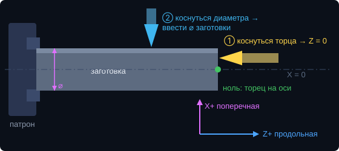

- **Z — продольная ось**: суппорт едет вдоль детали, к патрону и от него. «Z+» — от патрона.
- **X — поперечная ось**: резец едет поперёк детали, к её оси и от неё. «X+» — от оси.
- **Ноль Z** обычно ставят на торец детали, **ноль X** — на ось шпинделя (тогда X удвоенный — это диаметр).
- На блоке DRO и на маленьком экране LCD2004 продольная ось подписана **Y** — это та же Z.

## 2. Пульт: кнопки, переключатели, джойстик

Всё, что есть на экране, есть и на пульте (подробная таблица соответствия — [CONTROLS.md](../CONTROLS.md)).

| Орган | Что делает |
|---|---|
| **Переключатель режимов** (8 положений) | M1…M8: синхронная подача, асинхронная, резьба, конус <, конус >, шар, делилка, G-код |
| **Переключатель подрежимов** (3 положения) | **Внутренний** — автоцикл внутри детали (расточка); **Ручной** — обычная работа; **Наружный** — автоцикл снаружи |
| **Джойстик** (4 направления) | Влево/вправо — суппорт по Z, вперёд/назад — резец по X. В автоцикле — «пока держишь, цикл идёт» |
| **Кнопка на джойстике** (ускоренный ход) | Пока нажата — суппорт едет быстро. С кнопками меню — шаг изменения крупнее |
| **Кнопки ◀ ▶ ▲ ▼** | Менять числа на экране (что именно — зависит от режима и подэкрана). **В автоцикле: ▼ — пауза, ▲ — продолжить** |
| **«Ускоренная» + ◀ / ▶** (на первом подэкране) | Обнулить линейку **Z** / **X** (в отрезании — смещение, см. [M6](#отрезание-вразбежку)) |
| **Комбинации ◀ / ▶ + ▲ / ▼** | Ввод ⌀ и расстояния до упора по разрядам ([подэкраны 3 и 4](#подэкраны-3-и-4-ввод--и-дистанционные-лимиты)). Сначала зажмите ◀ или ▶, потом коротко ▲ / ▼ и отпустите **сначала ▲ / ▼** |
| **Кнопка «Выбор»** | Следующий подэкран: 1 → (2) → 3 → 4 → 1. **С «ускоренной»**: в резьбе — профиль резьбы, в шаре — шар ↔ отрезание |
| **Кнопки упоров** (левый, правый, передний, задний) | Поставить упор там, где сейчас суппорт; на подэкране 4 — **на заданном расстоянии**; повторное нажатие — снять. Только в подрежиме «Ручной» |
| **Светодиоды упоров** | Горит — упор стоит |
| **Ручной энкодер (маховичок, РГИ)** | Точное перемещение: переключатель оси Z / выкл / X и масштаба ×1 / ×10 |
| **Переменник подачи** | Плавно меняет подачу в режимах подачи |

## 3. Экран

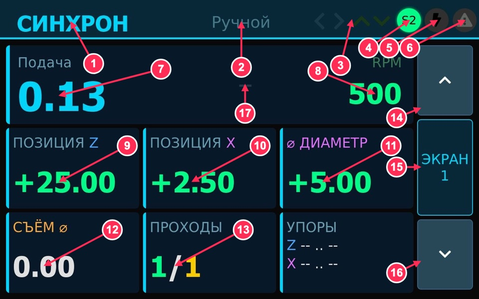

1. **Режим** — тап открывает выбор режима (то же, что переключатель режимов).
2. **Подрежим**: Ручной / Внутренний / Наружный.
3. **Упоры**: стрелки ◀ ▶ ▲ ▼ загораются, когда стоит левый / правый / передний / задний упор.
4. **S1 / S2 / S3** — подрежим с экрана (Внутренний / Ручной / Наружный).
5. **⚡ — экранный джойстик** (если механического нет под рукой).
6. **⚠ — настройки** (механика, калибровка, Wi-Fi, линейки). Оранжевый — есть сообщение.
7. **Главное значение режима**: здесь подача, мм на оборот шпинделя. Тап — клавиатура (шаг резьбы в M3 — барабан).
8. **Обороты шпинделя** (об/мин).
9. **Позиция Z**, мм. Тап — ввести своё значение, **держать 2 секунды** — обнулить.
10. **Позиция X**, мм (радиус). Тап — ввести, держать 2 секунды — обнулить.
11. **Диаметр** — ⌀ детали под резцом. Тап — ввести диаметр (после касания заготовки).
12. **Съём** — сколько снять за проход (здесь — на диаметр). Тап — клавиатура.
13. **Проходы** — сколько осталось / всего (как «Циклов» на маленьком экране LCD2004).
14. **▲**, 16. **▼** — то же, что кнопки ▲ ▼ пульта. В автоцикле (подрежим «Внутренний» или «Наружный») на них
    надписи **ДАЛЕЕ** и **ПАУЗА** — [пауза автоцикла](#пауза-автоцикла).
15. **ЭКРАН N** — то же, что кнопка «Выбор»: одно нажатие — следующий подэкран, N — номер текущего. Пока открыт
    барабан или правится значение, на кнопке **OK** — она подтверждает выбор. В делилке (M7) кнопка всегда «OK» —
    следующая метка.
17. **Подэкран**: «--» — первый; «ПАРАМЕТРЫ» — второй (в M1 — отскок и натяг); «ВВОД ДИАМЕТРА» — третий;
    «ДИСТАНЦ. ЛИМИТЫ» — четвёртый.

**Переключатель и экран — кто главный.** Режим и подрежим меняет тот, кто переключил последним: выбрали режим на
экране — работает он, пока не повернёте переключатель; повернули переключатель — работает его положение. Сам
переключатель от выбора на экране, конечно, не поворачивается. Поэтому, если он стоит не там, где выбранный режим,
на месте подрежима горит янтарная надпись **«галетник: …»** — где стоит переключатель:

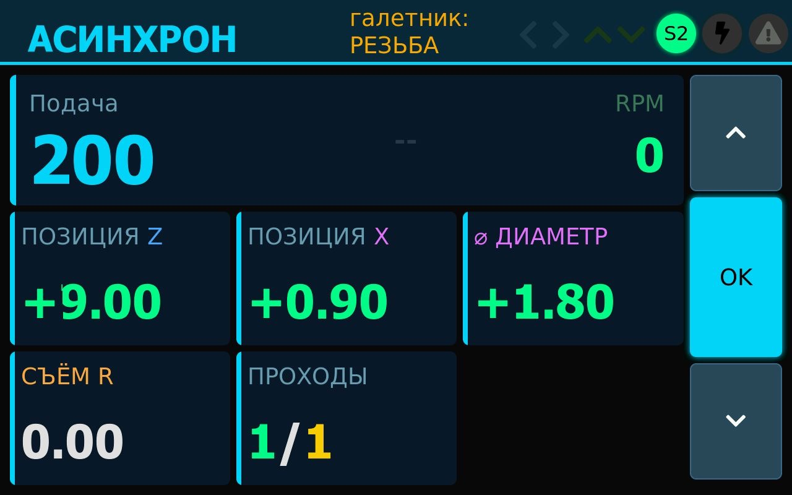

Здесь переключатель режимов стоит на «Резьбе», а на экране выбрали «Асинхрон» — работает «Асинхрон». Надпись
пропадёт, когда режим на экране и переключатель совпадут. То же для подрежима («галетник: Наружная»); подрежим
при этом виден в кружке S1/S2/S3. Пока ось едет от джойстика, режим не меняется ни переключателем, ни с экрана
(с экрана — длинный сигнал «нельзя»).

Выбор режима (тап по названию режима):

**Как нажимать — везде одинаково:**

| Жест | Что делает |
|---|---|
| **Тап** | Открыть, выбрать, ввести: меню, клавиатура для числа, барабан |
| **Двойной тап** | Только переключить подменю: по ⌀ — следующий подэкран, по шагу резьбы в M3 — тип резьбы |
| **Держать 2 секунды** | То, что стирает: обнулить ось, «ИЗ КОНФИГА», забыть сеть Wi-Fi. Пока держите — подсказка «ДЕРЖИТЕ» |

Цифры вводятся на такой клавиатуре (появляется при тапе по числу). Точку можно не набирать: у подачи «0», «2», «0»
— это 0.20. Число вне пределов не принимается — окно «НЕ ПРИНЯТО» скажет, какие числа можно:

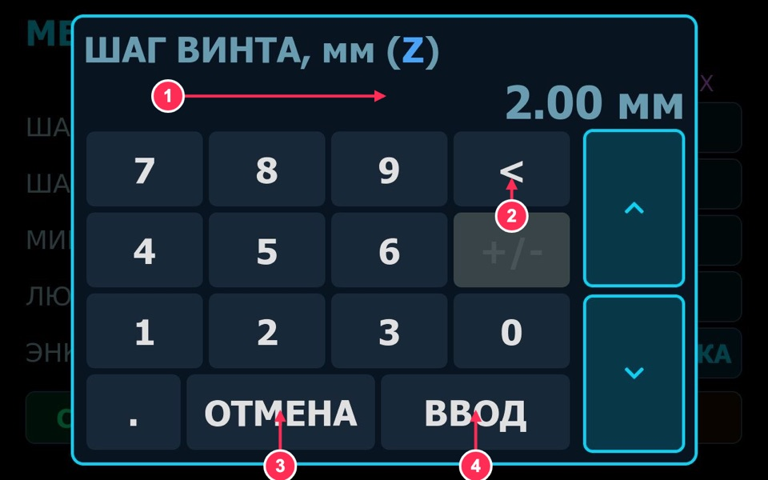

1. Что вводим. 2. Стереть цифру. 3. «ОТМЕНА» — ничего не менять. 4. «ВВОД» — сохранить.

## 4. Первое включение и ноль

1. Включите блок питания 5 В (шилд). Дисплей показывает режим, который стоит на переключателе.
2. Переключатель подрежимов — в **«Ручной»**. Джойстик — в середине (иначе сообщение «Установите джойстик в
   нейтральное положение»).
3. Ноль осей:
   - **Z**: подведите резец к торцу детали до лёгкого касания → **держите «ПОЗИЦИЯ Z» 2 секунды** → 0.
   - **Диаметр**: коснитесь резцом наружного диаметра (или проточите поясок и измерьте штангенциркулем) →
     **тап по «⌀ ДИАМЕТР»** → введите диаметр → «ВВОД».
   - Если координаты даёт **блок DRO** — ноль и ввод делаются на самом блоке (экран скажет «ОСИ ЗАДАЮТСЯ НА БЛОКЕ DRO»).
4. Теперь «ПОЗИЦИЯ Z» показывает расстояние от торца, «⌀ ДИАМЕТР» — диаметр под резцом.

## 5. Упоры и автоцикл — главное, что нужно понять

**Упор** — это точка, дальше которой суппорт не поедет. Упоры ставятся кнопками упоров там, где сейчас стоит
суппорт, только в подрежиме **«Ручной»**. Светодиод и стрелка на экране горят — упор стоит. Повторное нажатие —
снять упор.

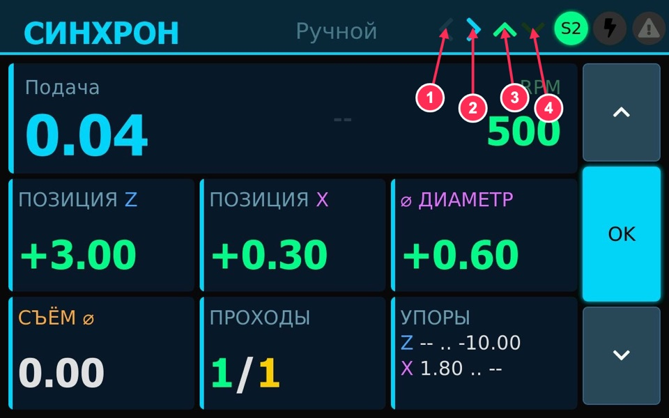

1. Левый упор (◀) — не горит. 2. Правый (▶) — стоит. 3. Передний (▲) — стоит. 4. Задний (▼) — не горит.

**Автоцикл** — станок сам делает все проходы: врезается на съём, проходит до упора, отходит, возвращается,
врезается глубже — и так до последнего прохода. Как запустить:

1. В «Ручном» поставьте **два упора по одной оси** (обычно правый и левый — начало и конец обработки).
2. Поставьте суппорт **на упор** (точку начала): джойстиком к упору — суппорт остановится на нём сам.
3. Переключатель подрежимов → **«Наружный»** (снаружи детали) или **«Внутренний»** (расточка внутри).
   Если упоров нет — «УСТАНОВИТЕ УПОРЫ!»; если суппорт не на упоре — «УСТАНОВИТЕ СУППОРТ В ИСХОДНУЮ ПОЗИЦИЮ!».
4. Включите шпиндель и **держите джойстик в сторону обработки** (к патрону — влево). Пока держите — цикл идёт.
   Нужно остановиться посреди работы (убрать стружку, сменить пластину) — **ПАУЗА**, ниже.
5. Конец: длинный сигнал и «ОПЕРАЦИЯ ЗАВЕРШЕНА!». Отпустите джойстик, переключатель — в «Ручной», снимите упоры.

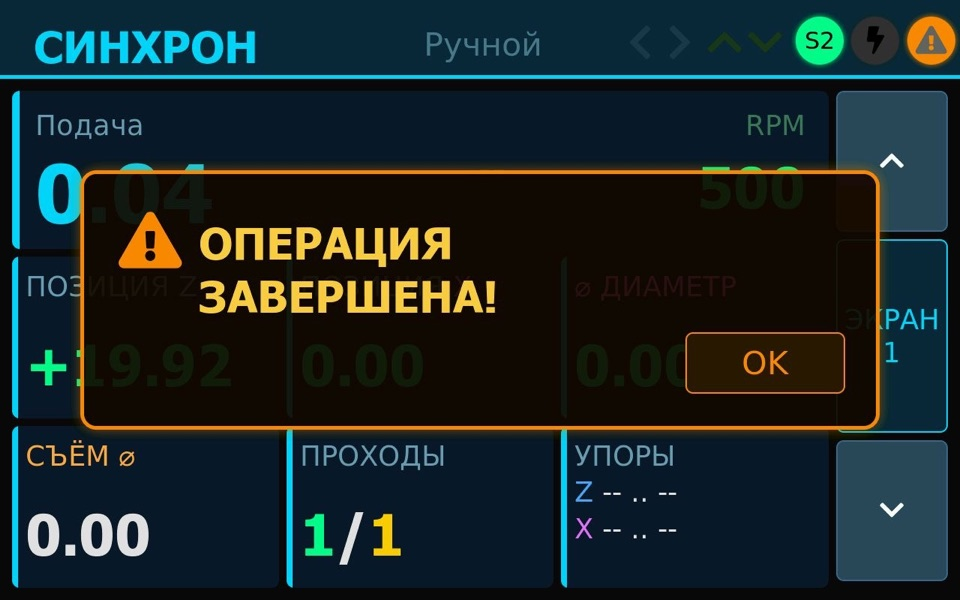

Конусам (M4, M5) упоры для автоцикла не нужны — там свой порядок, см. [M4 и M5](#m4-и-m5--конус).

### Пауза автоцикла

Во всех автоциклах (подача, асинхронная подача, резьба, конусы, шар, отрезание) цикл можно поставить на паузу и
продолжить с того же места.

1. Цикл идёт — нажмите **▼** на пульте **один раз** (держать не нужно) или **ПАУЗА** на экране. Короткий сигнал.
2. Резец доходит до **безопасной точки** и останавливается — в начале прохода, когда резец уже отведён от детали
   (у упора; при торцевании — у переднего или заднего упора). На экране окно «ПАУЗА»:

   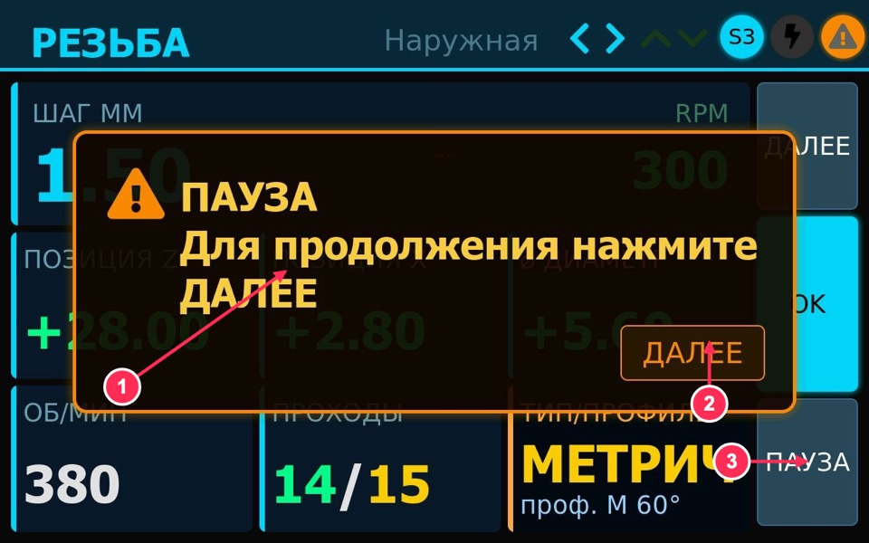

   1. Окно «ПАУЗА». 2. Кнопка **ДАЛЕЕ** — продолжить. 3. ▲ и ▼ в автоцикле — **ДАЛЕЕ** и **ПАУЗА**.

3. Уберите стружку, смените пластину, промерьте — суппорт стоит, джойстик **держите** в прежнем положении.
4. Продолжить — **▲** на пульте, **ДАЛЕЕ** в окне или на экране. Цикл идёт дальше с того же прохода.

> **Не отпускайте джойстик, чтобы «приостановить».** Отпущенный джойстик — это остановка, а не пауза: суппорт встанет
> сразу, где был, а цикл сбросится. В резьбе и подачах, если снова взять джойстик, станок продолжит от упора; в
> **конусах M4/M5 цикл начнётся заново от того места, где стоит резец** — получится другой конус. Для перерыва —
> только ПАУЗА.

## 6. Режимы

Подэкраны каждого режима листаются кнопкой **«Выбор»** (или кнопкой **«ЭКРАН N»** справа на экране — одно нажатие). Что на каком
подэкране — ниже; подэкраны 3 и 4 одинаковы во всех режимах M1–M5.

### Подэкраны 3 и 4: ввод ⌀ и дистанционные лимиты

**Подэкран 3 — ВВОД ДИАМЕТРА.** Замерили деталь — введите её диаметр, дальше экран показывает диаметр под резцом.

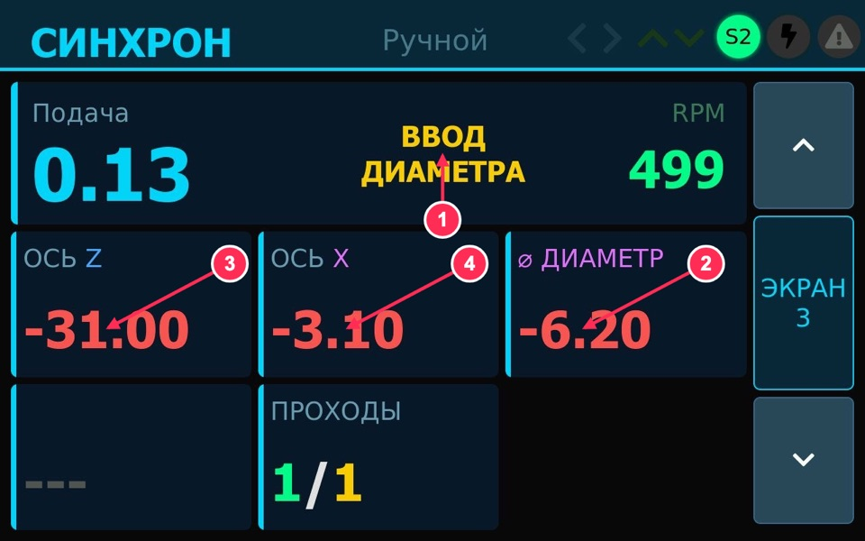

1. Подэкран «ВВОД ДИАМЕТРА». 2. **⌀ ДИАМЕТР** — тап открывает клавиатуру. 3, 4. Оси Z и X (держать 2 с — обнулить).

Если координаты идут с блока DRO (НАСТРОЙКИ → ЛИНЕЙКИ, источник «БЛОК DRO»), оси и ⌀ задаются на самом блоке: тап
покажет «ОСИ ЗАДАЮТСЯ НА БЛОКЕ DRO», кнопки пульта ⌀ не меняют.

С пульта диаметр вводится кнопками, без клавиатуры:

| Нажатие | ⌀ | Нажатие | ⌀ |
|---|---|---|---|
| ▲ | +0.10 мм | ▼ | −0.10 мм |
| ◀ + ▲ | +0.01 мм | ◀ + ▼ | −0.01 мм |
| ▶ + ▲ | +1 мм | ▶ + ▼ | −1 мм |
| «ускоренная» + ▲ | +10 мм | «ускоренная» + ▼ | −10 мм |
| ◀ + ▶ | ⌀ = 0 | | |

«◀ + ▲» — **сначала зажмите ◀**, потом коротко нажмите ▲, отпустите **сначала ▲**, потом ◀. Если нажать ▲ первым
или отпустить ◀ раньше ▲, сработает и одиночная ▲ (+0.10). Держать дольше полсекунды — значение пойдёт повторяться.

**Обнулить линейки** можно и на главном экране любого режима: **«ускоренная» + ◀** — Z в ноль, **«ускоренная» + ▶** —
X в ноль (на экране — удержание плитки ПОЗИЦИЯ 2 с, как раньше).

**Подэкран 4 — ДИСТАНЦИОННЫЕ ЛИМИТЫ.** Упор ставится не там, где резец, а **на заданном расстоянии от него** —
не надо гнать суппорт к месту упора. Пример: отторцевали, резец у торца, надо точить на 138.5 мм — введите
138.500 и нажмите «левый упор»: упор встал на 138.5 мм левее, суппорт не сдвинулся.

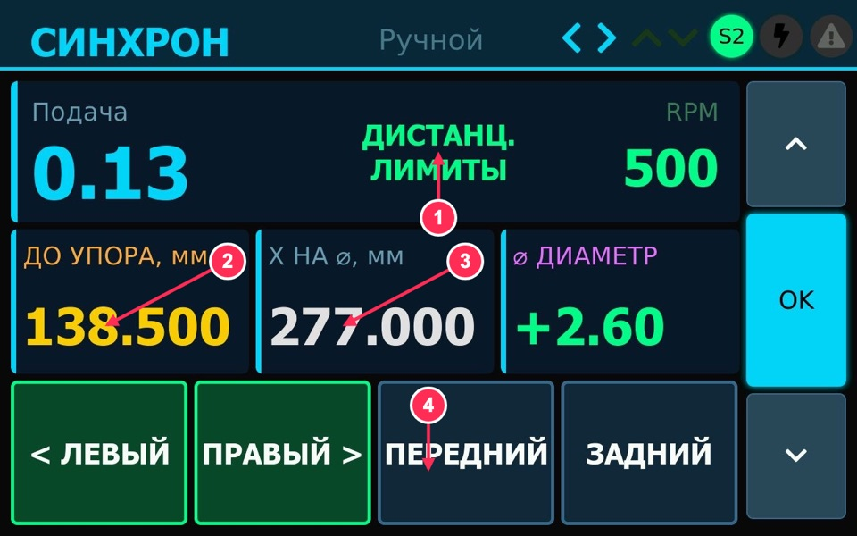

1. Подэкран «ДИСТАНЦ. ЛИМИТЫ». 2. **ДО УПОРА** — расстояние, мм (тап — клавиатура). 3. То же на диаметр (для X).
4. Кнопки упоров: **< ЛЕВЫЙ** — левее резца (к патрону), **ПРАВЫЙ >** — правее, **ПЕРЕДНИЙ** — дальше от вас,
**ЗАДНИЙ** — ближе к вам. Горит зелёным — упор стоит; повторный тап — снять. Кнопки упоров пульта на этом подэкране
делают то же самое.

- Расстояние **одно для всех упоров**; для X — **на радиус** (ход резца), рядом показано на диаметр.
- С пульта расстояние вводится так же, как ⌀ на подэкране 3, только самый мелкий шаг — 0.005 мм (◀ + ▲); ◀ + ▶ — 0;
  «Выбор» с «ускоренной» на этом подэкране — тоже 0, «Выбор» без неё — к подэкрану 1.
- Упор не ставится, если до противоположного упора меньше тормозного пути (около 4 мм при механике по умолчанию) —
  так же, как обычный упор.
- Упоры, поставленные здесь, работают во всех режимах. На остальных подэкранах кнопки упоров ставят упор у резца.
- Только в подрежиме «Ручной».

### M1 — Синхронная подача

Резец движется **на заданную долю миллиметра за каждый оборот шпинделя** (мм/об): медленнее шпиндель — медленнее
подача, чистота поверхности одинаковая. Для обычной проточки.

- **Подача** (7 на рисунке) — тап по значению или переменник; 0.01…0.25 мм/об.
- **Съём ⌀** (12) — ▲ ▼: на 0.02 мм (с кнопкой ускоренного хода — на 0.10); снимается **с диаметра** за проход.
- **Проходы** (13) — ◀ ▶. После автоцикла снова 1 (так у автора: черновые проходы, потом 1–2 чистовых).
- Подэкран 2 — **отскок и натяг Z** — только в подрежиме «Наружный» и с упорами X (передний и задний); иначе
  «Выбор» сразу ведёт к подэкрану 3. Нужен для [ручьёв и «ёлочек»](#ручьи-шкивов-и-ёлочка):

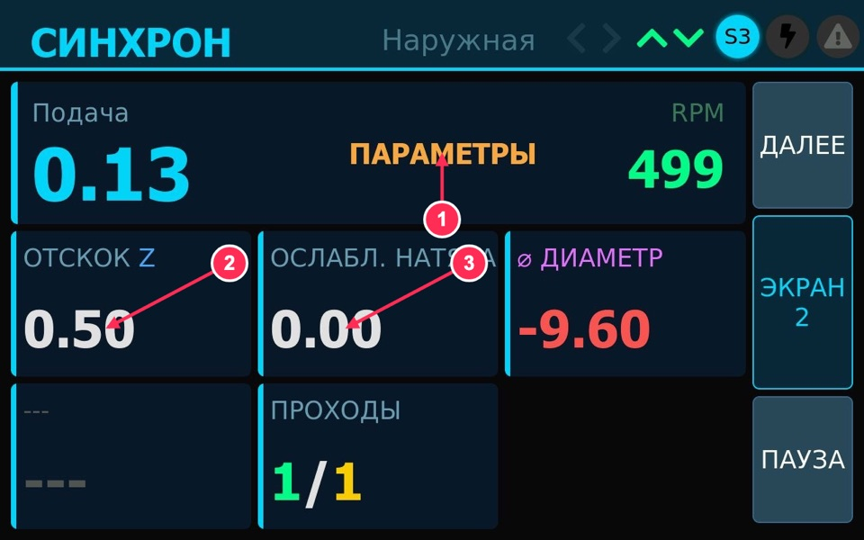

1. Подэкран «ПАРАМЕТРЫ». 2. **Отскок Z** — на сколько резец отходит вправо после врезания: ◀ — снять (0.00), ▶ —
вернуть (из настроек механики). 3. **Ослабление натяга Z** — отвод вправо перед врезанием, ▲ ▼ по 0.01 мм (не больше
половины люфта продольного винта).

- Подэкраны 3 и 4 — [ввод ⌀ и дистанционные лимиты](#подэкраны-3-и-4-ввод--и-дистанционные-лимиты).

**Пример: проточить вал с ⌀30 до ⌀28 на длине 50 мм**

1. Режим **M1**, подрежим **«Ручной»**. Подача — **0.13** мм/об.
2. Подведите резец к правому концу заготовки, в 2–3 мм от торца, и коснитесь им поверхности ⌀30 (резец
   касается — это «нулевой» проход).
3. Нажмите **упор правый** — здесь начало.
4. Джойстиком влево (с кнопкой ускоренного хода — быстрее) отведите суппорт на 50 мм — смотрите «ПОЗИЦИЯ Z»
   (если ноль Z на торце — до −50.00). Нажмите **упор левый** — здесь конец.
5. Джойстиком вправо — суппорт сам остановится на правом упоре.
6. Снять надо 2 мм с диаметра. **Съём ⌀ = 0.50** (▲ 25 раз, или с кнопкой ускоренного хода 5 раз), **проходы = 4**
   (▶). 4 × 0.50 = 2.00 мм.
7. Включите шпиндель. Переключатель подрежимов → **«Наружный»**.
8. **Держите джойстик влево.** Станок сделает 4 прохода и скажет «ОПЕРАЦИЯ ЗАВЕРШЕНА!».
9. Переключатель → «Ручной», снимите упоры (нажмите левый и правый ещё раз). Измерьте — ⌀28.

#### Ручьи шкивов и «ёлочка»

Торцевой автоцикл M1 с **отскоком Z = 0**: каждое врезание по X — на новом месте, через **съём** по Z. Так режут ручьи
поликлиновых шкивов, штуцеры «ёлочка», ребристые радиаторы.

**Пример: шкив PL, 6 ручьёв (шаг 2.34 мм, глубина 2.20 мм), резец профильный 40°**

1. Проточите заготовку до нужного ⌀. Отведите резец вправо за торец, обнулите X (удержание ПОЗИЦИЯ X 2 с).
2. Подведите резец по X до **−2.20** («ПОЗИЦИЯ X») — **упор передний**; отведите назад за деталь — **упор задний**
   (между ними не меньше 2–3 мм).
3. Ведите суппорт по Z к патрону, пока резец не встанет напротив **первого** ручья.
4. **Съём = 2.34** (▲ ▼ — это шаг ручьёв по Z), **проходы = 6** (◀ ▶).
5. Подрежим **«Наружный»**, «Выбор» — подэкран 2: **отскок Z = 0.00** (◀), натяг — 0.00…0.02 (▲ ▼). «Выбор» до подэкрана 1.
6. Шпиндель, **джойстик вверх** (от себя) — режет 6 ручьёв: первый напротив резца, следующие — через 2.34 мм.
7. После работы верните отскок (▶ на подэкране 2) и натяг 0.00.

### M2 — Асинхронная подача

Резец движется **с заданной скоростью в мм/мин**, не зависит от оборотов шпинделя. Для подрезки торца, отрезки,
работы при выключенном шпинделе.

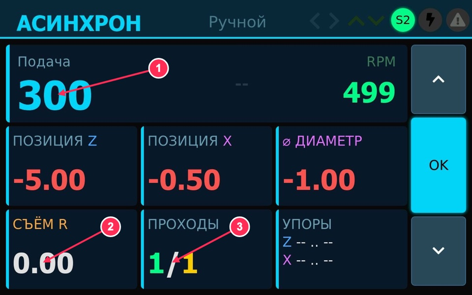

1. Подача, мм/мин (тап — барабан; 10…400). 2. Съём R — **на радиус** за проход (▲ ▼ по 0.01, с ускоренным — 0.05).
3. Проходы (◀ ▶). Подэкран 2 — делитель (число делений, метка), подэкраны 3 и 4 —
[ввод ⌀ и дистанционные лимиты](#подэкраны-3-и-4-ввод--и-дистанционные-лимиты). Автоцикл — как в M1, но **число
проходов после цикла остаётся** (удобно для повторяющихся операций — зубья шестерни, шпоночные пазы при стоящем
шпинделе); съём за проход отрабатывается точно (V3.4: раньше при микрошаге 4 на каждый проход набегало 2 микрошага).

### M3 — Резьба

Резец движется **ровно на шаг резьбы за оборот** и каждый проход начинает **с той же нитки** (по метке энкодера
шпинделя). Глубина каждого прохода считается сама по профилю 60°: первые проходы глубже, последние — тоньше.

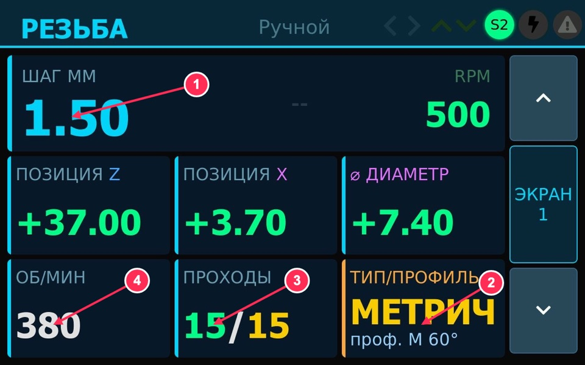

1. **Шаг резьбы**, мм (▲ ▼ — по таблице). 2. **ТИП/ПРОФИЛЬ** — крупно раздел таблицы шагов (метрическая, дюймовая,
трубная G и K), мелко — **профиль**; тап открывает выбор. 3. **Проходы** — сколько рабочих проходов (по таблице для
шага; ◀ ▶ — добавить). 4. **Наибольшие обороты** для этого шага — шпиндель не должен крутиться быстрее (иначе мотор
не успеет).

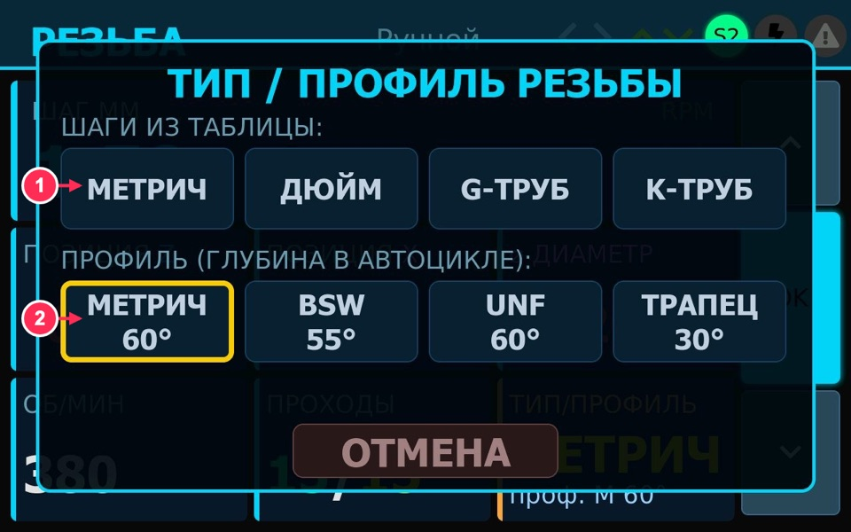

1. **Шаги из таблицы** — какой список шагов листают ▲ ▼: метрические мм, дюймовые (ниток на дюйм), трубные G и K.
2. **Профиль** — на какую полную глубину врежется резец в автоцикле:

| Профиль | Полная глубина (P — шаг) | Для чего |
|---|---|---|
| **МЕТРИЧ 60°** (после включения) | наружная 0.613·P, внутренняя 0.601·P | метрическая; так же считала прошивка до V3.4 |
| **BSW 55°** | 0.640·P (наружная и внутренняя) | дюймовая Витворта, трубная G (55°) |
| **UNF 60°** | 0.613·P | дюймовая 60° (UNC/UNF), трубная K |
| **ТРАПЕЦ 30°** | 0.5·P + 0.15 (P < 2), + 0.25 (P 2…5), + 0.5 (P > 5) | трапецеидальная (Tr) |

Тип и профиль выбираются **отдельно**: например, шаг 3.00 из метрической таблицы и профиль ТРАПЕЦ — резьба Tr16×3.
С пульта профиль меняет **«ускоренная» + «Выбор»** на первом подэкране резьбы (1 → 2 → 3 → 4 → 1). Глубина — это
расчёт: если гайка идёт туго, отведите резец за правый упор и доберите проход (см. пример ниже). Профиль после
выключения — снова метрический.

Подэкран 2 — параметры резьбы:

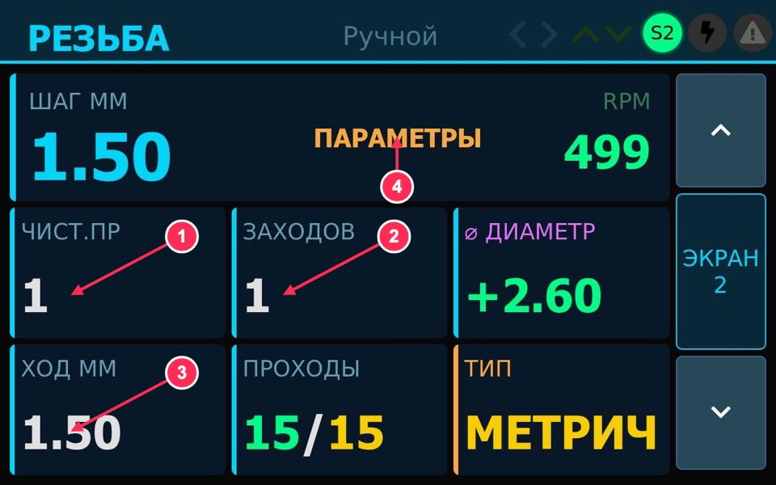

1. **Чистовые проходы** — проходы без врезания в конце (◀ ▶). 2. **Заходов** — многозаходная резьба (▲ ▼).
3. **Ход** — шаг × число заходов. 4. Подэкран «ПАРАМЕТРЫ».

**Пример: нарезать наружную резьбу M20×1.5 длиной 80 мм**

1. Проточите заготовку до ⌀20 и снимите фаску. Резец — резьбовой 60°, ровно по оси.
2. Режим **M1** или **M3**, подрежим **«Ручной»**.
3. Подведите резец правее торца на 3–5 мм (разгон) и **коснитесь им поверхности ⌀20** — это начало, с него
   считается глубина.
4. Нажмите **упор правый**.
5. Джойстиком влево отведите суппорт до конца резьбы — 80 мм от торца плюс разгон (если ноль Z на торце —
   «ПОЗИЦИЯ Z» −80.00). Нажмите **упор левый**.
6. Джойстиком вправо — суппорт остановится на правом упоре.
7. Режим **M3 «Резьба»**. Шаг — **1.50** (▲ ▼ или тап), профиль — **МЕТРИЧ 60°**. Экран покажет **16 проходов** +
   **1 чистовой** и **380 об/мин** наибольшие обороты.
8. Включите шпиндель **не быстрее 380 об/мин** (для первого раза — 150–200).
9. Переключатель подрежимов → **«Наружный»**.
10. **Держите джойстик влево.** Каждый проход: врезание → нарезка до левого упора → отвод резца → возврат вправо →
    следующий проход глубже. Нужен перерыв — [ПАУЗА](#пауза-автоцикла) (встанет у правого упора, в начале прохода).
11. «ОПЕРАЦИЯ ЗАВЕРШЕНА!» — переключатель в «Ручной», снимите упоры. Проверьте резьбу гайкой; туго — ◀ ▶ добавьте
    проход и повторите цикл.

Внутренняя резьба — то же, но резец расточной и подрежим **«Внутренний»**.

**Пример: трапецеидальная Tr20×4 (наружная).** Таблица — метрическая, шаг **4.00**; профиль — **ТРАПЕЦ 30°**
(глубина 0.5·4 + 0.25 = 2.25 мм). Резец — трапецеидальный 30°, заготовка ⌀20. Дальше — как в примере M20×1.5.

### M4 и M5 — Конус

Суппорт идёт по Z, а резец одновременно по X — получается конус. **«Конус <»** (M4) сужается к патрону,
**«Конус >»** (M5) — к задней бабке (обычный наружный конус, например, под центр).

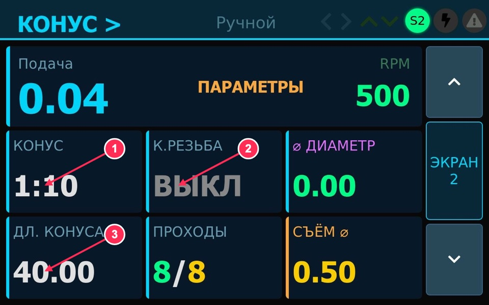

1. **Конус** — угол или конусность (◀ ▶): градусы 1°…45°, 1:N, Морзе. 2. **Конусная резьба** — вкл/выкл (▲ ▼).
3. **ДЛ. КОНУСА** — какой длины получится конус при этих съёме и проходах (мм по Z; при включённой конусной резьбе
здесь подсказка «В РЕЖИМЕ РЕЗЬБА»). Подэкран 1 — подача, конус, съём, проходы; подэкраны 3 и 4 —
[ввод ⌀ и дистанционные лимиты](#подэкраны-3-и-4-ввод--и-дистанционные-лимиты).

Как задают конус: **градусы** — угол наклона образующей к оси детали (как поворачивают верхние салазки); **1:N** —
конусность: на длине N мм диаметр меняется на 1 мм (1:10 — на 10 мм длины диаметр меньше на 1 мм); **КМ0…КМ6** —
конусы Морзе. В ряду градусов теперь есть и 30°, и 45° (◀ ▶ листают 1° … 45° подряд); конусности: 1:4, 1:5, 1:7,
1:10, 1:16, 1:20, 1:24, 1:30, 3:25 (вентили газовых баллонов), 1:50, 7:64.

#### Автоцикл конуса (с V3.7/V3.8 — без упоров)

Резец ставят в **точку старта** — на край будущего конуса, касаясь детали. Упоры **не ставят**: длину конуса
прошивка считает сама из съёма и числа проходов (видно на подэкране 2, «ДЛ. КОНУСА»). Каждый проход: отвод,
быстрый ход по конусу к дальнему краю, выбор люфта по Z, врезание на половину съёма, рабочий проход по конусу
к старту (на 1 мм дальше него), выбор люфта. После последнего прохода резец остаётся **на конусе у дальнего края**,
а левый и правый упоры **ставятся сами** — для чистового прохода вручную или для конусной резьбы.

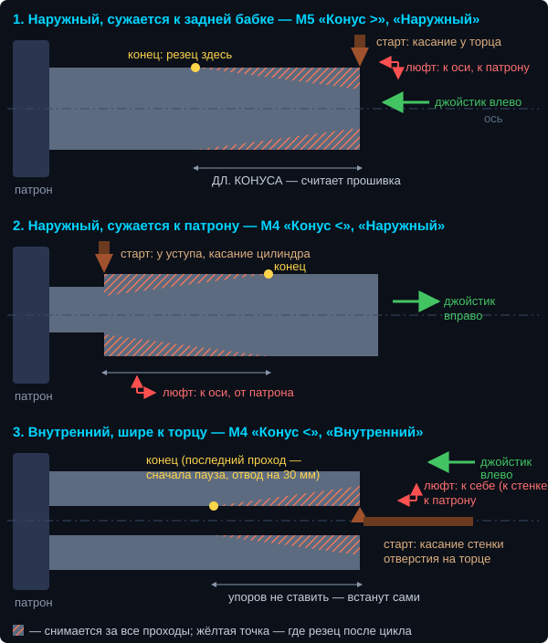

| Конус | Режим, подрежим | Где старт | Люфт перед стартом | Джойстик |
|---|---|---|---|---|
| Наружный, сужается к задней бабке | **M5 «Конус >»**, «Наружный» | правый торец (узкий конец), резец касается цилиндра | по X — к оси, по Z — к патрону | **влево** |
| Наружный, сужается к патрону | **M4 «Конус <»**, «Наружный» | левый край (узкий конец, у патрона/уступа), касание цилиндра | по X — к оси, по Z — от патрона | **вправо** |
| Внутренний (расточка), шире к торцу | **M4 «Конус <»**, «Внутренний» | торец, резец касается стенки отверстия | по X — к себе, по Z — к патрону | **влево** |
| Внутренний, шире вглубь | M5, «Внутренний» | — | — | **«Режим невозможен!»** — такого цикла нет |

«Люфт выбран к оси» — последнее движение резца перед стартом было к оси детали; «к патрону» — последнее движение
суппорта было влево. Внутренний конус: на **последнем проходе** резец сам отходит на 30 мм вправо и встаёт на паузу —
уберите стружку, промерьте диаметр на торце, **ДАЛЕЕ** — вернётся на конус в точку чистового прохода.

**Пример 1: наружный конус 1:10 длиной 40 мм на конце вала ⌀30 (узкий конец — у торца)**

Конусность 1:10 на 40 мм — диаметр уменьшается на 40 / 10 = **4 мм**: у торца будет ⌀26, через 40 мм — ⌀30.
Значит, у торца снять 4 мм с диаметра. Съём 0.50 мм на диаметр за проход → **8 проходов**.

1. Режим **M5 «Конус >»** (сужается к задней бабке, то есть к торцу), подрежим **«Ручной»**.
2. Подэкран 2 (кнопка «Выбор»): **Конус = 1:10** (◀ ▶). Подэкран 1: **подача 0.10** мм/об (тап по значению),
   **Съём = 0.50** (▲ ▼), **проходы = 8** (◀ ▶). Подэкран 2 покажет **ДЛ. КОНУСА 40.00**.
3. Подведите резец к правому торцу и **коснитесь им поверхности ⌀30** у самого торца — последним движением
   к оси (люфт X выбран к детали). Последнее движение по Z — влево (к патрону). Упоры не ставьте.
4. Включите шпиндель. Переключатель подрежимов → **«Наружный»**.
5. **Держите джойстик влево.** Резец отходит, быстро уходит влево по конусу, врезается и режет конус к торцу; с каждым
   проходом конус глубже. Первые проходы у дальнего края идут по воздуху — так и должно быть.

   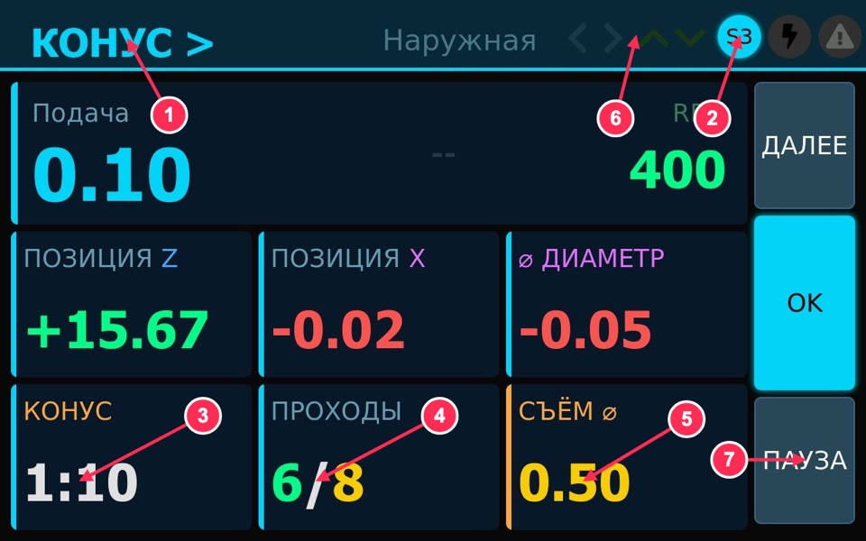

   1. Режим «КОНУС >». 2. S3 — подрежим «Наружный». 3. Конус 1:10. 4. Проходы: осталось / всего.
   5. Съём за проход. 6. Упоры — поставятся сами в конце. 7. **ПАУЗА** (▼) и **ДАЛЕЕ** (▲) — [пауза автоцикла](#пауза-автоцикла).

6. «ОПЕРАЦИЯ ЗАВЕРШЕНА!» — резец на конусе у левого края, упоры стоят. Проверьте: у торца ⌀26, через 40 мм — ⌀30.
   Мало — доберите чистовым проходом вручную (РГИ по X на нужное, джойстик вправо — до правого упора).
7. Переключатель в «Ручной», снимите упоры.

**Пример 2: внутренний конус КМ2 в пиноли (отверстие ⌀14.9, широкий конец ⌀17.78)**

1. Сверлите или расточите отверстие **⌀14.9** (малый ⌀ КМ2). Резец — расточной с вылетом не меньше длины конуса + 5 мм.
2. Режим **M4 «Конус <»**, «Ручной». Конус — **КМ2**. Снять 17.78 − 14.9 = 2.88 мм на ⌀: съём **0.36** × **8** проходов.
   Подэкран 2 покажет длину конусной части — проверьте, что хватит вылета резца.
3. Подача 0.05–0.07 мм/об, шпиндель ~200 об/мин.
4. Подведите резец к стенке отверстия **на торце** до касания: последнее движение по X — **к себе**, по Z — **влево**.
5. Подрежим **«Внутренний»**, **джойстик влево**. Время от времени — [ПАУЗА](#пауза-автоцикла), уберите стружку.
6. На последнем проходе резец отойдёт на 30 мм вправо и встанет на паузу: промерьте ⌀ на торце; **ДАЛЕЕ** — резец
   вернётся на конус. «ОПЕРАЦИЯ ЗАВЕРШЕНА!» — дальше чистовой проход вручную (не больше 0.2 мм) или конусная резьба.

#### Конусная резьба

Резьба на конусе (трубная коническая, газовые штуцеры). Удобнее точить конус **той же резьбовой пластиной**:

1. В M4/M5 на подэкране 2 — конус и **конусная резьба: ВКЛ** (▲). Проточите конус автоциклом (выше) до «ОПЕРАЦИЯ
   ЗАВЕРШЕНА!» — упоры встанут сами.
2. Подрежим не трогайте, переключатель режимов — в **«Резьба»**, выберите шаг, джойстиком — автоцикл резьбы.
3. Внутренний левый и наружный правый конусы режутся **от патрона**: правую резьбу на них — на **реверсе шпинделя**
   (резец перевёрнут); на реверсе джойстик для резьбы от патрона — **влево**.
4. Конусная и многозаходная резьба вместе не включаются. После работы выключите конусную резьбу (подэкран 2 конуса).

### M6 — Шар и отрезание

Положение «Шар» переключателя режимов — это два режима: **шар** и **отрезание вразбежку**. Переключаются кнопкой
**ШАР / ОТРЕЗАНИЕ** на экране (по центру верхней панели) или **«ускоренная» + «Выбор»** на пульте (джойстик в
нейтрали). После включения — шар. В шапке — «ШАР» или «ОТРЕЗАНИЕ».

#### Шар

Резец описывает дугу — получается шар (сфера) на конце детали.

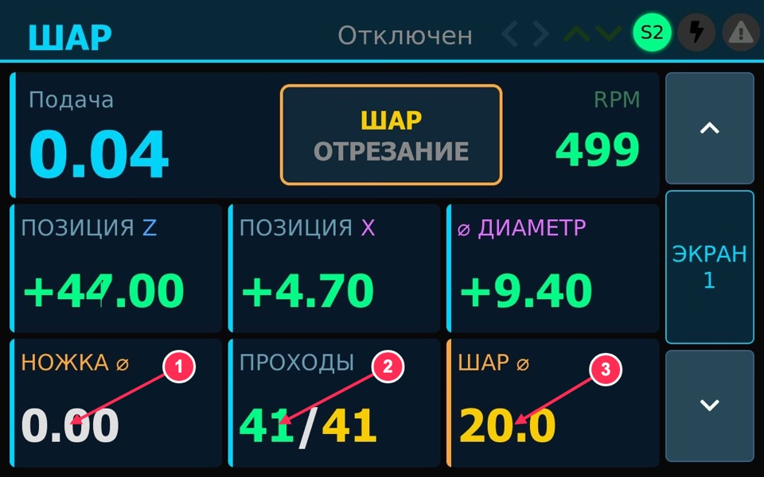

1. **Ножка** — диаметр шейки под шаром (◀ ▶). 2. **Проходы** (считаются сами). 3. **Шар** — диаметр шара (▲ ▼).

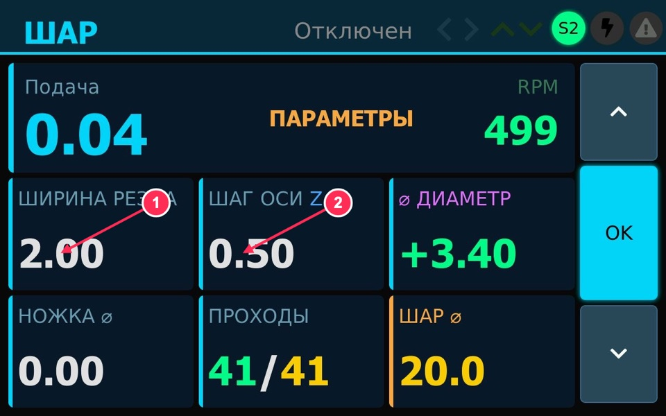

1. **Ширина резца** (▲ ▼; 1.00…5.00 мм). 2. **Шаг по Z** между врезаниями (◀ ▶; меньше — глаже). Подрежим «Внутренний»
в шаре невозможен — будет «Режим невозможен!».

Как режет: отрезным (канавочным) резцом **врезаниями**. Суппорт сдвигается влево на шаг по Z, резец врезается по X
до поверхности шара, отходит — и так по всей длине шара. Справа от экватора форму даёт левый угол резца, слева —
правый, поэтому важна ширина резца. Под шаром остаётся **ножка** заданного диаметра — её потом отрезают.

**Пример: шар ⌀20 на прутке ⌀20, ножка ⌀8**

1. Проточите заготовку до **⌀20** (диаметр шара) на длину больше 20 мм + ширина резца + запас под отрезку.
   Резец — отрезной шириной, например, **3 мм**.
2. Режим **M6 «Шар»**, подрежим **«Ручной»**. Подэкран 1: **Шар = 20.0** (▲ ▼), **Ножка = 8.00** (◀ ▶). Проходы
   экран посчитает сам (диаметр шара / шаг по Z).
3. Подэкран 2: **Ширина резца = 3.00** (▲ ▼) — как у вашего резца, **шаг по Z = 0.50** (◀ ▶).
4. Подведите резец так, чтобы его **левая кромка была ровно на торце** заготовки (это правый конец будущего шара), и
   **коснитесь поверхности ⌀20**. Нажмите **упор правый** и **упор задний** — это точка начала.
5. Включите шпиндель (для первого раза — медленно, 300–400 об/мин). Переключатель подрежимов → **«Наружный»**.
   Если суппорт сдвинулся с точки начала — «УСТАНОВИТЕ СУППОРТ В ИСХОДНУЮ ПОЗИЦИЮ!».
6. **Держите джойстик влево.** Резец врезается, отходит, сдвигается влево — счётчик проходов растёт до последнего.

   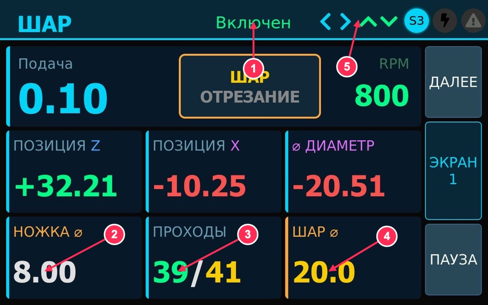

   1. «Включен» — шар режется (подрежим «Наружный»). 2. Ножка ⌀8. 3. Проходы: осталось / всего. 4. Шар ⌀20.
   5. Упоры.

7. «ОПЕРАЦИЯ ЗАВЕРШЕНА!» — переключатель в «Ручной», снимите упоры, отрежьте шар по ножке и доведите напильником и
   шкуркой.

#### Отрезание вразбежку

Отрезной резец врезается не на всю ширину сразу, а **попеременно в две канавки**, сдвигаясь влево-вправо на
**смещение**: стружка свободнее, резец не зажимает, можно отрезать на больших оборотах и без СОЖ. Торец после такого
отрезания — «кольцами», его потом подрезают.

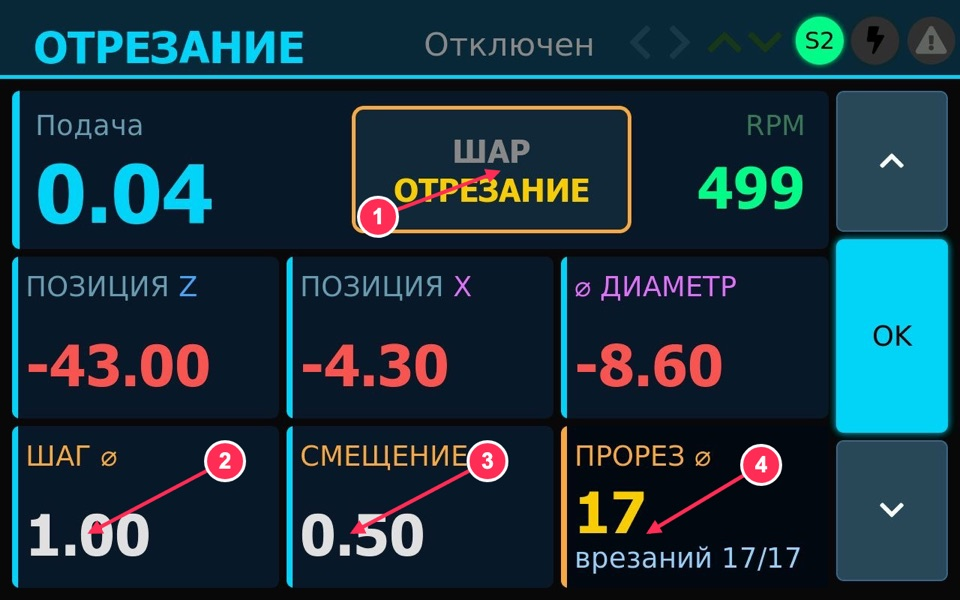

1. **ШАР / ОТРЕЗАНИЕ** — переключатель. 2. **ШАГ ⌀** — на сколько врезается резец за раз, мм на диаметр (тап —
клавиатура; 1, 2, 3 … мм; с пульта ◀ ▶). 3. **СМЕЩЕНИЕ** — сдвиг между канавками (0.10…2.00 мм; с пульта
«ускоренная» + ◀ ▶). 4. **ПРОРЕЗ ⌀** — какой диаметр прорезать (тап — клавиатура; с пульта ▲ ▼ — по шагу), мелко —
сколько врезаний осталось.

- Прорез ⌀ = врезаний × шаг. Больше диаметра заготовки — отрежет полностью; чуть меньше — оставит ножку (дорезать
  вручную или отломить).
- Фактический сдвиг резца больше «смещения» на отскок Z из настроек механики минус люфт продольного винта.
- Подача — переменником или тапом, 0.03–0.05 мм/об; обороты — по цвету стружки (не до синего).
- По умолчанию шаг 1.00, смещение 0.50 — для стали резцом 2 мм.

**Пример: отрезать деталь от прутка ⌀16**

1. M6, кнопка **ОТРЕЗАНИЕ**, подрежим «Ручной». **ШАГ ⌀ = 1**, **СМЕЩЕНИЕ = 0.50**, **ПРОРЕЗ ⌀ = 17** (чуть больше прутка).
2. Подведите резец в точку отрезания и **слегка коснитесь** заготовки. Последнее движение по Z — **слева направо**
   (люфт выбран).
3. Нажмите **упор правый** и **упор задний** (ближний к вам) — это точка старта. Подрежим — **«Наружный»**.
4. Шпиндель, **джойстик влево**. Джойстик вверх/вниз в автоотрезании не работает. Конец — «ОПЕРАЦИЯ ЗАВЕРШЕНА»,
   джойстик в нейтраль.
5. Чтобы торец детали был чистым: начните на 0.2 мм левее нужного размера, отрежьте не до конца (ПРОРЕЗ чуть меньше
   ⌀), потом резец в размер — и одним проходом подрежьте торец и ножку.

### M7 — Делилка

Делит окружность на равные части: показывает угол шпинделя и угол следующей метки. Для разметки граней, отверстий
по окружности (шпиндель поворачивают рукой).

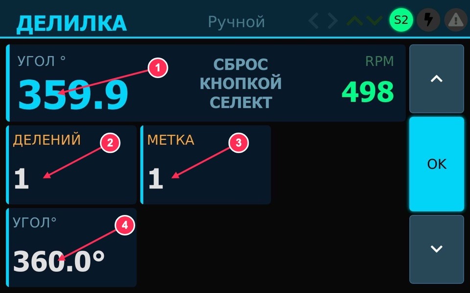

1. **Угол** шпинделя сейчас. 2. **Делений** — на сколько частей. 3. **Метка** — номер текущей. 4. **Угол метки** —
куда повернуть шпиндель. Делений и метку задают тапом по значению (или кнопками в M2 на подэкране 2); кнопка
«Выбор» — обнулить угол (взять текущее положение за 0°).

Пример: 6 граней под ключ — делений 6; поверните шпиндель до угла метки 1 (60°), разметьте, метка 2 (120°) …

### M8 — G-код

Станок выполняет программу из файла, как 3D-принтер. Файлы загружают и запускают на веб-странице дисплея с
телефона или компьютера по Wi-Fi. Что понимает станок и как писать программы — [GCODE.md](../GCODE.md).
Ниже — пример с файлом `pawn_g71.nc` (шахматная пешка из заготовки ⌀32) от файла до готовой детали.

**Шаг 1. Откройте страницу.** Телефон или компьютер — в той же сети, что и дисплей. Адрес — крупно внизу экрана
«НАСТРОЙКИ» (тап по ⚠). После первой прошивки Wi-Fi выключен: «НАСТРОЙКИ» → «WI-FI» → «РОУТЕР» (своя сеть) или
«ТОЧКА ДОСТУПА» (без роутера: подключитесь к сети дисплея, адрес — там же).
Страницу удобно сохранить в закладки.

**Шаг 2. Загрузите файл и проверьте программу.**

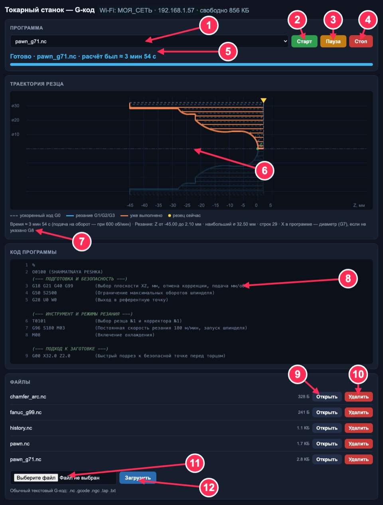

1. **Список программ** — выберите файл. 2. **Старт**. 3. **Пауза** — оси встают сразу, даже посреди строки;
повторное нажатие — едут дальше с того же места. 4. **Стоп** — сразу. 5. **Состояние**: «Нет программы», «Выполняется», «Готово», «Ошибка»
(здесь — «Готово» от прошлого запуска). 6. **Траектория резца**: синим — резание, пунктиром — ускоренные ходы,
снизу — деталь зеркально. Посмотрите на неё до запуска: нет ли хода сквозь деталь или в патрон. 7. **Время** и
размеры: сколько займёт программа, от какого до какого Z режет, наибольший ⌀ (должен быть не больше заготовки).
8. **Код программы** с номерами строк. 9. **Открыть** — показать файл. 10. **Удалить**. 11. **Выберите файл**
на телефоне или компьютере → 12. **Загрузить**: файл появится в списке. Подходят `.nc .gcode .ngc .tap .txt`.

**Шаг 3. Подготовьте станок.** Заготовка в патроне, резец в резцедержателе. Ноль — как в
[разделе 4](#4-первое-включение-и-ноль): Z — торец, диаметр — касанием и вводом ⌀. Режим **M8** включать не
обязательно: при старте со страницы экран станка переключится в M8 сам.

С блоком DRO или линейками станок после каждого включения должен один раз узнать, в какую сторону они считают:
проведите джойстиком **каждую ось на 3 мм и отпустите** (в любом режиме). Иначе программа сразу, до первого
движения, остановится с «НАПРАВЛЕНИЕ ЛИНЕЕК ЕЩЁ НЕ ИЗВЕСТНО».

**Шаг 4. Старт.** Нажмите «Старт» на странице. Откроется окно «Перед стартом» с числами вашей программы:

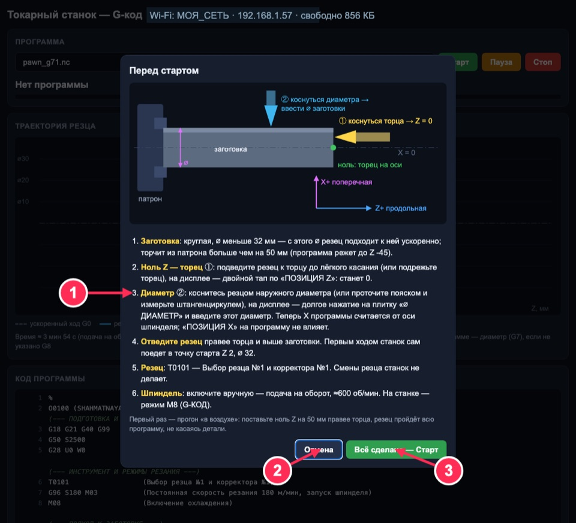

1. **Что проверить**: какой нужен диаметр заготовки и вылет из патрона, как поставить ноль, куда отвести
резец, какой резец, нужен ли шпиндель и на каких оборотах. 2. **Отмена**. 3. **Всё сделано — Старт**.
Включите шпиндель вручную (если в программе подача на оборот, G95/G99 — без шпинделя станок не поедет) и
нажмите «Старт». Первый раз — прогон «в воздухе»: ноль Z на 50 мм правее торца, резец пройдёт всю программу,
не касаясь детали.

**Шаг 5. Программа идёт.** На странице:

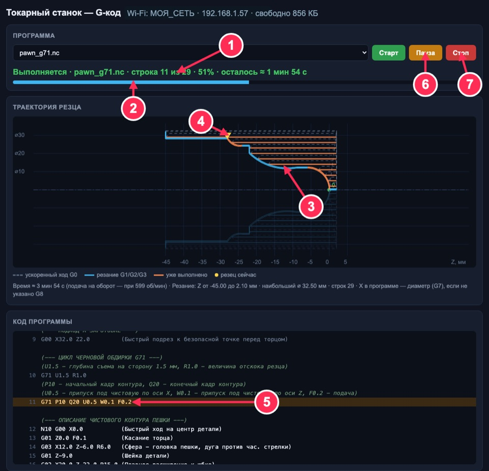

1. **Строка, процент и сколько осталось** (время уточняется по ходу). 2. **Полоса хода**. 3. **Пройденный путь**
— оранжевым. 4. **Резец сейчас** — жёлтый треугольник. 5. **Текущая строка** — подсвечена в коде.
6. **Пауза**. 7. **Стоп**.

На экране станка — то же:

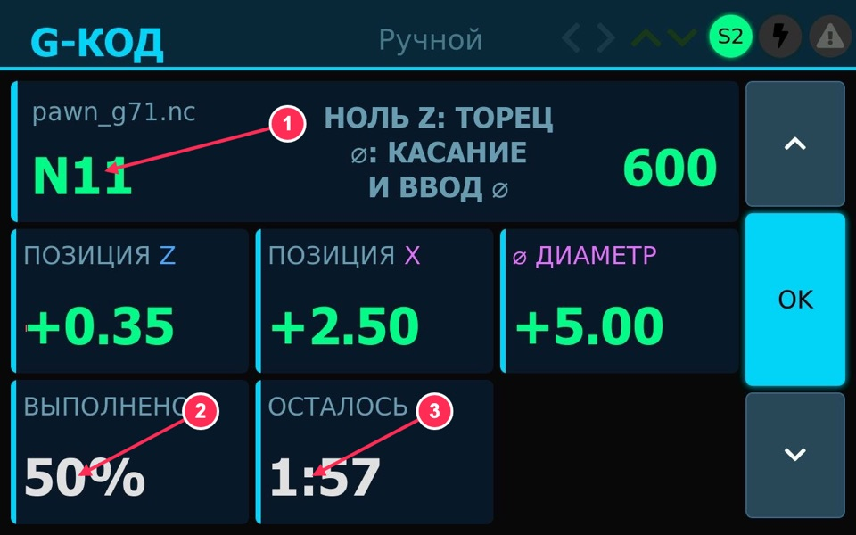

1. **Номер строки** (над ним — имя файла). 2. **Выполнено**, %. 3. **Осталось**, минуты:секунды.

Пока программа идёт, **экран станка заблокирован**: значения видны, но режим, подачу и настройки поменять нельзя
(тап — подсказка вверху). Работают две кнопки:

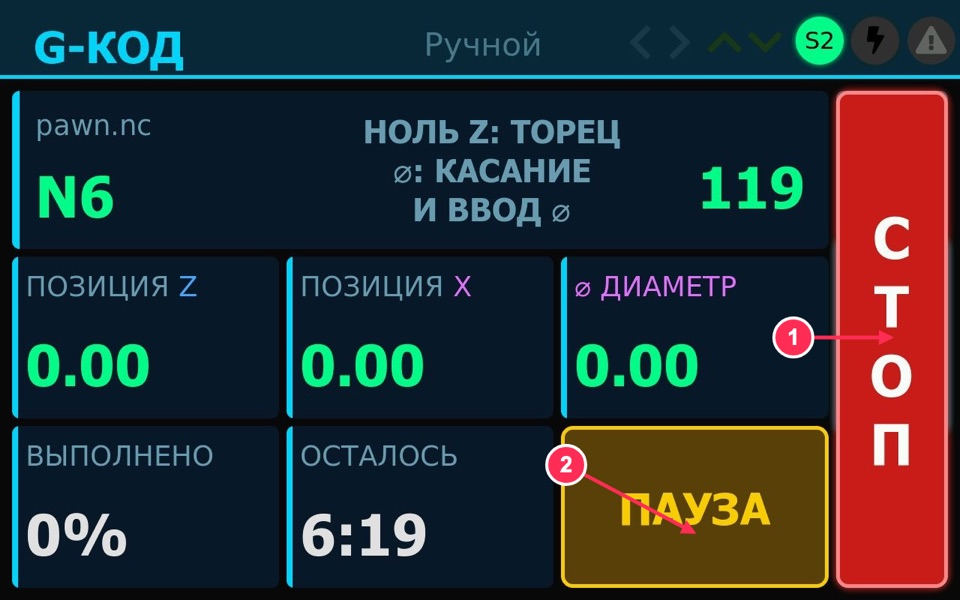

1. **СТОП** — красная, во всю высоту справа: программа останавливается сразу. 2. **ПАУЗА** — оси встают посреди
строки; кнопка становится **ПРОДОЛЖИТЬ** — оси едут дальше с того же места:

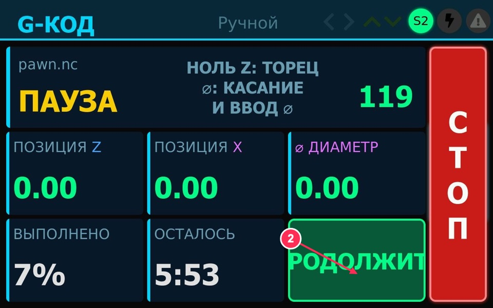

Остановить можно и без экрана: любой ход джойстиком — программа остановится («ОСТАНОВЛЕНО»).

**Шаг 6. Готово.** Страница пишет «Готово» и сколько было по расчёту, путь — весь оранжевый. На экране — «ГОТОВО»
и 100 %.

| Страница | Экран |
|---|---|
| 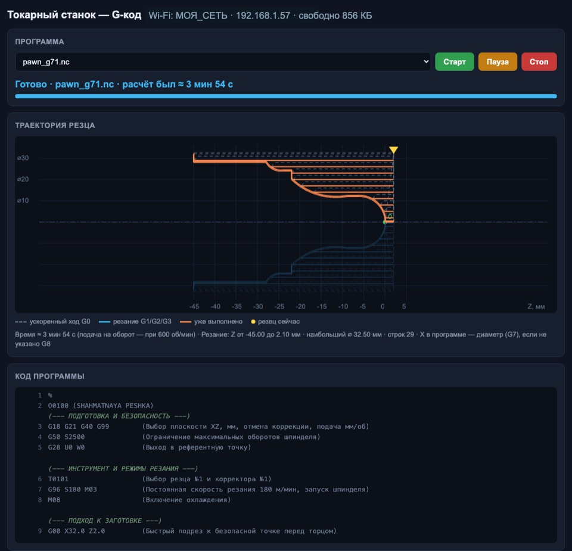 | 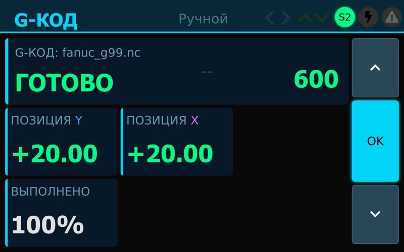 |

Если в программе ошибка, станок остановится и покажет номер строки и причину — окно не закроется, пока не
нажмёте OK. Что значит каждая ошибка — [раздел 8](#8-сообщения-и-ошибки--что-значит-и-что-делать), «G-код».

Ссылки на страницу с готовым выбором: `http://<адрес>/#file=pawn_g71.nc` — сразу открыть файл,
`http://<адрес>/#start=pawn_g71.nc` — сразу окно «Перед стартом».

## 7. Настройки

Тап по **⚠** в шапке → «НАСТРОЙКИ».

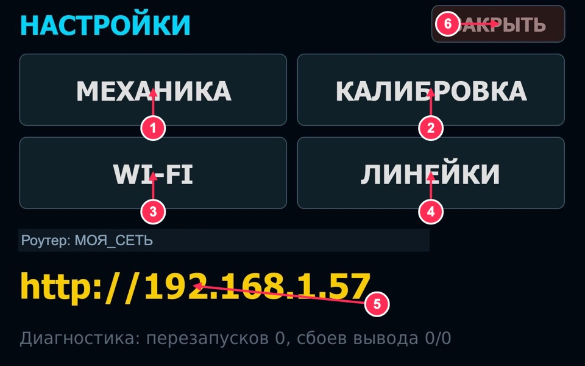

1. **Механика** — винты, шаги, микрошаг, люфт, энкодер. 2. **Калибровка** — уточнить шаг винта и люфт.
3. **Wi-Fi** — выключить, подключить к роутеру или включить точку доступа. 4. **Линейки** — откуда брать координаты. 5. **Адрес веб-страницы** (G-код,
файлы); при выключенном Wi-Fi — «Wi-Fi выключен». 6. Закрыть.
7. **Версия прошивки** — с какой версии собраны дисплей и STM32 (как в выпуске на GitHub, например `v0.4.2`; между
выпусками — `v0.4.1-9-gd472c04`: 9 изменений после v0.4.1; `-dirty` — собрано с несохранёнными в git правками). Если дисплей и STM32 из **разных** выпусков, строка
оранжевая и показывает обе версии бегущей строкой — прошейте обе платы из одного выпуска. Версию называйте, когда
спрашиваете на форуме.

Строка **«Диагностика»** внизу — для поиска редких сбоев экрана: «перезапусков» — сколько раз дисплей
перезапускался сам (сбой, сторожевой таймер, просадка питания; в скобках — причина последнего), «сбоев вывода» —
сколько раз матрица не получила кадр вовремя. Если экран моргнул, а числа не изменились — сбой не в прошивке
дисплея (питание, шлейф, сама матрица). Сообщите эти числа вместе с описанием.

### Механика

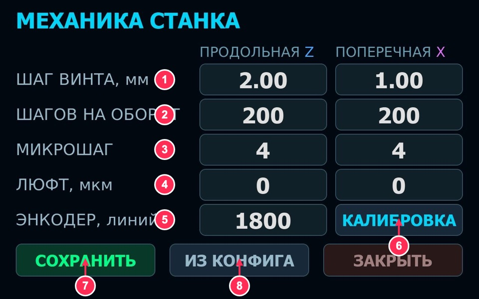

1. **Шаг винта**, мм — у ходового винта оси. 2. **Шагов на оборот** мотора (200 для 1.8°). 3. **Микрошаг** — как
на переключателях драйвера. 4. **Люфт**, мкм — выбирается при смене направления. 5. **Энкодер** — линий на оборот
шпинделя. 6. **Калибровка**. 7. **Сохранить** — механика работает сразу, перезапуска нет. 8. **Из конфига** —
вернуть заводские (держать 2 секунды).

**«ИЗ КОНФИГА» — это не «отменить правки».** Кнопка ставит **заводские** значения — те, с которыми собрана
прошивка (`els_config.h`), — и сразу записывает их в память STM32 вместо ваших сохранённых. Люфт по умолчанию — 0,
поэтому сохранённый люфт после «ИЗ КОНФИГА» становится 0: так и должно быть. В строке состояния — «ЗАВОДСКИЕ
ЗНАЧЕНИЯ», и окно с этим же объяснением. Чтобы просто отменить несохранённые правки, нажмите **«ЗАКРЫТЬ»**, не
нажимая «СОХРАНИТЬ»: в памяти останется то, что было сохранено.

Ввод чисел — тап по полю → клавиатура → «ВВОД».

**Подробно, с картинками — [Механика станка](mechanics.md):** что значит каждое поле и где взять число на своём
станке (шаг винта, шильдик мотора, переключатели драйвера, энкодер), правило «шагов на мм», готовые наборы,
проверенные на стенде, и разбор каждого сообщения «НЕ СОХРАНЕНО».

### Калибровка

Калибровка уточняет **шаг винта** (по паспорту 2.00 мм, а на деле может быть 2.01) и **люфт** — сколько
каретка не доходит при смене направления. От этих двух чисел зависит, совпадёт ли размер детали с экраном.
Калибровка — после того как заполнена «Механика» (винт, шаги, микрошаг). Делается один раз и после ремонта
винтов. Открыть: ⚠ → «НАСТРОЙКИ» → «КАЛИБРОВКА» (или кнопка «КАЛИБРОВКА» в «Механике»).

Как калибровать — зависит от того, откуда станок берёт координаты:

| Что стоит на станке | Способ | Раздел |
|---|---|---|
| Линейки, подключённые к шилду | По линейкам — станок меряет сам | [А](#а-по-линейкам-линейки-подключены-напрямую) |
| Блок DRO (HS800-2) с линейками | По линейкам — так же, через блок | [Б](#б-по-линейкам-через-блок-dro) |
| Нет ни линеек, ни DRO | По индикатору (или штангенциркулю) | [В](#в-без-линеек-по-индикатору) |

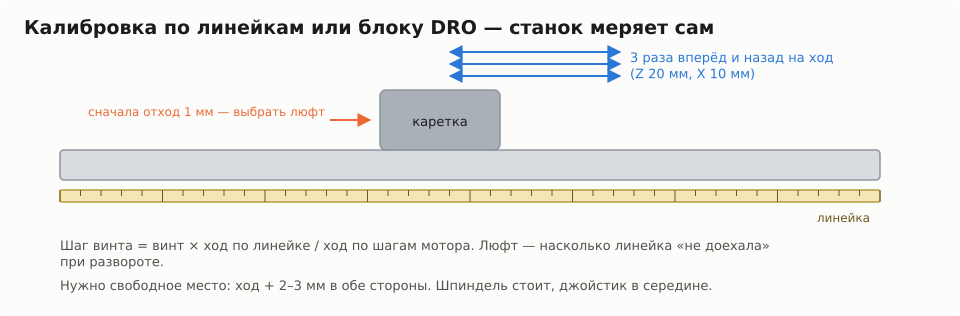

Общее для всех способов: **шпиндель стоит**, джойстик в середине (иначе «ОСТАНОВИТЕ ШПИНДЕЛЬ И ДВИЖЕНИЕ»),
заготовка снята или резец отведён от неё. Калибровка прерывается **любым ходом джойстика** или кнопкой «СТОП».

#### А. По линейкам (линейки подключены напрямую)

1. **Линейки настроены.** «НАСТРОЙКИ» → «ЛИНЕЙКИ»: источник — линейки, тип и «мкм на импульс» по каждой оси
   ([раздел «Линейки»](#линейки), [docs/scales](../scales/README.md)) → «Сохранить» (STM32 перезапустится).
2. **Линейки считают правильно.** Проведите каждую ось джойстиком на 2–3 мм: экран узнаёт направление линейки.
   Проверьте грубо: каретка проехала по метке на станине 10 мм — «ПОЗИЦИЯ Z» изменилась примерно на 10.
3. **Место для хода.** Поставьте каретку так, чтобы в обе стороны было свободно больше хода калибровки на
   2–3 мм. Ось сначала отходит на 1 мм — выбирает люфт.
4. Откройте «КАЛИБРОВКА» → вкладка **«ПО ЛИНЕЙКАМ»**.

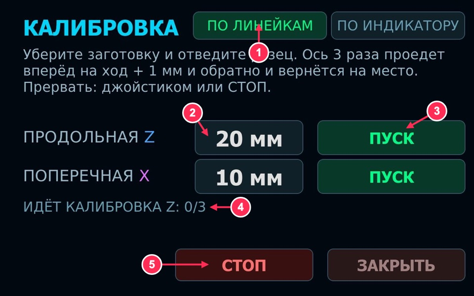

1. **Вкладка «ПО ЛИНЕЙКАМ».** 2. **Ход**, мм — тап, ввести число. По умолчанию Z — 20 мм, X — 10 мм; чем
длиннее ход, тем точнее шаг винта (Z — 50–100 мм, если позволяет станок). 3. **ПУСК** в строке оси.
4. **Ход калибровки**: «ИДЁТ КАЛИБРОВКА Z: 1/3» — ось 3 раза проезжает вперёд и назад и возвращается на место.
5. **СТОП** — прервать.

5. Через полминуты–минуту — итог:

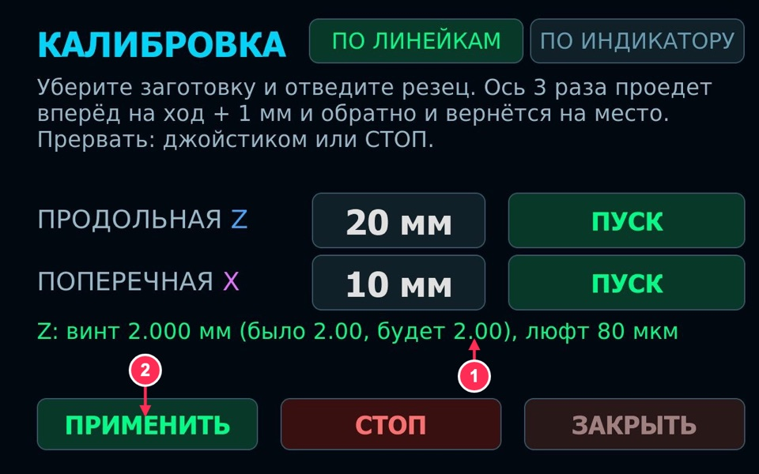

1. **Итог**: «Z: винт 2.000 мм (было 2.00, будет 2.00), люфт 80 мкм». Шаг винта станок хранит в сотых мм —
   «будет» — это округлённое значение. 2. **ПРИМЕНИТЬ** — записать шаг винта и люфт в «Механику».

6. Повторите для оси X (строка «ПОПЕРЕЧНАЯ X»).
7. **Проверка.** Запустите калибровку ещё раз: шаг винта должен совпасть («было» = «будет»), люфт — в пределах
   10–20 мкм от прошлого. Если сильно скачет — разболтаны клинья или гайка винта.

Если в итоге оранжевая строка **«ОТЛИЧАЕТСЯ БОЛЕЕ 20%: ПРОВЕРЬТЕ ЛИНЕЙКУ (ДИАМЕТР/РАДИУС)»** — «ПРИМЕНИТЬ» не
нажимайте: неверно «мкм на импульс» линейки, микрошаг или шаг винта в «Механике», либо X считается в диаметрах.

#### Б. По линейкам через блок DRO

Всё как в [А](#а-по-линейкам-линейки-подключены-напрямую), отличия:

1. «НАСТРОЙКИ» → «ЛИНЕЙКИ»: источник — **блок DRO**.
2. **На самом блоке DRO:** миллиметры (не дюймы), ось X — **в радиусе**, не в диаметре. Если X в диаметре,
   блок показывает вдвое больше, чем проехал суппорт, — будет «ЛИНЕЙКА X НЕ СОВПАДАЕТ С МЕХАНИКОЙ» или «ОТЛИЧАЕТСЯ
   БОЛЕЕ 20%». Продольная ось на блоке подписана **Y** — это Z.
3. Компенсацию люфта и коррекцию линейки на самом блоке выключите: их делает станок.
4. Дальше — шаги 2–7 из [А](#а-по-линейкам-линейки-подключены-напрямую).

#### В. Без линеек: по индикатору

Нужен **индикатор часового типа** (цена деления 0.01 мм) на магнитной стойке. Ход индикатора ограничивает ход
калибровки: у обычного индикатора 10 мм — ставьте ход 8 мм. Вместо индикатора можно штангенциркулем
(глубиномером между кареткой и упором) — тогда ход 50–100 мм, точность ниже.

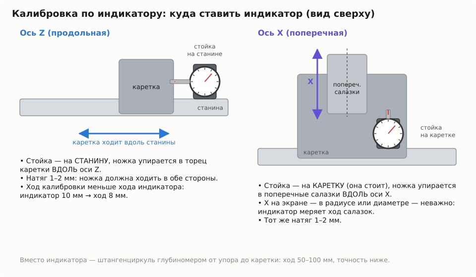

1. **Индикатор.** Стойка — на станину (для X — на каретку), ножка индикатора упирается в каретку (для X — в
   поперечные салазки) **вдоль оси**. Дайте натяг: ножка утоплена на 1–2 мм, чтобы хватило хода в обе стороны.
2. Откройте «КАЛИБРОВКА». Без линеек и блока DRO сразу открыта вкладка **«ПО ИНДИКАТОРУ»**.
3. **Ход** — тап по «20 мм», введите ход меньше хода индикатора (8 мм).
4. **ПУСК** в строке оси. Ось отойдёт на 1 мм и вернётся — выберет люфт.

Весь ход калибровки по индикатору — коротко на одной картинке, подробно — ниже по шагам:

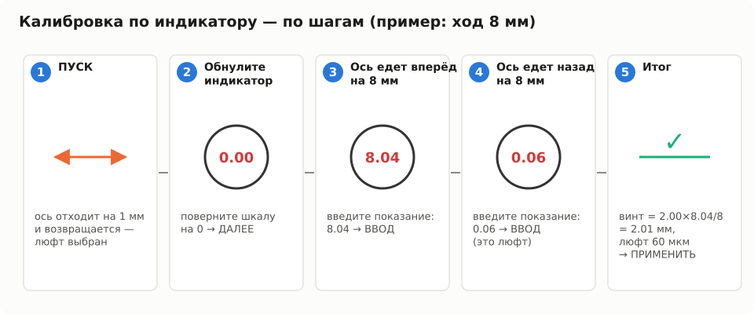

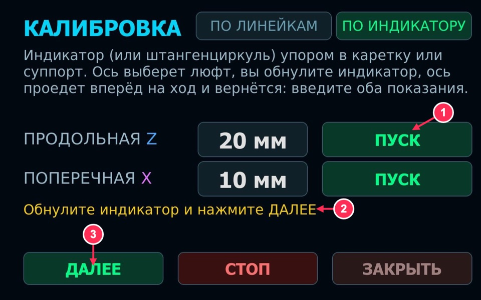

1. **ПУСК** в строке оси. 2. **Подсказка**: «Обнулите индикатор и нажмите ДАЛЕЕ». 3. **ДАЛЕЕ**.

5. **Обнулите индикатор** (поверните шкалу на 0) и нажмите «ДАЛЕЕ». Ось проедет вперёд ровно на ход — по шагам
   мотора.
6. **Введите показание индикатора**, например 8.04:

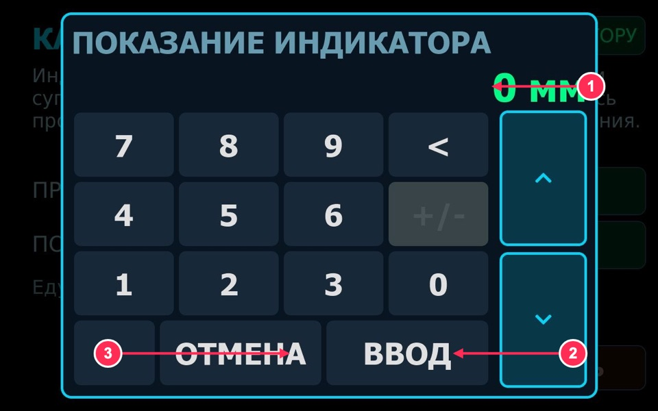

1. **Показание** — набирается кнопками. 2. **ВВОД**. 3. **ОТМЕНА** — прервать без расчёта.

7. Ось вернётся назад на тот же ход. Окно «ПОКАЗАНИЕ ПОСЛЕ ВОЗВРАТА» — введите, что показывает индикатор
   **сейчас**, например 0.06: столько каретка не дошла до нуля — это люфт. Знак не важен.
8. Итог — как в способе А: «Z: винт 2.010 мм (было 2.00, будет 2.01), люфт 60 мкм» → **ПРИМЕНИТЬ**.
   Как считается: винт × показание / ход = 2.00 × 8.04 / 8 = 2.01 мм.
9. Повторите для X и ещё раз для проверки — числа должны совпасть.

**Если нет и индикатора** — оставьте шаг винта из паспорта станка и люфт 0. Станок будет работать, но размер
может уходить на величину люфта (обычно 0.03–0.2 мм) при смене направления подачи.

### Wi-Fi

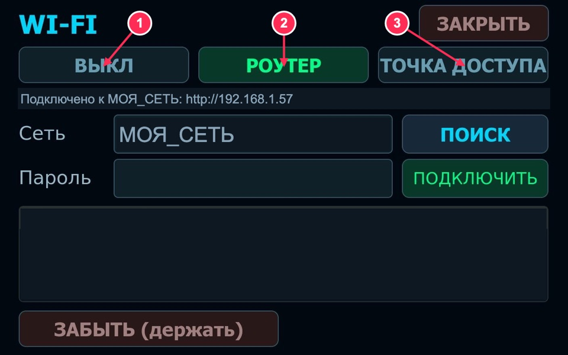

Режим Wi-Fi — одна из трёх кнопок вверху, выбор запоминается и после выключения:

1. **ВЫКЛ** — Wi-Fi выключен (так после первой прошивки). Станок работает как обычно, нет только веб-страницы и
   G-кода по сети.
2. **РОУТЕР** — подключаться к сети роутера. Сеть — выберите из списка («ПОИСК») или впишите, пароль,
   «ПОДКЛЮЧИТЬ» (режим сам переключится на РОУТЕР). После перезагрузки дисплей подключается сам. Роутер не
   отвечает — дисплей повторяет подключение и **свою точку доступа не включает**.
3. **ТОЧКА ДОСТУПА** — дисплей сам создаёт сеть (имя, пароль и адрес — в строке под кнопками), к ней подключаются
   телефоном или компьютером без роутера.

При ВЫКЛ сети не ищутся и список пуст — сначала выберите РОУТЕР. «ЗАБЫТЬ (держать)» — держать 2 секунды:
стереть сеть роутера.

### Линейки

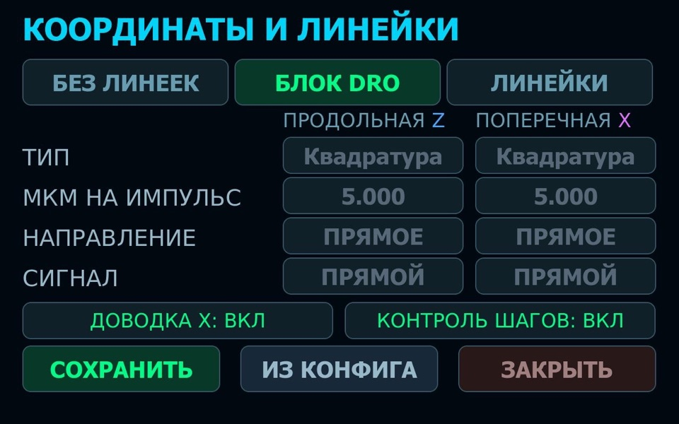

Откуда координаты: **без линеек** (по шагам моторов), **блок DRO** (HS800), **линейки напрямую** (к STM32).

- **Тип, мкм на импульс, направление, сигнал** — только для «ЛИНЕЙКИ» (линейки подключены прямо к шилду). При «БЕЗ
  ЛИНЕЕК» и «БЛОК DRO» эти поля серые и не меняются — тап по ним пишет «ТОЛЬКО ДЛЯ ЛИНЕЕК»: блок DRO сам знает свои
  линейки.
- **Доводка X** — довести врезание по линейке; **контроль шагов** — остановка, если мотор пропустил шаги. Работают с
  блоком DRO и с линейками; при «БЕЗ ЛИНЕЕК» — серые («НУЖНЫ DRO ИЛИ ЛИНЕЙКИ»).
- **СОХРАНИТЬ** — STM32 записывает выбор и **перезапускается сам**: окно «СОХРАНЕНО» так и пишет, ничего нажимать и
  выключать не нужно, через 2–3 секунды координаты снова на экране. «ИЗ КОНФИГА» — держать 2 секунды.

Подробно о линейках — [docs/scales](../scales/README.md).

## 8. Сообщения и ошибки — что значит и что делать

Сообщение всплывает в окне; «OK» — закрыть. Кружок ⚠ в шапке оранжевый, пока сообщение не прочитано.

Окно **«НЕ СОХРАНЕНО»** на экране «МЕХАНИКА» (MIN_FEED, MAX_FEED, РЕЗЬБА …, КОНУС …) — каждое сообщение разобрано в
[Механика станка, раздел 10](mechanics.md#10-не-сохранено--каждое-сообщение-и-что-делать).

| Сообщение | Что значит | Что делать |
|---|---|---|
| 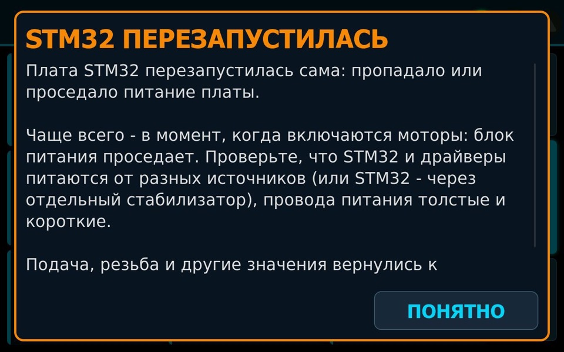 **STM32 ПЕРЕЗАПУСТИЛАСЬ** | Плата STM32 перезапустилась сама, пока дисплей работал: проседало питание (чаще всего — когда включаются моторы) или зависла программа (сторожевой таймер). Все режимы вернулись к значениям после включения (подача M1 — 0.13), упоры сняты | Питание STM32 — отдельно от драйверов (свой источник или стабилизатор), провода питания толстые и короткие. Если повторяется — напишите на форуме, что делали перед этим |
| 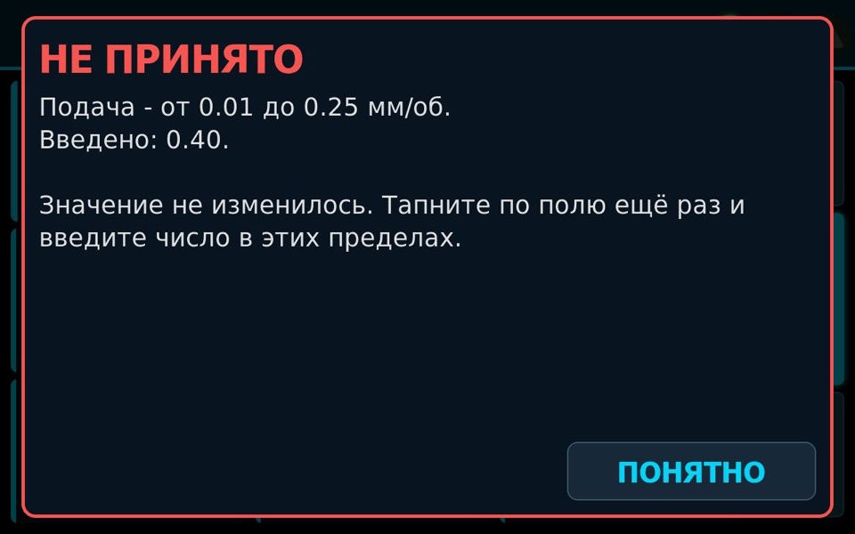 **НЕ ПРИНЯТО** | С клавиатуры введено число вне пределов (подача больше 0.25 мм/об, асинхронная больше 400 мм/мин, съём больше 99 мм) | Значение не изменилось: тап по полю и введите число в пределах, написанных в окне |
|  **ПАУЗА — для продолжения нажмите ДАЛЕЕ** | Автоцикл на паузе (нажали ▼ / ПАУЗА; во внутреннем конусе — сам на последнем проходе, резец отведён на 30 мм) | Уберите стружку, промерьте; **ДАЛЕЕ** в окне или ▲ — цикл продолжится. Джойстик не отпускайте ([пауза](#пауза-автоцикла)) |
| 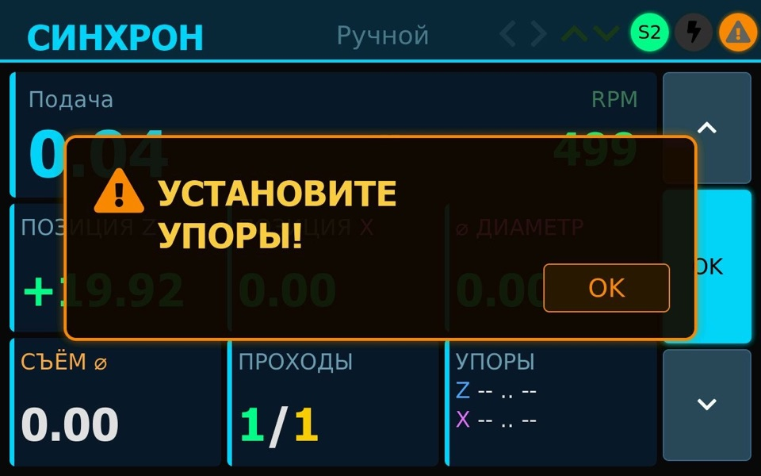 **УСТАНОВИТЕ УПОРЫ!** | Переключили в «Внутренний»/«Наружный», а двух упоров по одной оси нет (конусам M4/M5 упоры не нужны) | В «Ручном» поставьте два упора ([раздел 5](#5-упоры-и-автоцикл--главное-что-нужно-понять)) |
| 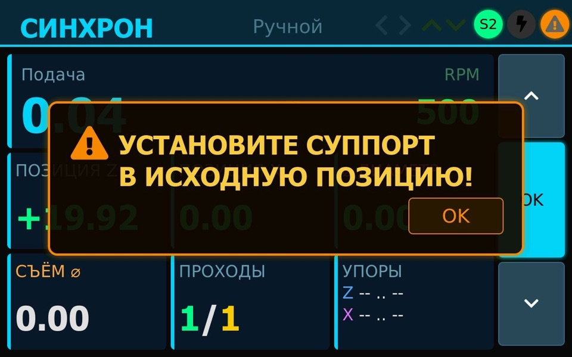 **УСТАНОВИТЕ СУППОРТ В ИСХОДНУЮ ПОЗИЦИЮ!** | Автоцикл начинается только с упора | Переключатель в «Ручной», джойстиком к упору начала, снова «Наружный» |
|  **ОПЕРАЦИЯ ЗАВЕРШЕНА!** | Автоцикл сделал все проходы | Отпустите джойстик, переключатель — в «Ручной» |
| 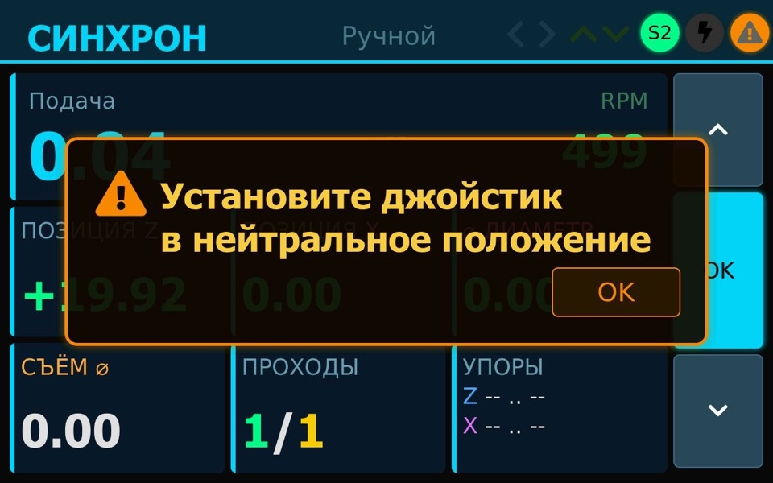 **Установите джойстик в нейтральное положение** | При включении или смене режима джойстик был отклонён | Отпустите джойстик в середину |
| **Режим невозможен!** | Подрежим «Внутренний» в режиме «Шар» или в «Конус >» (M5; внутреннего конуса, расширяющегося вглубь, у автора нет) | Переключатель — в «Ручной» или «Наружный»; внутренний конус, широкий к торцу, — M4 «Конус <» |
| 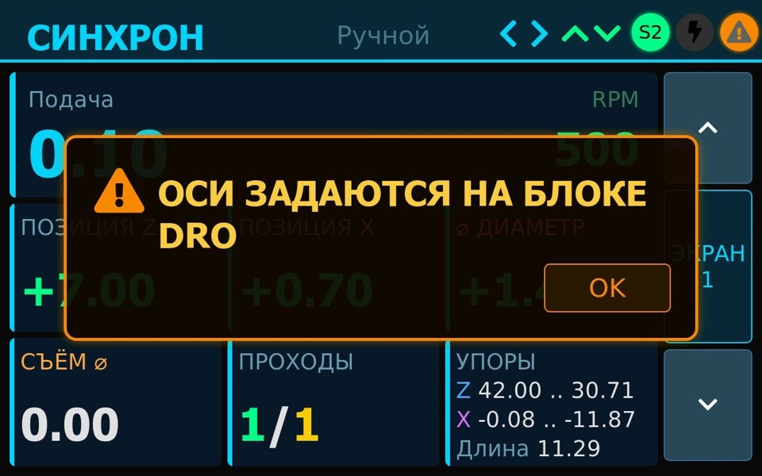 **ОСИ ЗАДАЮТСЯ НА БЛОКЕ DRO** | Координаты дают блок DRO — экран их только показывает | Ноль и ввод — кнопками блока DRO |
| 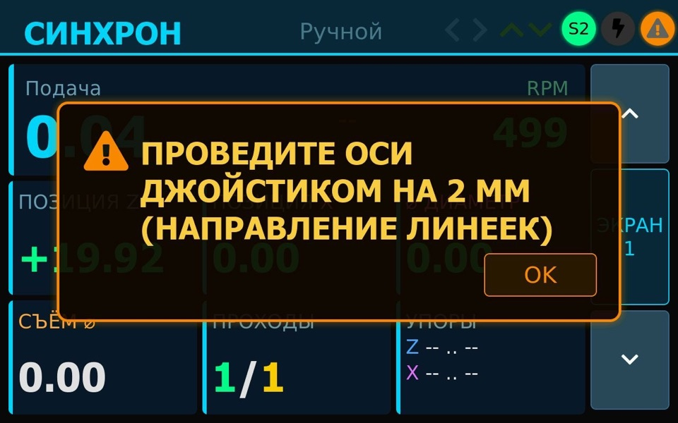 **НАПРАВЛЕНИЕ ЛИНЕЕК ЕЩЁ НЕ ИЗВЕСТНО: ПРОВЕДИТЕ ДЖОЙСТИКОМ КАЖДУЮ ОСЬ НА 3 ММ И ОТПУСТИТЕ** (G-код; в прошлых версиях — «ПРОВЕДИТЕ ОСИ ДЖОЙСТИКОМ НА 2 ММ») | После каждого включения станок один раз узнаёт, в какую сторону считают линейки или блок DRO, — по первому ходу оси больше 2 мм. Программа проверяет это до первого движения | Проведите каждую ось джойстиком на 3 мм в любую сторону и отпустите, потом снова «Старт» |
| 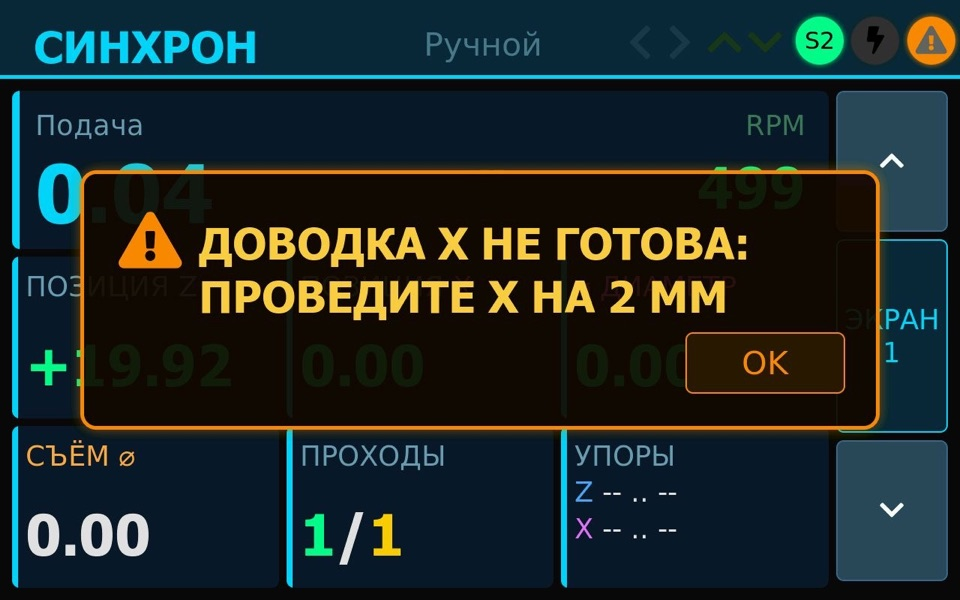 **ДОВОДКА X НЕ ГОТОВА: ПРОВЕДИТЕ X НА 2 ММ** | То же для доводки врезания по линейке X | Проведите X джойстиком на 2–3 мм |
| 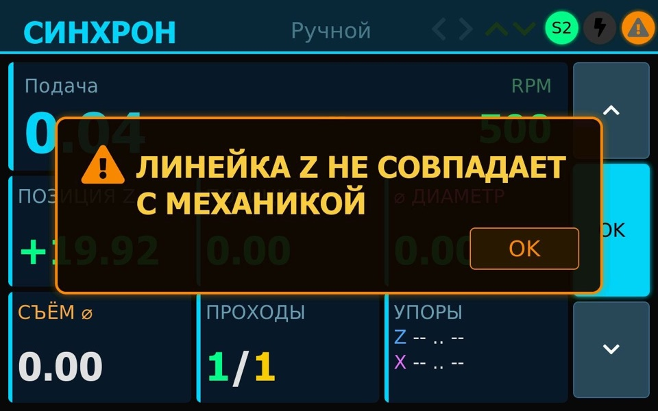 **ЛИНЕЙКА Z (X) НЕ СОВПАДАЕТ С МЕХАНИКОЙ** | Мотор проехал одно, линейка показала другое (в 2 раза, в другую сторону) | Проверьте «мкм на импульс» и направление линейки, шаг винта и микрошаг; калибровка |
|  **ПРОПУСК ШАГОВ** | Линейка показала меньше, чем должен был проехать мотор: мотор пропустил шаги, автоцикл остановлен | Меньше подача/съём, проверьте ток драйвера, затяжку муфты, клин; отпустите джойстик |
|  **НЕТ СВЯЗИ С ЛИНЕЙКОЙ Z (X)** | От линейки не приходят данные | Проверьте разъём, питание линейки, тип в настройках |
|  **ДИСПЛЕЙ НЕ СОВПАДАЕТ С КОНФИГОМ STM32** | Прошивка STM32 собрана под другой дисплей | Прошейте STM32 и дисплей из одного выпуска |
| **РАСХОЖДЕНИЕ ЛИНЕЙКИ** | При доводке X по линейке разница с заданной глубиной слишком велика — автоцикл остановлен | Как при пропуске шагов; проверьте линейку X и люфт |

**Калибровка** (красная строка на экране калибровки):

| Сообщение | Что делать |
|---|---|
| ОСТАНОВИТЕ ШПИНДЕЛЬ И ДВИЖЕНИЕ | Выключите шпиндель, отпустите джойстик |
| НУЖНЫ ЛИНЕЙКИ ИЛИ БЛОК DRO / НА ЭТОЙ ОСИ НЕТ ЛИНЕЙКИ | Калибровка «по линейкам» — только с линейками; иначе вкладка «По индикатору» |
| ЛИНЕЙКА НЕ ДВИЖЕТСЯ | Ось ехала, а линейка не изменилась — проверьте линейку и её крепление |
| СЛИШКОМ КОРОТКИЙ ХОД | Увеличьте ход (от 5 мм) |
| ПРЕРВАНО | Калибровку остановили джойстиком или «СТОП» — запустите снова |

**Настройки механики и линеек** (при «Сохранить» значение вне допустимого — не сохраняется):

| Сообщение | Допустимо |
|---|---|
| ЭНКОДЕР: 100-10000 ЛИНИЙ | 100…10000 |
| ШАГ ВИНТА: 0.25-10 ММ | 0.25…10 мм |
| ШАГОВ НА ОБОРОТ: 50-1000 | 50…1000 |
| МИКРОШАГ: 1, 2, 4 ... 128 | степень двойки до 128 |
| ЛЮФТ: 0-2000 МКМ | 0…2000 мкм |
| РАЗРЕШЕНИЕ ЛИНЕЙКИ: 10-100000 НМ | 10 нм…100 мкм на импульс |
| ДОПУСК ПРОПУСКА ШАГОВ: 20-2000 МКМ | 20…2000 мкм |
| MAX_FEED / MIN_FEED / MAX_aFEED / MIN_aFEED: ДЕЛИТЕЛЬ … | Подача вне возможностей таймера при такой механике — уменьшите микрошаг или пределы подачи в `els_config.h` |

**G-код** — ошибки показываются на экране станка и на веб-странице, с номером строки:

| Сообщение | Что делать |
|---|---|
| ВКЛЮЧИТЕ РЕЖИМ M8 (G-КОД) | Переключатель режимов — в M8 |
| ОТПУСТИТЕ ДЖОЙСТИК | Джойстик в середину |
| ВКЛЮЧИТЕ ШПИНДЕЛЬ (G99 - ПОДАЧА НА ОБОРОТ) | Программа с подачей на оборот — включите шпиндель |
| ЗА УПОРОМ | Программа выводит суппорт за поставленный упор — снимите упор или проверьте ноль |
| ОСТАНОВЛЕНО | Остановили «Стоп» на странице или джойстиком |
| G… НЕ ПОДДЕРЖИВАЕТСЯ, G50 X/Z …, ДУГА … , F <= 0 | Команда, которую станок не выполняет, или ошибка в программе — см. [GCODE.md](../GCODE.md) |
| G71/G70: … | Ошибка в контуре цикла (нет кадра N, контур не от торца к патрону, нет подачи) — текст подскажет |

## 9. Частые вопросы

**Двигатель гудит, но не крутится / пропускает шаги.** Слишком большая подача или обороты для резьбы (смотрите
«наибольшие обороты»), мал ток драйвера, туго идёт суппорт. Уменьшите подачу, проверьте клинья и смазку.

**Ось едет не в ту сторону.** В «НАСТРОЙКИ» → «ЛИНЕЙКИ» — направление; для мотора — поменяйте местами провода
одной обмотки или DIR в настройках драйвера.

**Размер уходит на десятки микрон.** Люфт или неточный шаг винта — сделайте [калибровку](#калибровка).

**Резьба не попадает в нитку при повторном проходе.** Не трогайте маховичок суппорта между проходами; энкодер
шпинделя должен быть закреплён без проскальзывания.

**Веб-страница не открывается.** Компьютер и станок в одной сети; адрес — на экране «НАСТРОЙКИ». Без роутера —
подключитесь к точке доступа дисплея.

**На экране янтарное «галетник: РЕЗЬБА» — это ошибка?** Нет. Режим выбран с экрана, а переключатель стоит на
другом положении. Работает выбранный режим; повернёте переключатель — станет его режим. Подробно — в [разделе 3](#3-экран).

**Повернул переключатель подрежима на «Наружный», а режим остался «Ручной».** Для автоцикла нужны два упора по одной оси
и суппорт на упоре. Иначе станок пишет «УСТАНОВИТЕ УПОРЫ!» или «УСТАНОВИТЕ СУППОРТ В ИСХОДНУЮ ПОЗИЦИЮ!» и остаётся
в «Ручном», а на экране горит «галетник: Наружная». Поставьте упоры и суппорт, верните переключатель в «Ручной» и
снова в «Наружный» (или выберите S3 на экране).

**Экранный джойстик и механический — одно и то же?** Да. Экранный — «⚡» в шапке:

Позиции Z (слева) и X (справа) видны прямо на нём — тап по позиции вводит значение, удержание 2 секунды
обнуляет, как на главном экране. Синие стрелки ◀ ▶ двигают Z, фиолетовые ▲ ▼ — X. Ось едет, **пока держите
стрелку**, отпустили — встала (так же работает и автоцикл: держите стрелку в сторону реза). «БЫСТРО» —
переключатель: тап — «ВКЛ» (кнопка ярче), стрелки едут ускоренным ходом; ещё тап — «выкл». Держать его вместе со
стрелкой не нужно (и нельзя: экран понимает одно касание). При закрытии джойстика БЫСТРО выключается. Сам джойстик не закрывается — только ✕ или «⚡». «СТОП» — остановить. Справа — текущая подача. Закрыть — ✕ или снова «⚡».

**Что делать, если что-то пошло не так в автоцикле?** Отпустите джойстик — движение остановится. Переключатель
подрежимов в «Ручной» — автоцикл отменится.

**Как работает плитка «⌀ ДИАМЕТР» и на что она влияет?** Это диаметр детали в том месте, где сейчас вершина резца.
Задаётся один раз: коснитесь резцом детали (или проточите поясок и смерьте штангенциркулем), тап по «⌀ ДИАМЕТР» и
введите размер. Дальше станок считает сам: суппорт ушёл к оси на 0.5 мм — диаметр уменьшился на 1.0 мм. Отличие от
«ПОЗИЦИЯ X»: позицию X можно обнулять где удобно (например, отсчитать глубину канавки), а диаметр всегда считается
от оси шпинделя. На подачу, обороты и автоциклы плитка не влияет: подача задаётся на оборот шпинделя, съём — за
проход; диаметр нужен вам, чтобы видеть размер детали, и G-коду — X в программе это именно диаметр. Удержанием
диаметр не обнуляется: ноль диаметра — это резец на оси шпинделя, такое почти никогда не нужно; вводите размер.

**Двойной тап по ⌀ открыл клавиатуру, а не следующий подэкран.** Между тапами больше 0.45 секунды — тапните
чуть быстрее. Одиночный тап по ⌀ открывает клавиатуру через 0.45 секунды: экран ждёт, не будет ли второго.
