# Механика станка: что вводить и как узнать это у своего станка

Экран **«МЕХАНИКА СТАНКА»** говорит контроллеру, как устроен ваш станок: какой шаг у винтов, какие моторы и
драйверы, сколько линий у энкодера шпинделя. От этих чисел зависит всё: подача, шаг резьбы, конус, размеры на
экране. Ошибка в одном числе — и резьба выйдет не того шага, а деталь не того размера.

Здесь — по шагам и с картинками: что значит каждое поле, где это число взять на своём станке, как его ввести, что
делать, если экран пишет «НЕ СОХРАНЕНО», и как проверить, что всё правильно.

**Пересобирать прошивку не нужно.** Всё вводится на экране и хранится в памяти платы STM32: переживает
выключение, перезагрузку и прошивку новой версии. Сбросить к заводским — кнопка «ИЗ КОНФИГА» (держать 2 секунды).

**Содержание**

1. [Что означает каждое поле](#1-что-означает-каждое-поле)
2. [Как ввести и сохранить](#2-как-ввести-и-сохранить)
3. [Шаг винта](#3-шаг-винта)
4. [Шагов на оборот](#4-шагов-на-оборот)
5. [Микрошаг](#5-микрошаг)
6. [Энкодер](#6-энкодер)
7. [Люфт](#7-люфт)
8. [Подойдут ли числа: «шагов на мм»](#8-подойдут-ли-числа-шагов-на-мм)
9. [Готовые примеры — проверены на стенде](#9-готовые-примеры--проверены-на-стенде)
10. [«НЕ СОХРАНЕНО» — каждое сообщение и что делать](#10-не-сохранено--каждое-сообщение-и-что-делать)
11. [Проверка после настройки](#11-проверка-после-настройки)
12. [Частые вопросы](#12-частые-вопросы)

---

## 1. Что означает каждое поле

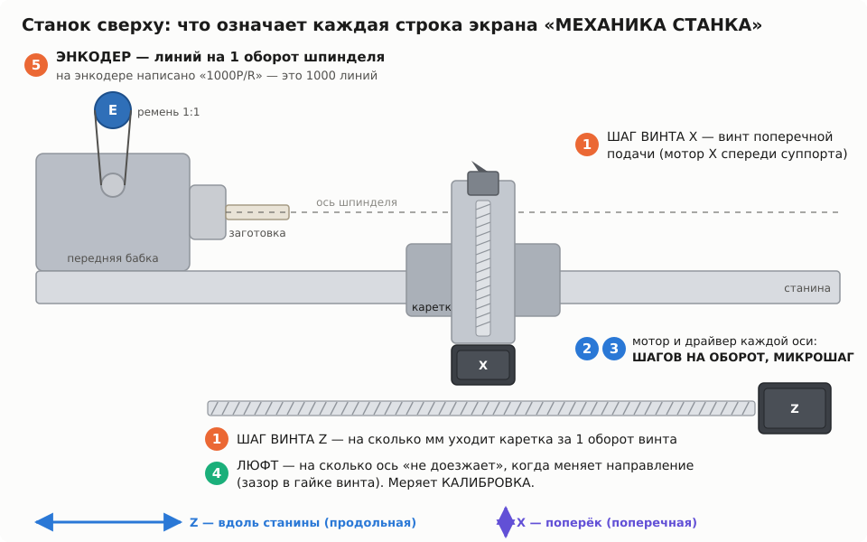

Открыть: тап по **⚠** в шапке экрана → **«НАСТРОЙКИ»** → **«МЕХАНИКА»**.

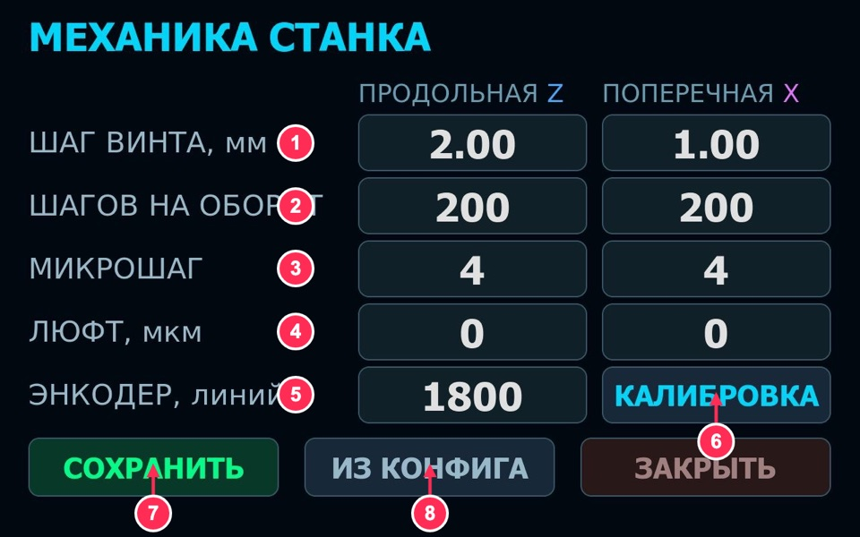

| № | Поле | Что это | Можно ввести | По умолчанию |
|---|---|---|---|---|
| 1 | **ШАГ ВИНТА, мм** | На сколько миллиметров уходит каретка (Z) или суппорт (X) за **один оборот ходового винта** | 0.25 – 10.00 мм, два знака после точки | Z 2.00, X 1.00 |
| 2 | **ШАГОВ НА ОБОРОТ** | Сколько шагов делает мотор на **один оборот винта** — без микрошага, но с учётом ремня или шестерён | 50 – 1000 | 200 |
| 3 | **МИКРОШАГ** | Как выставлено **переключателями на драйвере** мотора | 1, 2, 4, 8, 16, 32, 64, 128 | 4 |
| 4 | **ЛЮФТ, мкм** | Зазор в гайке винта: на сколько ось «не доезжает» при смене направления. 0 — не компенсировать | 0 – 2000 мкм | 0 |
| 5 | **ЭНКОДЕР, линий** | Сколько линий даёт энкодер за **один оборот шпинделя** | 100 – 10000 | 1800 |

Поля 1–4 — отдельно для продольной оси **Z** (вдоль станины) и поперечной **X**. Энкодер один — на шпинделе.

Кроме пределов каждого поля, числа должны **подходить друг к другу** — об этом [раздел 8](#8-подойдут-ли-числа-шагов-на-мм).

## 2. Как ввести и сохранить

1. **Шпиндель стоит, джойстик в середине.** Иначе станок не сохранит: «ОСТАНОВИТЕ ШПИНДЕЛЬ И ДВИЖЕНИЕ».
2. Тап по полю — откроется клавиатура. Наберите число и нажмите **ВВОД**. «ОТМЕНА» — закрыть без изменений.

   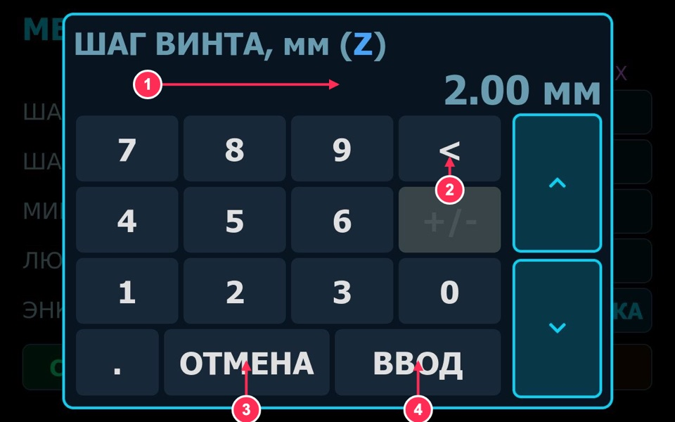

3. Изменённое поле стало **жёлтым**, вверху — «НЕ СОХРАНЕНО». Так можно поменять несколько полей.

   

4. **СОХРАНИТЬ.** Станок проверит числа и запишет их в память — вверху «СОХРАНЕНО», поле снова белое.
   Перезапуска нет: новая механика работает сразу.

   

5. Если числа не подходят — откроется окно **«НЕ СОХРАНЕНО»** с объяснением, что не получится и что поменять
   ([раздел 10](#10-не-сохранено--каждое-сообщение-и-что-делать)). Станок продолжает работать со старой механикой.

**ЗАКРЫТЬ** без «СОХРАНИТЬ» — правки пропадут. **ИЗ КОНФИГА** — вернуть заводские значения: держите кнопку
**2 секунды** (вверху «ДЕРЖИТЕ 2 СЕК»), короткое нажатие ничего не сбрасывает.

## 3. Шаг винта

Шаг винта — **на сколько сдвигается каретка за один оборот винта**. Чаще всего он есть в паспорте станка: у
настольных токарных Z обычно 1.5–3 мм, X — 1–2 мм. Нет паспорта — узнайте сами одним из двух способов:

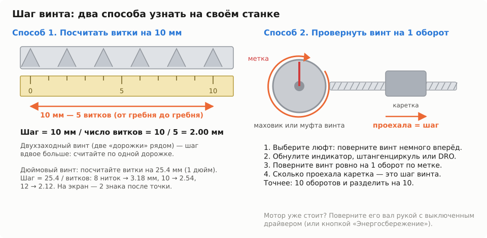

- **Посчитать витки.** Приложите линейку к винту и посчитайте витки на 10 мм: 5 витков — шаг 2 мм, 4 — 2.5 мм,
  8 — 1.25 мм. У двухзаходного винта (две «дорожки» рядом) считайте по одной дорожке.
- **Провернуть на один оборот.** Самый надёжный способ — он учитывает всё, что стоит между винтом и кареткой.
  Выберите люфт (поверните винт немного вперёд), обнулите индикатор, штангенциркуль или DRO, поверните винт ровно на
  один оборот по метке — сколько проехала каретка, это и есть шаг. Точнее — 10 оборотов и разделить на 10.
- **Дюймовый винт** (станки из США, старые): шаг = 25.4 / ниток на дюйм. 8 ниток → 3.18 мм, 10 → 2.54,
  12 → 2.12. На экран вводится два знака после точки.

Небольшую неточность (2.00 против 2.01) потом уберёт [калибровка](README.md#калибровка) — она уточняет шаг винта
по индикатору или линейкам.

## 4. Шагов на оборот

Это шаги мотора на **один оборот винта**, без микрошага. Посмотрите на шильдик мотора:

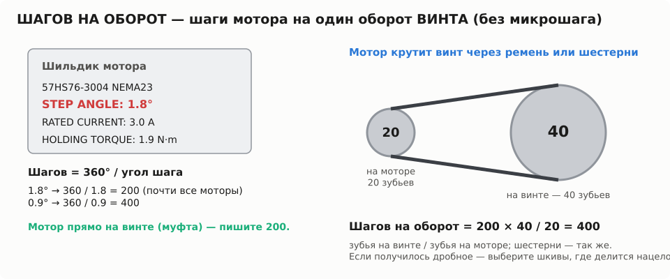

- **STEP ANGLE 1.8°** → 360 / 1.8 = **200** (почти все шаговые моторы, NEMA17/23/34).
- **0.9°** → **400**.
- **Мотор крутит винт через ремень или шестерни** — умножьте: шагов = 200 × (зубьев на винте / зубьев на моторе).
  Шкив 20 зубьев на моторе, 40 на винте → 200 × 40 / 20 = **400**. Шкивы одинаковые — 200.
- **Мотор напрямую через муфту** — **200**.

Число должно получиться целым. Если вышло дробное (например, 200 × 36 / 20 = 360 — целое, а 200 × 25 / 15 = 333.3 —
нет), подберите другую пару шкивов, иначе резьба будет с ошибкой.

## 5. Микрошаг

Драйвер дробит каждый шаг мотора на несколько — это и есть микрошаг. Он выставляется **переключателями на
драйвере**, а таблица обычно напечатана на корпусе:

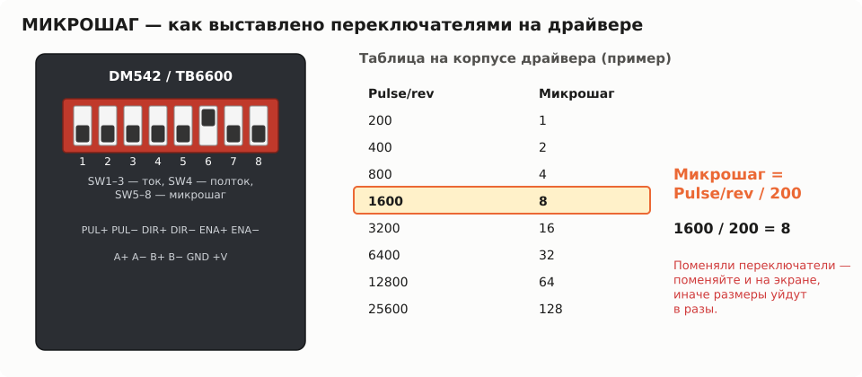

- В таблице есть столбец **«Microstep»** — пишите это число.
- Есть только **«Pulse/rev»** (импульсов на оборот) — разделите на 200: 1600 / 200 = **8**, 800 / 200 = **4**.
- **Поменяли переключатели — поменяйте и на экране.** Иначе ось будет ехать в 2, 4, 8 раз больше или меньше, чем
  показывает экран.

У Z и X микрошаг может быть разный — это нормально. Какой выбрать, если можно менять: [раздел 8](#8-подойдут-ли-числа-шагов-на-мм).

## 6. Энкодер

Энкодер на шпинделе говорит контроллеру, как крутится шпиндель: от него считаются подача и резьба. Вводится
число **линий на один оборот шпинделя**:

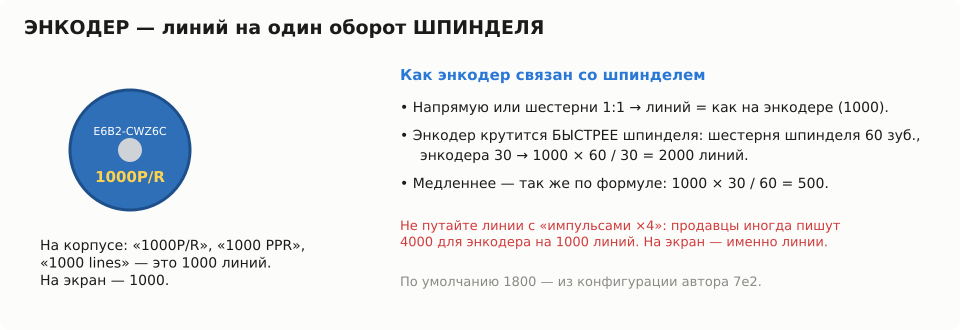

- На корпусе: **«1000P/R»**, «1000 PPR», «1000 lines» — это **1000** линий.
- Энкодер связан со шпинделем **напрямую или 1:1** — пишите, как на энкодере.
- **Через шестерни или ремень не 1:1** — умножьте на передаточное: шестерня шпинделя 60 зубьев, энкодера 30 →
  энкодер крутится вдвое быстрее → 1000 × 60 / 30 = **2000**.
- Продавцы иногда пишут «4000» для энкодера на 1000 линий (считают все фронты двух каналов). На экран — **линии**.
- По умолчанию **1800** — значение из конфигурации автора 7e2; у вашего станка, скорее всего, другое.

## 7. Люфт

Люфт — зазор в гайке ходового винта. Когда ось меняет направление, мотор сначала «выбирает» зазор, и каретка
не двигается. Станок может это компенсировать: доделывает шаги при развороте.

- **Не знаете — оставьте 0.** Станок работает, просто размер может уйти на величину люфта (обычно 0.03–0.2 мм)
  при смене направления подачи.
- **Измерить** — [калибровкой](README.md#калибровка): по линейкам или по индикатору. Она сама запишет люфт в это поле.
- Подтяните гайку винта, если люфт больше 0.2 мм, — компенсация не заменяет ремонт.

## 8. Подойдут ли числа: «шагов на мм»

Даже если каждое поле в своих пределах, станок может ответить «НЕ СОХРАНЕНО». Причина — числа не подходят друг
к другу. Контроллер (ядро 7e2) делает шаги мотора, деля импульсы энкодера на целые числа, и у этих делителей есть
пределы. Чтобы не разбираться в делителях, всё сводится к одному числу у каждой оси — **шагов на мм**:

> **Шагов на мм = шагов на оборот × микрошаг / шаг винта**
>
> По умолчанию: Z = 200 × 4 / 2.00 = **400**, X = 200 × 4 / 1.00 = **800**.

**Правило 1 — каждая ось в полосе.** Шагов на мм у Z и у X должно быть в пределах, которые зависят от энкодера:

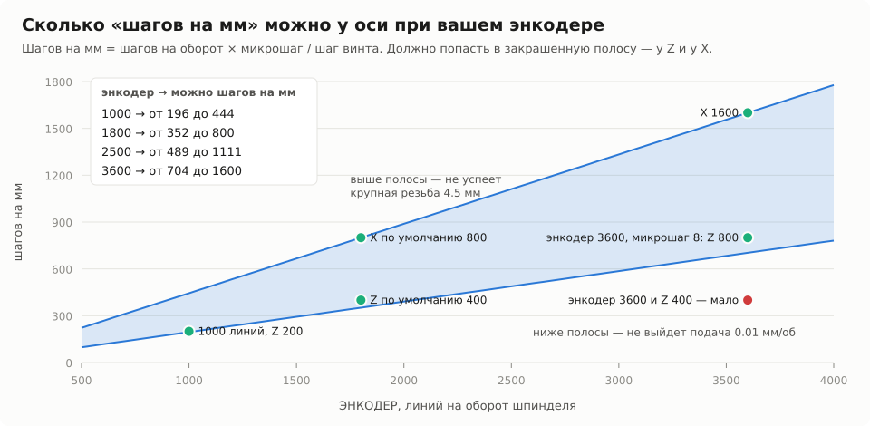

| Энкодер, линий | Шагов на мм у каждой оси |
|---|---|
| 1000 | от 196 до 444 |
| 1440 | от 282 до 640 |
| 1800 | от 352 до 800 |
| 2000 | от 391 до 888 |
| 2500 | от 489 до 1111 |
| 3000 | от 586 до 1333 |
| 3600 | от 704 до 1600 |

Для любого энкодера **E**: от E × 50 / 256 до E × 2 / 4.5. Почему такие границы:

- **меньше полосы** — на самой медленной подаче 0.01 мм/об на один шаг мотора пришлось бы больше 255 импульсов
  энкодера (сообщение `MIN_FEED`);
- **больше полосы** — на самой крупной резьбе 4.5 мм мотору пришлось бы шагать чаще, чем приходят импульсы
  энкодера (сообщение `РЕЗЬБА …: НЕ УСПЕЕТ`).

**Правило 2 — для конусов: Z / X от 0.50 до 1.27.** Разделите шагов на мм оси Z на шагов на мм оси X:

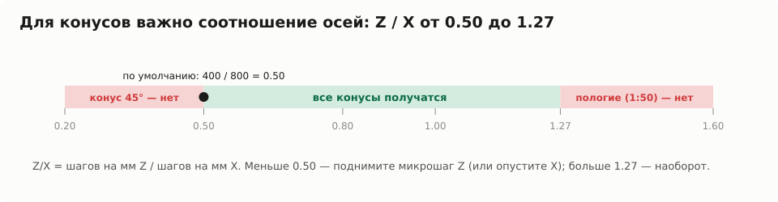

Меньше 0.50 — не получится крутой конус 45° (`КОНУС 45°: ДЕЛИТЕЛЬ < 1`); больше 1.27 — пологий 1:50.

**Как попасть в полосу.** Шаг винта и мотор не поменять, а **микрошаг — переключателями на драйвере за минуту**.
Каждое удвоение микрошага удваивает шагов на мм. Поэтому почти всегда помогает так:

- шагов на мм **мало** — поднимите микрошаг этой оси (4 → 8);
- **много** — опустите (8 → 4);
- Z / X меньше 0.50 — поднимите микрошаг Z или опустите X.

**Пример — энкодер 3600 линий** (вопрос с форума). По умолчанию Z = 400 шагов на мм, а при 3600 линиях нужно от
704 → «НЕ СОХРАНЕНО: MIN_FEED Z». Микрошаг 8 на обоих драйверах: Z = 200 × 8 / 2 = 800, X = 200 × 8 / 1 = 1600 —
оба в полосе 704–1600, Z / X = 0.50. Сохраняется и работает — проверено на стенде (набор 2 в [разделе 9](#9-готовые-примеры--проверены-на-стенде)).

Экран в окне «НЕ СОХРАНЕНО» сам считает шагов на мм сейчас и нужную полосу для вашего энкодера:

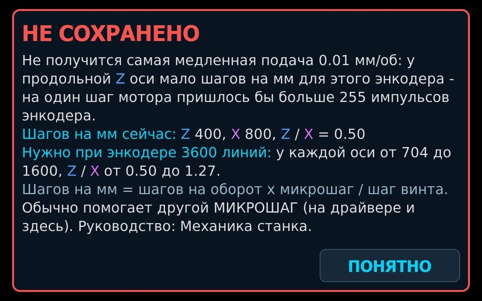

## 9. Готовые примеры — проверены на стенде

Каждый набор ниже прогнан на стенде автотестом `tools/hil_mech.py`: станок принял его, сохранил (и после
перезапуска STM32 — тоже), и оси реально проехали ровно столько шагов, сколько должны, — в синхронной подаче по
Z и X, на резьбе 1.5 мм и в асинхронной подаче. Найдите свой станок или похожий.

| № | Станок | Энкодер | Z: шагов × микрошаг / винт | X: шагов × микрошаг / винт | Шагов на мм Z / X |
|---|---|---|---|---|---|
| 1 | по умолчанию (как у автора 7e2) | 1800 | 200 × 4 / 2.00 | 200 × 4 / 1.00 | 400 / 800 |
| 2 | энкодер 3600 | 3600 | 200 × 8 / 2.00 | 200 × 8 / 1.00 | 800 / 1600 |
| 3 | винты 3 и 2 мм | 1800 | 200 × 8 / 3.00 | 200 × 8 / 2.00 | 533 / 800 |
| 4 | винт Z 2.5 мм, люфты 30 / 20 мкм | 1800 | 200 × 8 / 2.50 | 200 × 8 / 2.00 | 640 / 800 |
| 5 | энкодер 2000 | 2000 | 200 × 4 / 2.00 | 200 × 4 / 1.00 | 400 / 800 |
| 6 | энкодер 1000, X микрошаг 2 | 1000 | 200 × 4 / 2.00 | 200 × 2 / 1.00 | 400 / 400 |
| 7 | энкодер 1000, Z микрошаг 2 | 1000 | 200 × 2 / 2.00 | 200 × 4 / 2.00 | 200 / 400 |
| 8 | энкодер 1440, винт X 1.25 мм | 1440 | 200 × 4 / 2.00 | 200 × 4 / 1.25 | 400 / 640 |
| 9 | винты 1.5 и 1.25 мм | 1800 | 200 × 4 / 1.50 | 200 × 4 / 1.25 | 533 / 640 |
| 10 | винты 5 и 2.5 мм | 1800 | 200 × 16 / 5.00 | 200 × 8 / 2.50 | 640 / 640 |
| 11 | ремень 20 → 30 зубьев на Z | 1800 | 300 × 4 / 2.50 | 200 × 4 / 1.25 | 480 / 640 |
| 12 | энкодер 3000 | 3000 | 200 × 8 / 2.50 | 200 × 8 / 2.00 | 640 / 800 |
| 13 | энкодер 1200, винт X 1.5 мм | 1200 | 200 × 4 / 2.00 | 200 × 4 / 1.50 | 400 / 533 |
| 14 | энкодер 2500 | 2500 | 200 × 8 / 3.00 | 200 × 8 / 2.00 | 533 / 800 |
| 15 | дюймовые винты, 6 и 10 ниток на дюйм | 1800 | 200 × 8 / 4.23 | 200 × 8 / 2.54 | 378 / 630 |
| 16 | моторы 0.9°, винты 4 и 2 мм, люфт 50 мкм | 1800 | 400 × 4 / 4.00 | 400 × 4 / 2.00 | 400 / 800 |

Недопустимые наборы стенд тоже проверяет: станок отказывает с понятным сообщением и оставляет прежнюю механику.

## 10. «НЕ СОХРАНЕНО» — каждое сообщение и что делать

Когда числа не подходят, станок ничего не меняет и показывает окно с объяснением. Вверху экрана — «НЕ СОХРАНЕНО»
красным. Ниже — каждое сообщение полностью (на экране в окне — оно же, словами), что значит и как исправить.

| Сообщение (как его пишет STM32) | Что значит | Что сделать |
|---|---|---|
| `ЭНКОДЕР: 100-10000 ЛИНИЙ` | Число линий вне пределов | Проверьте, что ввели линии, а не «импульсы ×4» ([раздел 6](#6-энкодер)) |
| `ШАГОВ НА ОБОРОТ: 50-1000` | Вне пределов | 200 для мотора 1.8°, × передаточное ремня ([раздел 4](#4-шагов-на-оборот)) |
| `МИКРОШАГ: 1, 2, 4 ... 128` | Микрошаг не степень двойки (например, 3, 5, 10) | Как в таблице драйвера: 1, 2, 4, 8, 16… ([раздел 5](#5-микрошаг)) |
| `ШАГ ВИНТА: 0.25-10 ММ` | Вне пределов | Шаг винта в мм за оборот ([раздел 3](#3-шаг-винта)). 20.00 вместо 2.00 — частая опечатка |
| `ЛЮФТ: 0-2000 МКМ` | Люфт больше 2 мм | Введите в микрометрах: 0.05 мм = 50. Больше 0.2 мм — ремонтируйте гайку |
| `MIN_FEED Z: ДЕЛИТЕЛЬ > 255` (или `X`) | У оси мало шагов на мм для этого энкодера: не выйдет подача 0.01 мм/об | Поднимите микрошаг этой оси ([раздел 8](#8-подойдут-ли-числа-шагов-на-мм)) |
| `MAX_FEED Z: ДЕЛИТЕЛЬ <= 1` (или `X`) | Много шагов на мм: не выйдет подача 0.25 мм/об — мотор не успевает за энкодером | Опустите микрошаг этой оси |
| `MIN_aFEED Z: ДЕЛИТЕЛЬ > 65535` | Очень мало шагов на мм: асинхронная подача 10 мм/мин слишком медленная для таймера | Поднимите микрошаг |
| `MAX_aFEED Z: ДЕЛИТЕЛЬ <= 1` | Очень много шагов на мм: на 400 мм/мин больше 41 000 шагов в секунду | Опустите микрошаг |
| `РЕЗЬБА 3.00mm: X НЕ УСПЕЕТ` | Для крупной резьбы оси нужно больше шагов за оборот шпинделя, чем импульсов от энкодера | Опустите микрошаг названной оси или поставьте энкодер с бóльшим числом линий |
| `РЕЗЬБА 0.20mm: Z ДЕЛИТЕЛЬ > 255` | Для мелкой резьбы у оси слишком мало шагов на мм | Поднимите микрошаг названной оси |
| `КОНУС 45°: ДЕЛИТЕЛЬ < 1` | Z / X меньше 0.50: поперечной оси пришлось бы шагать чаще продольной | Поднимите микрошаг Z или опустите X ([правило 2](#8-подойдут-ли-числа-шагов-на-мм)) |
| `КОНУС 1:50: ДЕЛИТЕЛЬ > 255` | Z / X больше 1.27: не выйдут пологие конусы | Опустите микрошаг Z или поднимите X |
| `ОСТАНОВИТЕ ШПИНДЕЛЬ И ДВИЖЕНИЕ` | Сохранять можно только на стоящем станке | Остановите шпиндель, джойстик в середину, «СОХРАНИТЬ» ещё раз |
| `ОШИБКА ЗАПИСИ ВО ФЛЕШ` | Память STM32 не записалась | Нажмите «СОХРАНИТЬ» ещё раз; если повторяется — напишите на форуме |
| `НЕТ ДАННЫХ ОТ STM32` (вверху экрана) | Дисплей не получил настройки от STM32 | Проверьте провода дисплей — STM32 и что STM32 включена; поля показывают «--» |

Примеры окон:

| Мало шагов на мм (энкодер 3600) | Конус 45° (шагов Z = 188) |
|---|---|
|  | 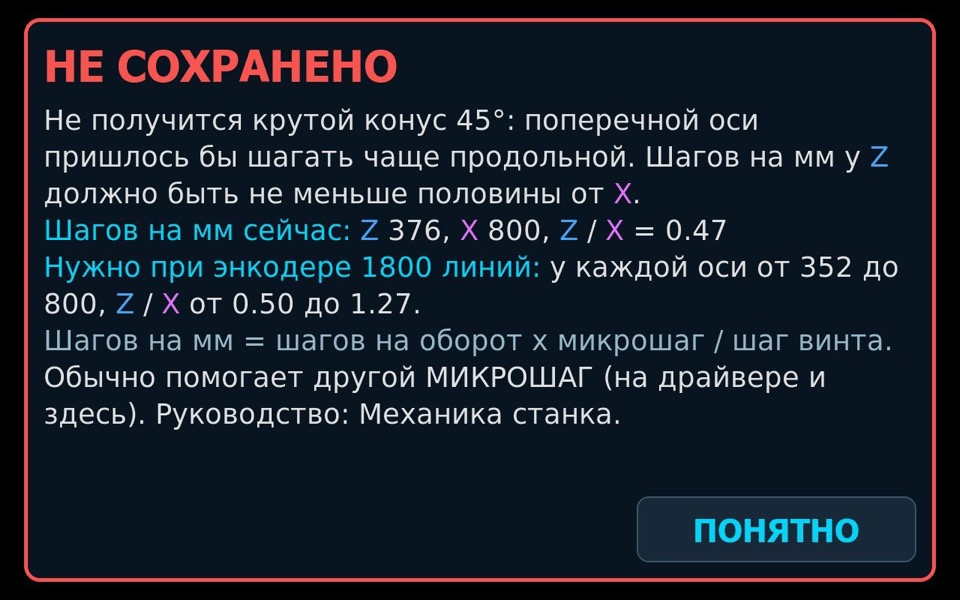 |
| **Крупная резьба (энкодер 1000)** | **Микрошаг 3** |
| 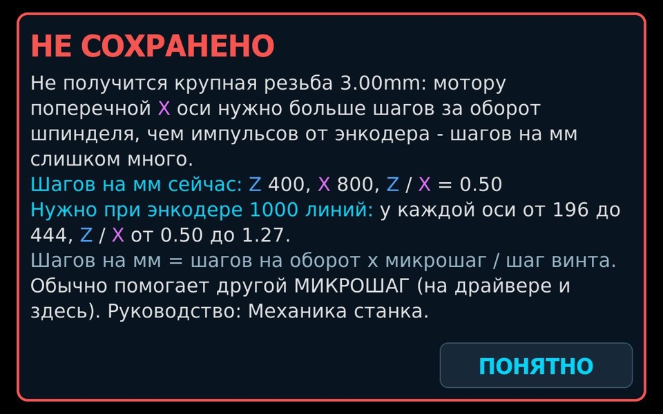 | 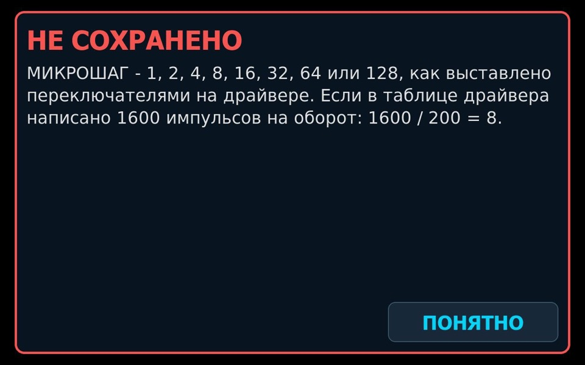 |

## 11. Проверка после настройки

1. **Ось едет на столько, сколько показывает экран.** В асинхронной подаче (M2) проведите каретку джойстиком,
   глядя на «ПОЗИЦИЯ Z», ровно на 10.00 мм и смерьте ход штангенциркулем, индикатором или по DRO. Должно быть 10.00
   ± 0.05. Вдвое, вчетверо больше или меньше — неверный микрошаг; на 10–30 % — шаг винта или шагов на оборот.
2. **То же для X.** На экране X может быть в диаметре — тогда суппорт проходит половину показанного.
3. **Резьба.** Нарежьте пробную резьбу 1.5 мм (или проведите резцом по заготовке «в воздухе» с маркером) и
   проверьте резьбомером или штангенциркулем по 10 ниткам: 15.0 мм.
4. **Уточнить** шаг винта и люфт — [калибровка](README.md#калибровка).

## 12. Частые вопросы

**Нужно ли перезагружать станок после «СОХРАНИТЬ»?** Нет, механика работает сразу. Перезапускается STM32 только
после сохранения на экране «ЛИНЕЙКИ» — и делает это сам.

**Сохранится ли настройка после перепрошивки?** Да. Пропадёт только после «Full chip erase» в STM32CubeProgrammer
или кнопки «ИЗ КОНФИГА».

**Энкодер 3600 линий и «MIN_FEED: ДЕЛИТЕЛЬ» — что это?** Для такого энкодера у оси Z (400 шагов на мм по
умолчанию) мало шагов. Поставьте микрошаг 8 на обоих драйверах и на экране — см. пример в [разделе 8](#8-подойдут-ли-числа-шагов-на-мм).

**Ставлю шагов на оборот 188 — «КОНУС 45°: ДЕЛИТЕЛЬ < 1».** Шагов Z стало 188 × 4 / 2 = 376, а X — 800:
Z / X = 0.47, меньше 0.50 — крутой конус 45° не получится. Поднимите микрошаг Z до 8 (752 шагов на мм, Z / X = 0.94).
И проверьте, откуда взялось 188 — у шаговых моторов почти всегда 200 или 400.

**Поставил шаг винта 10 мм — «MIN_FEED Z».** 200 × 4 / 10 = 80 шагов на мм — в разы меньше нужных 352. Проверьте,
что винт правда 10 мм (а не 1.0 или 2.0). Если правда — микрошаг 32 (640 шагов на мм).

**Можно ли сохранить, если конус 45° мне не нужен?** Нет: станок проверяет все резьбы и конусы из своей таблицы,
чтобы любой выбранный режим работал. Почти всегда хватает поменять микрошаг одной оси.

**Цифры в окне «Нужно … от 352 до 800» — откуда?** Это полоса из [раздела 8](#8-подойдут-ли-числа-шагов-на-мм)
для вашего энкодера; экран считает её сам.

**После смены микрошага ось едет вдвое больше/меньше.** На драйвере и на экране разный микрошаг — должны совпадать.
