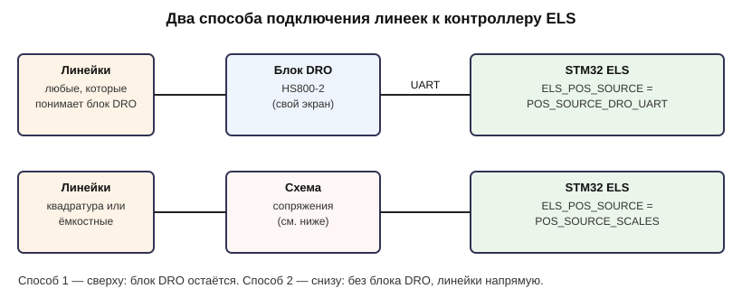
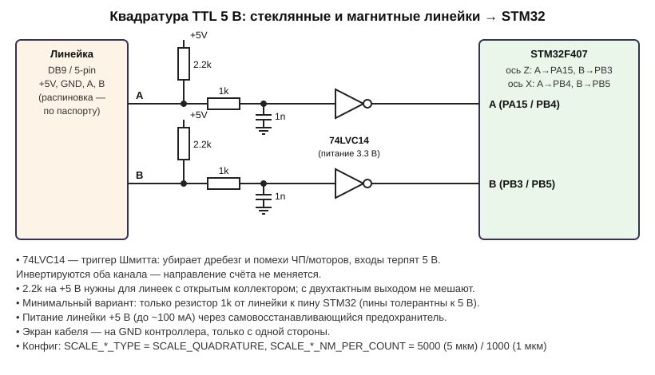
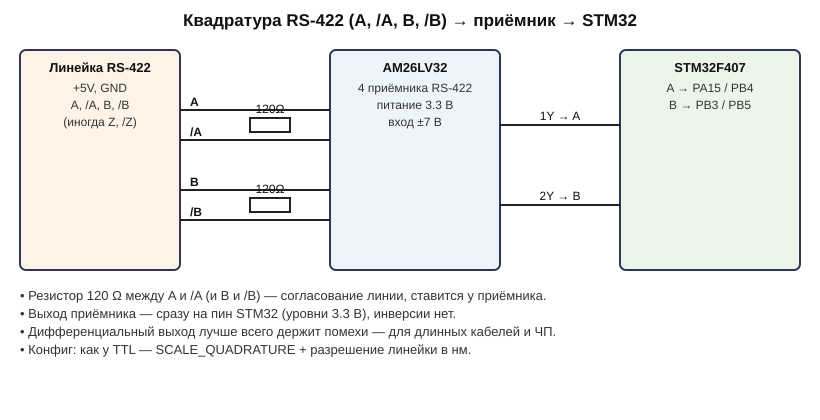
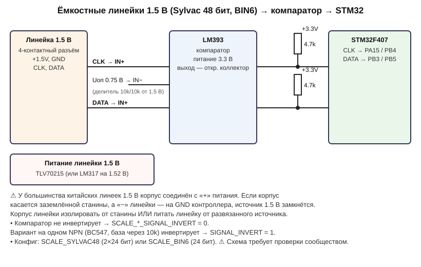
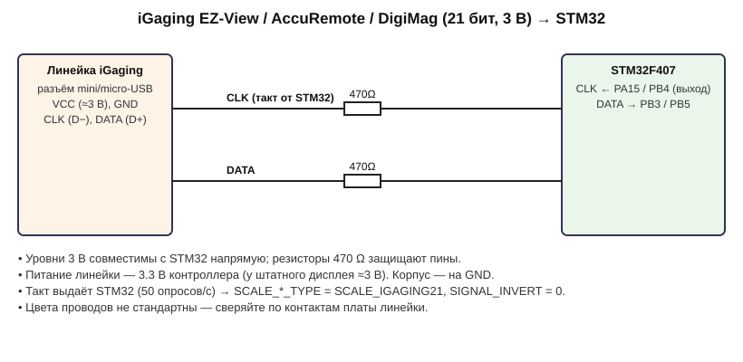
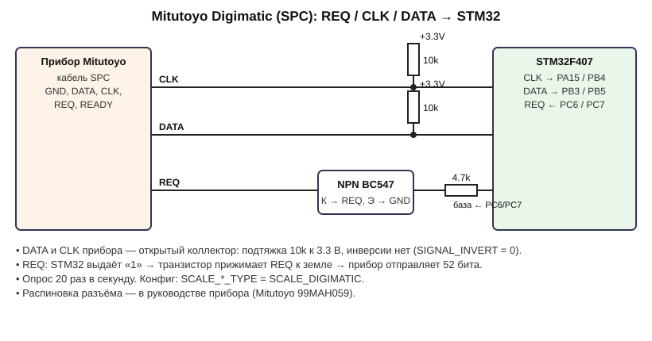

# Цифровые линейки и контроллер ELS

Контроллер получает положение каретки (ось Z) и суппорта (ось X) одним из трёх способов.
Способ выбирается в `Core/els_config.h` перед сборкой прошивки:

| `ELS_POS_SOURCE` | Как подключено | Когда выбирать |
|---|---|---|
| `POS_SOURCE_DRO_UART` | Линейки → блок DRO HS800-2 → UART → STM32 | У вас уже есть блок DRO, и он остаётся |
| `POS_SOURCE_SCALES` | Линейки → схема сопряжения → STM32 напрямую | Блока DRO нет или он не нужен |
| `POS_SOURCE_STEPS` | Линеек нет, позиция считается по шагам моторов | Станок без линеек (люфты не учитываются) |



В режиме `POS_SOURCE_SCALES` на ось можно не ставить линейку (`SCALE_NONE`). Тогда эта ось
считается по шагам мотора.

---

## Какие бывают линейки

Для контроллера важна не технология датчика, а **какой сигнал выходит из линейки**. Таких сигналов два вида:

1. **Квадратура A/B.** Это два прямоугольных сигнала, сдвинутых на 90°. Каждый фронт означает
   один шаг перемещения. Так работают **стеклянные (оптические) и магнитные** линейки, а также
   поворотные энкодеры. Сигнал «живой»: обновляется мгновенно и не зависит от частоты опроса.
2. **Последовательный протокол с тактом (CLK + DATA).** Это **ёмкостные** линейки и штангенциркули.
   Линейка несколько раз в секунду передаёт число. Форматы у разных производителей разные.

| Тип в конфиге | Что это | Выход | Питание | Разрешение | Обновление |
|---|---|---|---|---|---|
| `SCALE_QUADRATURE` | Стеклянные: Sino KA-300/500, Easson, Ditron и др. | A/B TTL 5 В или RS-422 | 5 В | 5 мкм (1 мкм у дорогих) | мгновенно |
| `SCALE_QUADRATURE` | Магнитные: лента и считывающая головка | A/B TTL 5 В или RS-422 | 5 В | 5 мкм / 1 мкм | мгновенно |
| `SCALE_SYLVAC48` | Ёмкостные китайские «стандартные», 2×24 бит (Sylvac-формат) | CLK/DATA 1.5 В, такт от линейки | 1.5 В | 20480 имп/дюйм (≈1.24 мкм теор., ~10 мкм реально) | ~3 Гц, в «быстром» режиме ~50 Гц |
| `SCALE_BIN6` | Ёмкостные 24 бит (Shahe, многие штангенциркули) | CLK/DATA 1.5–3 В, такт от линейки | 1.5 или 3 В | 0.01 мм / 0.0005" | 3–10 Гц |
| `SCALE_IGAGING21` | iGaging EZ-View DRO+, AccuRemote, iGaging DigiMag («магнитные» по названию, но ёмкостные) | CLK/DATA 3 В, **такт от контроллера** | 3 В | 2560 имп/дюйм (≈9.9 мкм) | до 50 Гц |
| `SCALE_DIGIMATIC` | Mitutoyo и совместимые с выходом SPC/Digimatic | REQ/CLK/DATA, открытый коллектор | своё | по прибору (BCD) | по запросу, ~20 Гц |

**Чем ёмкостные хуже для ELS.** Позиция приходит пакетами, от 3 до 50 раз в секунду. При нарезании
резьбы и упорах это задержка. Квадратурные линейки (стекло, магнит) — лучший выбор для ELS.

### Как определить свою линейку

- **Разъём DB9 или круглый 5–9 pin, питание 5 В, отдельный блок DRO** — почти наверняка квадратура
  (стекло или магнит). Узнайте у продавца разрешение (обычно 5 мкм) и тип выхода: TTL или RS-422.
  У RS-422 четыре сигнальных провода: A, /A, B, /B.
- **Тонкая алюминиевая линейка с ЖК-окошком или маленьким выносным дисплеем, батарейка 1.5 В
  (LR44/SR44)** — ёмкостная, скорее всего `SCALE_SYLVAC48` или `SCALE_BIN6`.
- **Разъём mini/micro-USB (не USB по протоколу!), батарейка CR2032 3 В, бренд iGaging/AccuRemote** —
  `SCALE_IGAGING21`.
- **Mitutoyo с разъёмом SPC/Digimatic** — `SCALE_DIGIMATIC`.

Если тип не очевиден, лучше всего снять осциллограмму или запись логическим анализатором
(дешёвый клон Saleae за 10$ подходит) и выложить её на форуме.

---

## Подключение к STM32F4DISCOVERY

| Сигнал | Ось Z (каретка) | Ось X (суппорт) | Назначение |
|---|---|---|---|
| A / CLK | **PA15** (TIM2_CH1) | **PB4** (TIM3_CH1) | квадратура A, или такт протокола |
| B / DATA | **PB3** (TIM2_CH2) | **PB5** (TIM3_CH2) | квадратура B, или данные |
| REQ | **PE4** | **PE5** | только Digimatic |
| GND | GND | GND | |

- Все сигнальные пины **толерантны к 5 В**. PA15/PB3/PB4 — это пины JTAG; прошивка через
  ST-Link идёт по SWD и их не использует.
- Квадратура считается **аппаратно** таймерами: на Z 32-битный TIM2, на X TIM3. Импульсы не
  теряются на любой скорости. Цифровой фильтр от помех настраивается параметром `SCALE_QUAD_FILTER`.
- Протоколы с тактом обрабатываются по прерываниям. Для iGaging такт выдаёт STM32 из таймера TIM11.

---

## Схемы сопряжения

### Квадратура TTL 5 В (стекло, магнит)



### Квадратура RS-422



### Ёмкостные 1.5 В (Sylvac 48 бит, BIN6)



> ⚠ **Корпус 1.5-вольтовых китайских линеек соединён с «+» батарейки.** На заземлённом станке
> это легко приводит к замыканию питания линейки. Проверьте это до подключения. Схема пока
> **не проверена на железе** — присылайте результаты на форум.

### iGaging 21 бит (3 В)



### Mitutoyo Digimatic



---

## Настройка `Core/els_config.h`

Общая часть:

```c
#define ELS_POS_SOURCE          POS_SOURCE_SCALES
```

Далее — по каждой оси (`SCALE_Z_*` — каретка, `SCALE_X_*` — суппорт).

**Магнитная или стеклянная линейка, 5 мкм:**

```c
#define SCALE_Z_TYPE            SCALE_QUADRATURE
#define SCALE_Z_NM_PER_COUNT    5000     // 5 мкм на импульс; 1 мкм → 1000
#define SCALE_Z_INVERT          0        // 1, если счёт идёт в обратную сторону
```

**Ёмкостная китайская 1.5 В через компаратор LM393:**

```c
#define SCALE_X_TYPE            SCALE_SYLVAC48   // или SCALE_BIN6
#define SCALE_X_SIGNAL_INVERT   0                // 1 — если в схеме один транзистор (инвертирует)
```

**iGaging:**

```c
#define SCALE_X_TYPE            SCALE_IGAGING21
#define SCALE_X_SIGNAL_INVERT   0
```

**Разные линейки на осях** допустимы. Например, магнитная на Z и iGaging на X.

**Направление.** На экране показываются показания линейки. Если при движении каретки в нужную
сторону число меняется не так, как ожидаете, поставьте `SCALE_*_INVERT 1`.

**Если ось без линейки** — `SCALE_*_TYPE SCALE_NONE`. Ось будет считаться по шагам мотора: нужны
корректные `SCREW_*`, `MOTOR_*_STEP_PER_REV`, `MICROSTEP_*`.

Когда пропадают данные от ёмкостной линейки или Digimatic (кадров нет дольше 1 с), на дисплее
появляется «НЕТ СВЯЗИ С ЛИНЕЙКОЙ Z/X», а в отладочный порт выводится строка `[SCALE] …`.

---

## Проверка без линеек (симулятор)

Arduino Mega с прошивкой `Simulator/dro_simulator` умеет изображать любую из этих линеек.
Проводку смотрите в шапке `Simulator/dro_simulator/src/main.cpp`. Режимы и позиции задаются
командами по USB: `mq` — квадратура, `ms` — Sylvac, `mb` — BIN6, `mi` — iGaging, `md` — Digimatic,
`z<мкм>` и `x<мкм>` — позиции.

Автоматическая проверка «симулятор → STM32 → дисплей»:

```bash
python3 tools/scales_hil_test.py --mode q --flash     # прошивает STM32 под квадратуру и сверяет экран
python3 tools/scales_hil_test.py --mode s --flash     # Sylvac 48 и т.д. (hs800, q, s, b, i, d)
```

Разбор форматов протоколов покрыт юнит-тестами на ПК: `bash tools/run_unit_tests.sh`.
Все варианты конфига собираются скриптом `bash tools/build_matrix.sh`.

---

## Статус проверки

| Тип | Юнит-тесты разбора | Сборка | Симулятор | Реальная линейка |
|---|---|---|---|---|
| Блок DRO HS800-2 (UART) | — | ✔ | ✔ | ✔ (у автора) |
| Квадратура (магнит/стекло) | ✔ | ✔ | нужна проводка Mega | ожидается — магнитные у автора |
| Sylvac 48 | ✔ | ✔ | нужна проводка Mega | нужны добровольцы |
| BIN6 | ✔ | ✔ | нужна проводка Mega | нужны добровольцы |
| iGaging 21 | ✔ | ✔ | нужна проводка Mega | нужны добровольцы |
| Digimatic | ✔ | ✔ | нужна проводка Mega | нужны добровольцы |

## Если не работает — что прислать

1. Тип и модель линейки, фото разъёма и наклейки.
2. Ваш блок настроек из `els_config.h` (`ELS_POS_SOURCE`, `SCALE_*`).
3. Вывод команды **`SCALES`** из отладочного порта STM32 (USART1, PA9/PA10, 115200). Там видны тип,
   позиция, число принятых и ошибочных кадров по каждой оси.
4. Для ёмкостных — запись CLK и DATA логическим анализатором (несколько кадров).

---

## Источники

- TouchDRO — поддерживаемые линейки и протоколы: [supported scales](https://d2osyvzfa02d73.cloudfront.net/resources/info/touchdro-supported-dro-scales.html),
  [различия ёмкостных протоколов](https://d2osyvzfa02d73.cloudfront.net/resources/scales/capacitive/important-differences.html),
  [китайские 48 бит](https://d2osyvzfa02d73.cloudfront.net/resources/scales/capacitive/generic-chinese-scales.html),
  [iGaging 21 бит](https://d2osyvzfa02d73.cloudfront.net/resources/scales/capacitive/igaging-21-bit.html)
- ShumaTech (OpenDRO), протокол 21 бит: <https://shumatech.com/web/21bit_protocol>
- Caliper2PC — типы протоколов штангенциркулей (BIN6 и др.): <https://www.caliper2pc.de/schieblehre/typen/caliper_types.html>
- Сдвигатель уровня для 1.5 В на LM339: <https://www.yuriystoys.com/2013/10/voltage-shifter-circuit-for-mixed-scale.html>
- Digimatic: <https://github.com/apirek/digimatic>, руководство Mitutoyo 99MAH059
