# Прошивка под Windows — по шагам, с нуля

Для тех, кто ни разу не прошивал платы. Нужен компьютер с Windows 10 или 11 и интернет. Паяльник и
программирование не нужны.

Плату управления (STM32F4DISCOVERY) и сенсорный дисплей прошивают по отдельности, каждый своим файлом.

**Два пути — выберите один:**

| | А. Готовая прошивка | Б. Своя сборка |
|---|---|---|
| Когда | Станок как у большинства: винты, моторы и линейки настраиваются на экране | Нужно то, чего нет на экране (примеры — в [части 4](#4-что-настроить-в-своей-сборке--примеры)) |
| Программы | STM32CubeProgrammer + браузер Chrome или Edge | VS Code + PlatformIO (+ STM32CubeProgrammer ради драйвера) |
| Время | 30–40 минут | 1–2 часа, из них час — скачивание |
| Разделы | [1](#1-подготовка-windows) → [2](#2-путь-а-готовая-прошивка-с-github) | [1](#1-подготовка-windows) → [3](#3-путь-б-своя-сборка-из-исходников) → [4](#4-что-настроить-в-своей-сборке--примеры) |

Сначала прочитайте [что в готовой прошивке может не подойти](#чем-готовая-прошивка-может-не-подойти). Если
ничего из списка вас не касается, берите путь А.

О картинках: окна Windows, VS Code и STM32CubeProgrammer здесь **нарисованы** по их настоящему виду (подпись
«схема окна» в углу). Цвета и мелкие надписи у вас могут отличаться. Номера в красных кружках — это номера шагов
в тексте. Страница прошивки дисплея (esptool) и экраны станка — настоящие снимки.

---

## 1. Подготовка Windows

### 1.1 Кабели и подключение

- **Плата STM32F4DISCOVERY** — кабель **mini-USB** в разъём **CN1 «USB ST-LINK»**: он вверху платы, рядом с
  наклейкой ST-LINK. Нижний разъём (micro-USB, CN5) для прошивки не нужен.
- **Дисплей** — кабель **USB-C**. Он должен передавать данные: кабели «только для зарядки» не подходят. Если
  компьютер не видит дисплей, сначала попробуйте другой кабель.

На время прошивки плату и дисплей можно не подключать к станку: питание они берут от USB.

### 1.2 Драйвер ST-Link (для платы STM32)

Драйвер ставится вместе с программой **STM32CubeProgrammer**. Она нужна и на пути А, и на пути Б.

1. Откройте https://www.st.com/en/development-tools/stm32cubeprog.html → **Get Software** → строка
   **STM32CubeProgrammer for Windows 64 bits** → **Get latest**.
2. Примите лицензию (**Accept**). Сайт попросит войти или оставить e-mail: на почту придёт ссылка на скачивание.
3. Распакуйте архив и запустите `SetupSTM32CubeProgrammer_win64.exe`. Везде нажимайте **Next**, оставляя всё
   по умолчанию. Когда Windows спросит «Установить программное обеспечение для данного устройства?», ответьте
   **Установить**: это и есть драйвер ST-Link.
4. Подключите плату Discovery. Откройте **Диспетчер устройств**: правый клик по «Пуск» → «Диспетчер устройств».

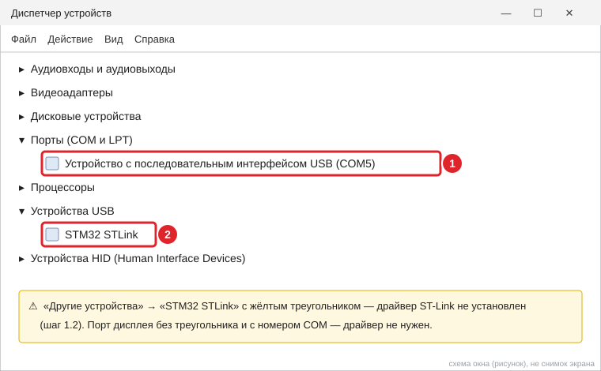

1. **Порт дисплея** — «Устройство с последовательным интерфейсом USB (COM5)». Номер COM у вас может быть другим.
   Драйвер для дисплея не нужен, Windows 10/11 ставит его сама.
2. **Плата STM32** — «STM32 STLink» в разделе «Устройства USB».

Если «STM32 STLink» стоит в разделе «Другие устройства» с жёлтым треугольником, драйвер не встал. Тогда скачайте
**STSW-LINK009** (https://www.st.com/en/development-tools/stsw-link009.html), распакуйте архив и запустите
`dpinst_amd64.exe`.

Если дисплей появился как «USB-SERIAL CH340» с жёлтым треугольником, на вашей плате стоит переходник CH340.
Драйвер для него — `CH341SER.EXE` с сайта производителя чипа (wch-ic.com). На большинстве плат его нет.

### 1.3 Браузер

Нужен **Google Chrome** или **Microsoft Edge**: дисплей прошивается прямо из браузера. Firefox и Opera не
подойдут — в них нет доступа к COM-портам.

---

## 2. Путь А: готовая прошивка с GitHub

### 2.1 Скачать файлы

Откройте страницу проекта на GitHub (ссылка — в теме на форуме) → справа **Releases** → последний выпуск
(с меткой **Latest**). Если вы читаете этот файл на GitHub, то же самое открывает ссылка
[последний выпуск](../../../../releases/latest).

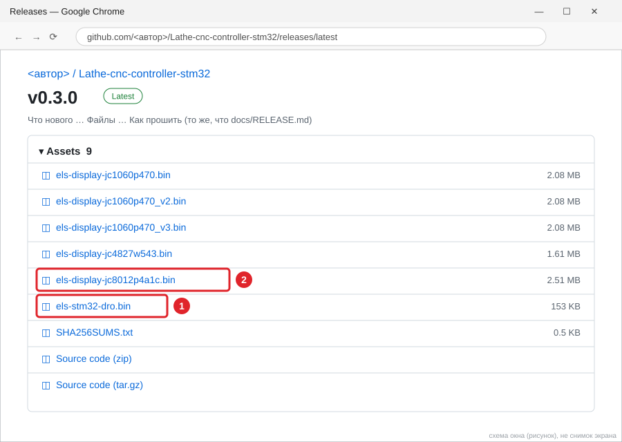

Внизу, в разделе **Assets**, лежат файлы прошивок. Номер версии у вас будет другим. Скачайте **два** файла:

1. **`els-stm32-dro.bin`** — для платы STM32. Он один на все станки: блок DRO, линейки или их отсутствие
   выбираются на экране.
2. **Файл дисплея** — по вашему дисплею:

| Дисплей | Файл |
|---|---|
| 4.3" JC4827W543 | `els-display-jc4827w543.bin` |
| 10.1" JC8012P4A1C | `els-display-jc8012p4a1c.bin` |
| 7" JC1060P470 — на корпусе **нет** надписи «V2» | `els-display-jc1060p470.bin` |
| 7" JC1060P470 — на корпусе **есть** «V2» | `els-display-jc1060p470_v2.bin`, а если esptool пишет «revision v3.x» — `els-display-jc1060p470_v3.bin` |

Как узнать ревизию 7" — в разделе [«7 дюймов»](#7-дюймов--какой-файл-и-если-экран-не-включился).

### 2.2 Прошить плату STM32

1. Подключите Discovery кабелем mini-USB (CN1) и запустите **STM32CubeProgrammer**.

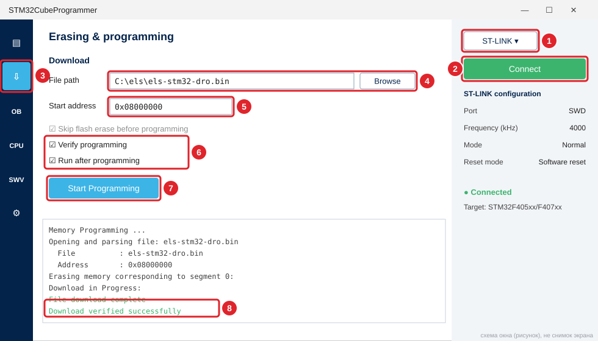

2. Справа вверху выберите **ST-LINK** (1) и нажмите зелёную **Connect** (2). Ниже появится «Connected», а в
   «Target» — «STM32F405xx/F407xx». Если программа предложит обновить прошивку ST-Link (**Firmware upgrade**),
   согласитесь: это безопасно.
3. Слева нажмите вторую иконку, со стрелкой вниз: **Erasing & programming** (3).
4. **File path** → **Browse** → скачанный `els-stm32-dro.bin` (4).
5. **Start address**: `0x08000000` (5). Проверьте, сколько нулей: после «08» их ровно шесть.
6. Отметьте галочками **Verify programming** и **Run after programming** (6).
7. **Start Programming** (7). Прошивка занимает около 10 секунд. Галочку **Full chip erase** не ставьте — она
   стирает и настройки станка, сделанные на экране.
8. В журнале внизу должны появиться строки «File download complete» и «Download verified successfully» (8).
   Нажмите **Disconnect**: плата перезапустится уже с новой прошивкой.

### 2.3 Прошить дисплей

1. Подключите дисплей кабелем USB-C. Откройте в Chrome или Edge страницу https://espressif.github.io/esptool-js/

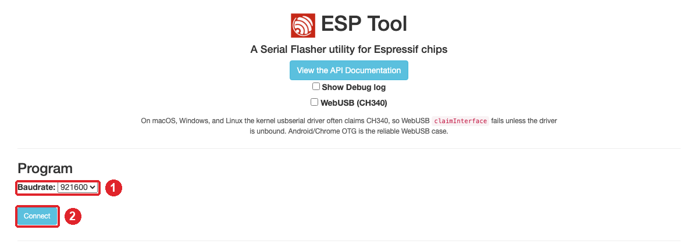

2. **Baudrate** — оставьте `921600` (1). Нажмите **Connect** (2). Браузер покажет окно со списком портов:
   выберите тот же COM, что в Диспетчере устройств (например, «USB JTAG/serial debug unit (COM5)»), и нажмите
   **Подключиться**.

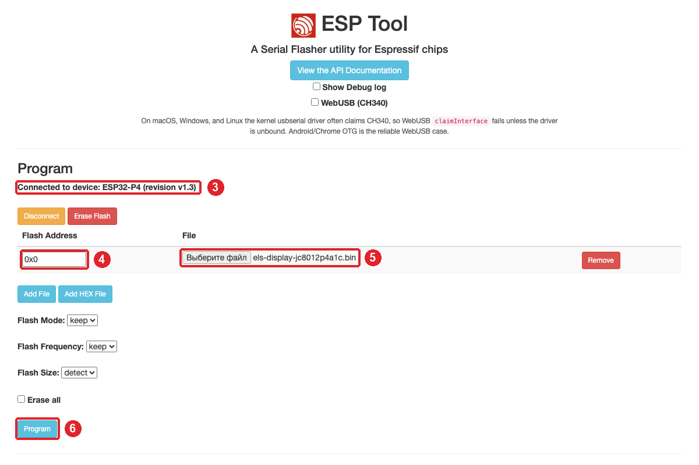

3. Строка **Connected to device** — какой чип найден (3). Для 4.3" это ESP32-S3, для 10.1" и 7" — ESP32-P4 с
   ревизией.
4. **Flash Address**: `0x0` (4) — ноль, а не 0x10000. В файле дисплея уже лежит всё: загрузчик, таблица разделов
   и программа.
5. **Выберите файл** → файл дисплея из таблицы выше (5).
6. **Program** (6). На 2–3 МБ уходит 1–2 минуты. Когда внизу появится «Leaving…», отключите и снова подключите
   кабель дисплея.

**Если Connect не находит плату:** на плате дисплея нажмите и держите кнопку **BOOT**, коротко нажмите **RST**
(**RESET**), отпустите BOOT и нажмите Connect ещё раз. После прошивки один раз нажмите RST.

### 2.4 Первое включение и настройка на экране

Соедините плату и дисплей по схеме ([сборка, раздел 6](../assembly/README.md#6-первое-включение--по-одному-блоку)).
Все настройки станка делаются на экране: тап по **⚠** в шапке → **НАСТРОЙКИ**.

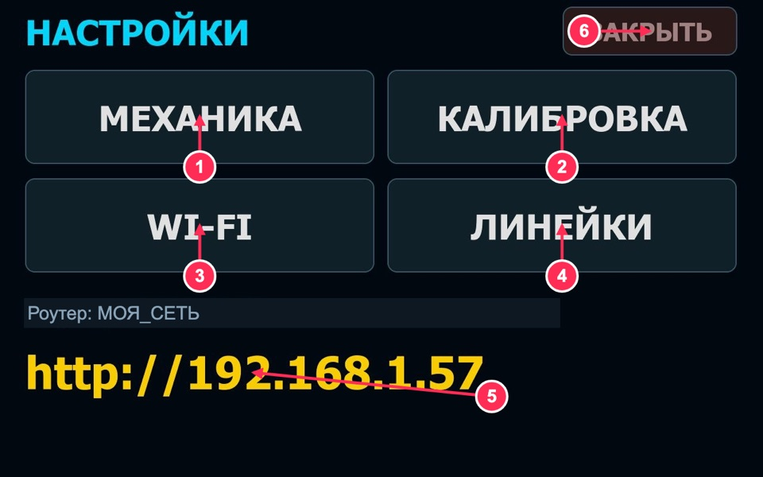

| Что | Где на экране | Пример |
|---|---|---|
| Винты, моторы, микрошаг, люфт, энкодер | **МЕХАНИКА** | Продольный винт 3 мм, мотор 200 шагов, микрошаг 8 |
| Откуда координаты: без линеек, блок DRO, линейки напрямую | **ЛИНЕЙКИ** | Линеек нет — «БЕЗ ЛИНЕЕК» |
| Wi-Fi для G-кода | **WI-FI** | Сеть «MyHomeWiFi» и пароль |
| Точный шаг винта и люфт | **КАЛИБРОВКА** | По индикатору: ход 8 мм |

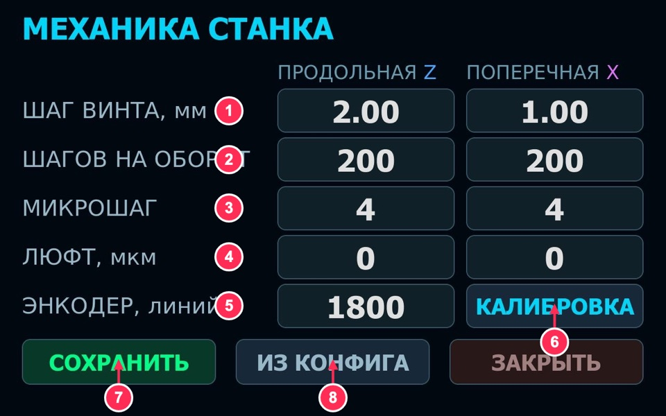
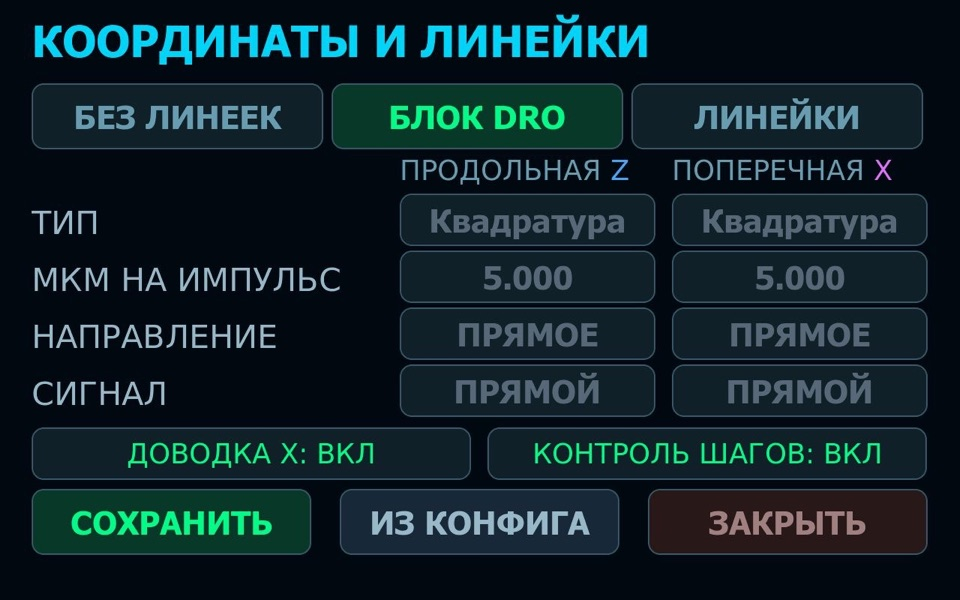
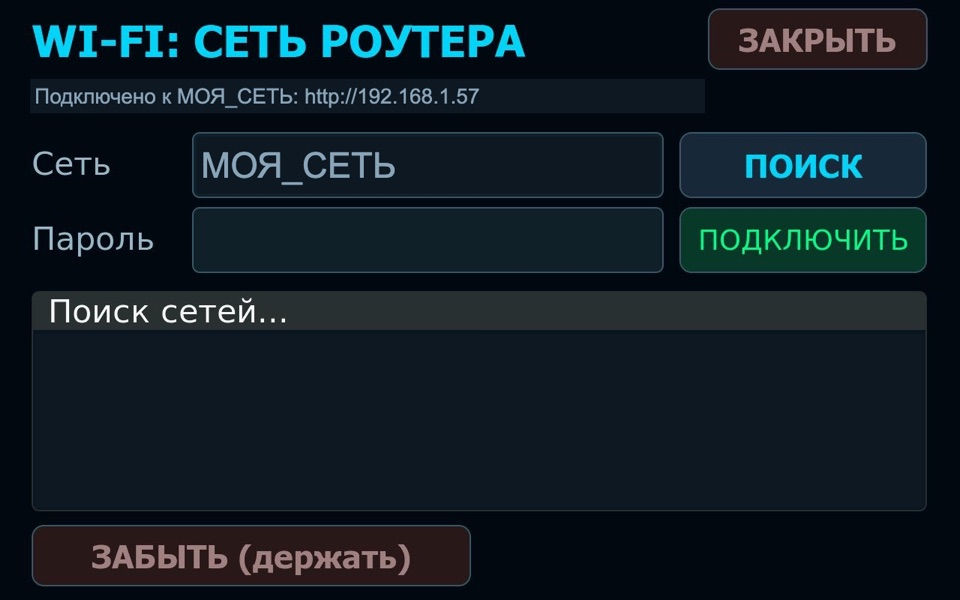

Каждый экран подробно описан в [руководстве, раздел 7](../manual/README.md#7-настройки). Настройки хранятся в
памяти платы и не пропадают при перепрошивке.

### Чем готовая прошивка может не подойти

При первом включении в готовой прошивке стоят начальные значения: энкодер 1800 линий, винт Z 2 мм, винт X 1 мм,
моторы 200 шагов, микрошаг 4, люфт 0, координаты — от блока DRO. **Пересобирать ради них прошивку не нужно** — всё
это задаётся на экране (тап по ⚠ → «НАСТРОЙКИ»):

- «МЕХАНИКА» — энкодер шпинделя, шаг винтов Z и X, шагов мотора на оборот, микрошаг, люфт;
- «КАЛИБРОВКА» — станок сам измеряет шаг винта и люфт;
- «ЛИНЕЙКИ» — откуда брать координаты: блок DRO, линейки напрямую (тип, разрешение, направление) или без линеек.

Выбранное **сохраняется в памяти платы STM32**: не пропадает при выключении, перезагрузке и перепрошивке новой
версией. Сбросить к начальным значениям — кнопка «ИЗ КОНФИГА» в «МЕХАНИКЕ» или полная очистка чипа
(Full chip erase в STM32CubeProgrammer — при обычной прошивке её не делайте).

**Без пересборки не поменять:**

| Ваш случай | Что не так с готовой прошивкой | Пример в части 4 |
|---|---|---|
| Входы драйверов подключены напрямую к STM32, без транзисторов | Моторы не крутятся или крутятся «наоборот» | [Пример 3](#пример-3-драйверы-подключены-напрямую) |
| Зуммер подключён как у автора 7e2 (между +3.3 В и выводом) | Пищит постоянно или молчит | [Пример 4](#пример-4-зуммер-как-у-7e2) |
| Ручной энкодер (РГИ) двигает ось не в ту сторону | Маховичок «наоборот» | [Пример 5](#пример-5-рги-ручной-энкодер-не-в-ту-сторону) |
| Нужна подача больше 0.25 мм/об или другое число чистовых проходов резьбы | Нельзя выставить | [Пример 6](#пример-6-предел-подачи-и-чистовые-проходы) |
| На пульте стоит ручка подачи (переменный резистор), как у 7e2 | Ручка не работает | [Пример 7](#пример-7-ручка-подачи-на-пульте) |
| Wi-Fi нужен сразу, без настройки на экране | Нет | [Пример 9](#пример-9-wi-fi-в-прошивке-дисплея) |

Если вашего случая в таблице нет, готовая прошивка подходит.

---

## 3. Путь Б: своя сборка из исходников

### 3.1 Перед установкой: имя пользователя Windows

PlatformIO не работает, если в пути к папке пользователя есть **русские буквы или пробелы**: например,
`C:\Users\Иван`. Откройте Проводник и наберите в адресной строке `%USERPROFILE%`. Если в пути есть кириллица или
пробел, сделайте так:

1. **Пуск** → наберите «переменные среды» → **Изменение переменных среды текущего пользователя** →
   **Создать…**

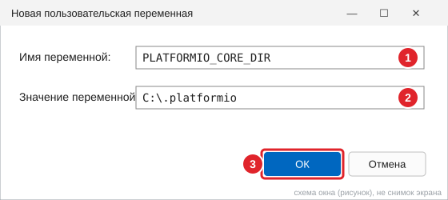

2. Имя переменной — `PLATFORMIO_CORE_DIR` (1), значение — `C:\.platformio` (2), затем **ОК** (3) и ещё раз
   **ОК**.

Если в пути только латиница и нет пробелов, этот шаг не нужен.

### 3.2 Установить VS Code и PlatformIO

1. Скачайте **Visual Studio Code**: https://code.visualstudio.com/ → **Download for Windows**. Установите,
   нажимая **Далее**. На шаге «Дополнительные задачи» оставьте галочку **«Добавить в PATH»**.
2. Запустите VS Code. Слева нажмите значок **Расширения** — четыре квадрата (1). В поиске наберите
   `platformio` (2), выберите **PlatformIO IDE** и нажмите **Install** (3).

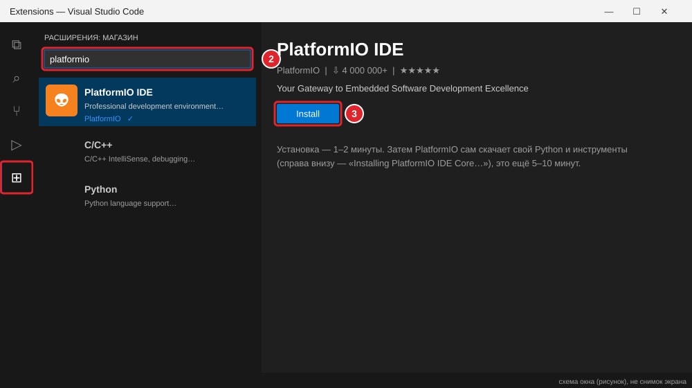

3. Подождите. Справа внизу появится «Installing PlatformIO IDE Core…»: PlatformIO скачивает свой Python, Python
   отдельно ставить не нужно. Затем появится сообщение «Please restart VSCode» — нажмите **Reload Now** (2).
   Слева появится значок PlatformIO — голова пришельца (1).

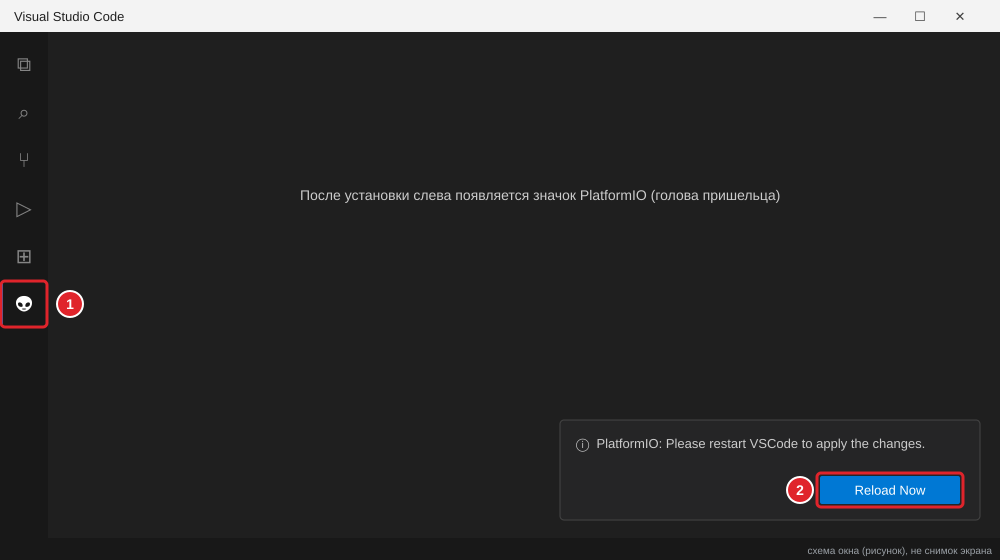

### 3.3 Скачать исходники

На странице проекта на GitHub: зелёная кнопка **Code** (1) → **Download ZIP** (2).

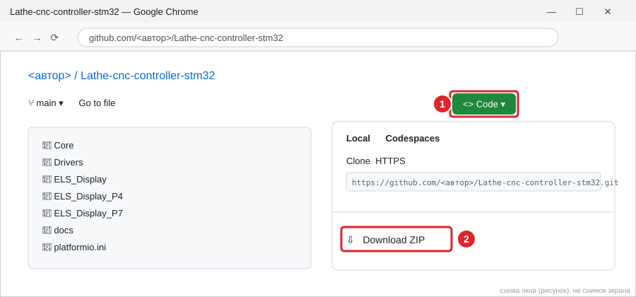

Распакуйте архив **в короткую папку**, например `C:\els`, чтобы внутри сразу лежали `platformio.ini`, `Core`,
`ELS_Display`… Не распаковывайте на рабочий стол и в «Загрузки»: путь получится слишком длинным, и сборка дисплея
упадёт с ошибкой о длине пути.

Если у вас установлен Git, можно вместо архива выполнить в терминале
`git clone <адрес со страницы проекта> C:\els`.

### 3.4 Открыть проект

**Файл → Открыть папку…** (1) → `C:\els` → **Выбор папки**. Если VS Code спросит «Доверяете авторам?», ответьте
**Да**. Слева появятся папки проекта (2).

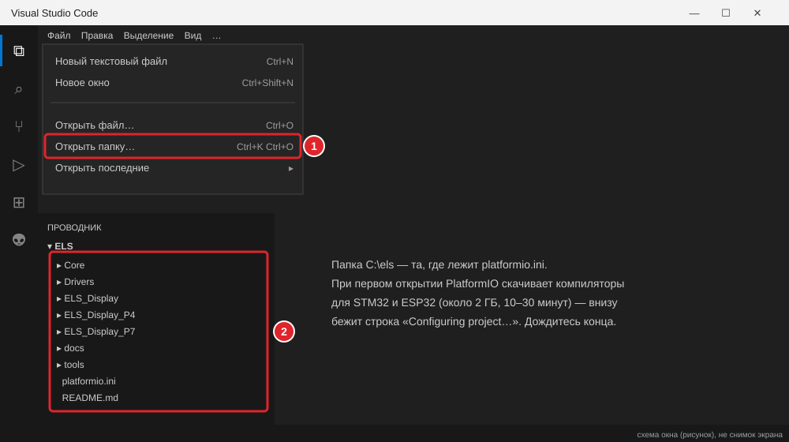

В первый раз PlatformIO скачивает компиляторы для STM32 и ESP32: около 2 ГБ, 10–30 минут. Внизу в это время
бежит строка «Configuring project…». Дождитесь, пока она пропадёт.

### 3.5 Выбрать, что собирать

Внизу, в синей строке состояния, есть кнопки PlatformIO:

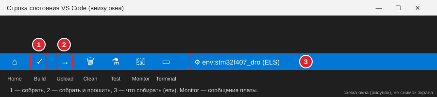

1. **✓ Build** — только собрать.
2. **→ Upload** — собрать и прошить.
3. **env:…** — что собирать. Нажмите на эту надпись (1), и вверху откроется список (2):

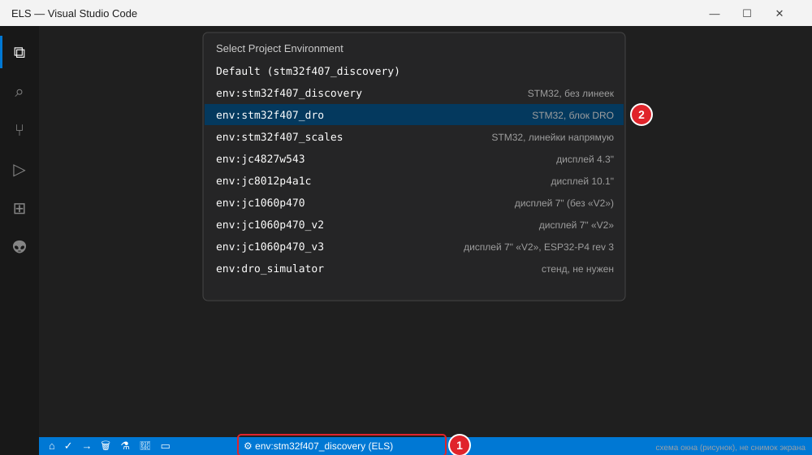

| env | Что это | Когда |
|---|---|---|
| `stm32f407_discovery` | плата STM32, координаты по шагам моторов | линеек нет |
| `stm32f407_dro` | плата STM32, блок DRO HS800-2 | есть блок DRO |
| `stm32f407_scales` | плата STM32, линейки напрямую к плате | линейки без блока |
| `jc4827w543` | дисплей 4.3" | |
| `jc8012p4a1c` | дисплей 10.1" | |
| `jc1060p470`, `jc1060p470_v2`, `jc1060p470_v3` | дисплей 7" | [какой из трёх](#7-дюймов--какой-файл-и-если-экран-не-включился) |
| `dro_simulator` | стенд разработчика (Arduino Mega) | не нужен |

Источник координат, выбранный в env, — это только значение при первом запуске: потом его можно сменить на
экране, в «ЛИНЕЙКИ».

### 3.6 Собрать и прошить плату STM32

1. Подключите Discovery кабелем mini-USB (CN1). Драйвер ST-Link должен стоять (шаг 1.2).
2. Выберите env `stm32f407_dro` (или ваш) и нажмите **→ Upload**.
3. Первая сборка идёт 1–3 минуты. Должны появиться строки **«Verified OK»** (1) и **«[SUCCESS]»** (2):

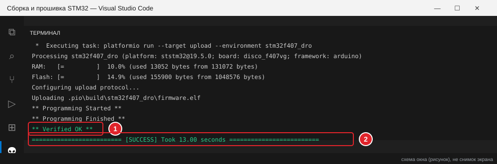

Строки на картинке взяты из настоящей прошивки платы.

**Если не получилось:**
- «Error: open failed» или «unable to find ST-Link» — плата не подключена, кабель без данных или нет драйвера
  (шаг 1.2).
- «Error: libusb_open() failed» — STM32CubeProgrammer ещё подключён к плате: нажмите в нём **Disconnect**.

### 3.7 Собрать и прошить дисплей

1. Подключите дисплей кабелем USB-C, выберите env дисплея (например, `jc8012p4a1c`) и нажмите **→ Upload**.
2. PlatformIO сам найдёт COM-порт (1). Строка **Chip type** покажет чип и ревизию (2). В конце должно быть
   **[SUCCESS]** (3):

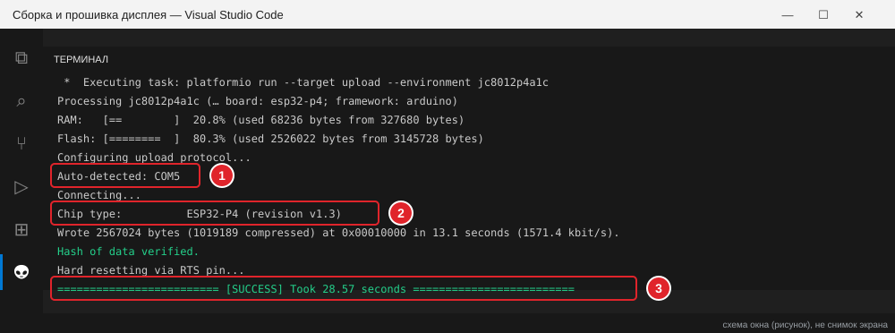

**Если «Failed to connect» или «No serial data received»:** зажмите на дисплее **BOOT**, нажмите и отпустите
**RST**, отпустите BOOT и снова нажмите **→ Upload**.

Если открыт Serial Monitor (значок вилки), закройте его: он занимает COM-порт.

---

## 4. Что настроить в своей сборке — примеры

Почти все настройки платы STM32 лежат в одном файле: **`Core/els_config.h`**. Откройте его слева: Core →
els_config.h. Поменяйте число, сохраните (**Ctrl+S**) и прошейте плату заново (**→ Upload**).

Механику и линейки удобнее задавать на экране. Числа в `els_config.h` — это значения «по умолчанию», которые
плата берёт при первом запуске и по кнопке «ИЗ КОНФИГА». Раз уж вы пересобираете прошивку, впишите сюда свои
числа: после полного стирания платы они вернутся.

На картинках ниже — настоящие строки из файлов проекта. Подсвечена строка, которую меняют. Под кодом показано,
что было и что стало.

### Пример 1. Откуда координаты

Есть блок DRO HS800-2, а прошивку собираете в env `stm32f407_discovery`. Проще выбрать env `stm32f407_dro`. Или
поменяйте строку:

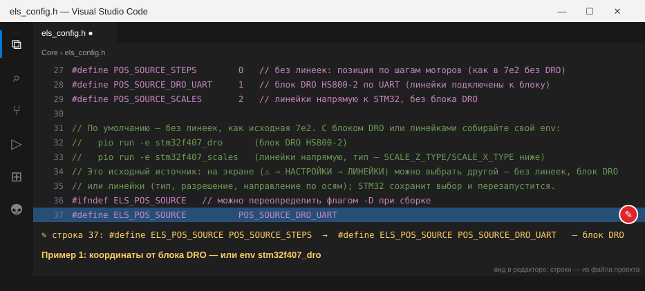

Варианты: `POS_SOURCE_STEPS` — без линеек, `POS_SOURCE_DRO_UART` — блок DRO, `POS_SOURCE_SCALES` — линейки
напрямую (тип и разрешение — на экране «ЛИНЕЙКИ» или в разделе 4 того же файла; см.
[docs/scales](../scales/README.md)).

### Пример 2. Винты и моторы

Продольный винт 3 мм, поперечный 1.25 мм. В файле шаг указан **в сотках миллиметра**: 3 мм = 300, 1.25 мм = 125.

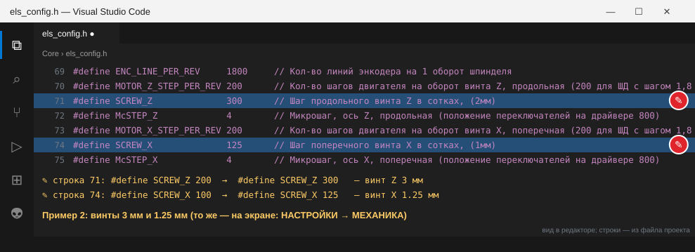

Рядом в том же файле:
- `ENC_LINE_PER_REV` — линий энкодера шпинделя;
- `MOTOR_*_STEP_PER_REV` — шагов мотора на оборот: 200 для мотора 1.8°;
- `McSTEP_*` — микрошаг, как на переключателях драйвера (драйвер на 1600 шагов/об при моторе 200 → 8).

Всё это же — на экране «МЕХАНИКА».

### Пример 3. Драйверы подключены напрямую

Вывод STM32 идёт прямо на «−» входа драйвера, а «+» драйвера — на +3.3 В, без транзисторов. Так можно только с
драйверами, входы которых срабатывают от 3.3 В. На шилде проекта стоят транзисторы, там оставьте `0`.

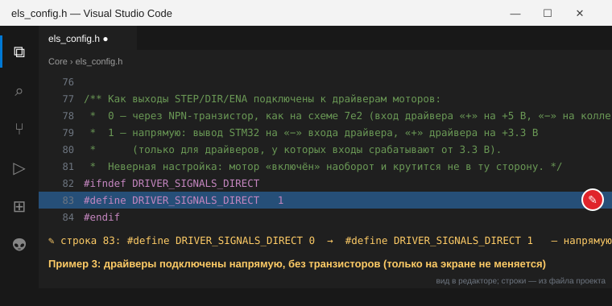

### Пример 4. Зуммер как у 7e2

Зуммер включён между +3.3 В и выводом платы, как в схеме 7e2. На шилде проекта он стоит через транзистор, там
оставьте `1`.

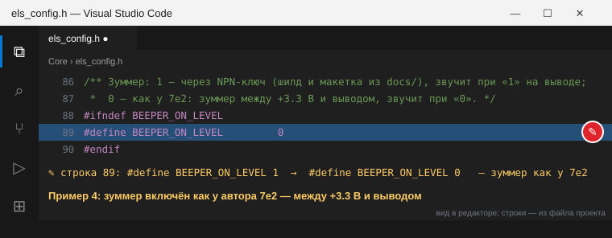

### Пример 5. РГИ (ручной энкодер) не в ту сторону

Маховичок крутите по часовой, а поперечка едет от вас — поменяйте 1 на 0 (`HC_Z_DIR` — то же для продольной).
Так РГИ меняет направление, а не мотор: мотор от джойстика должен ехать правильно, иначе поменяйте провода A+ и
A− мотора.

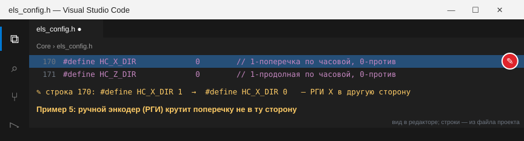

### Пример 6. Предел подачи и чистовые проходы

Подача до 0.30 мм/об (`MAX_FEED` 30 — в сотках) и 3 чистовых прохода в конце автоцикла резьбы.

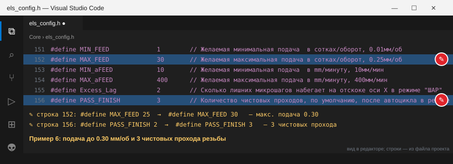

### Пример 7. Ручка подачи на пульте

Переменный резистор подачи стоит на пульте, как у 7e2: средний вывод — на вход PC1, крайние — на GND и +3.3 В.

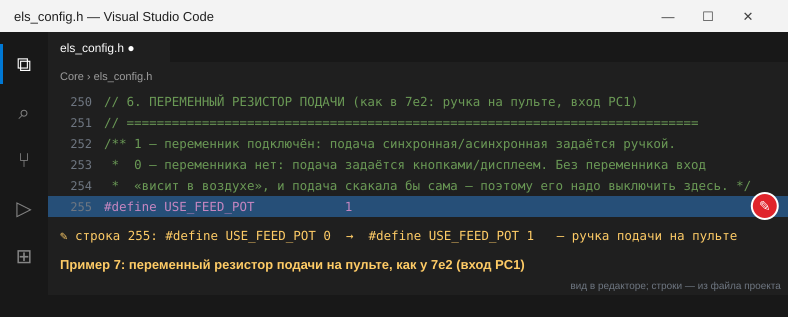

### Пример 8. Какой дисплей подключён

При включении плата сверяет тип дисплея с этой строкой. Если они не совпадают, в своей сборке появится сообщение
«ДИСПЛЕЙ НЕ СОВПАДАЕТ С КОНФИГОМ STM32» (в готовой прошивке его нет). Работе это не мешает, но лучше указать
свой дисплей: `DISPLAY_TYPE_4_3`, `DISPLAY_TYPE_7_0` или `DISPLAY_TYPE_10_1`.

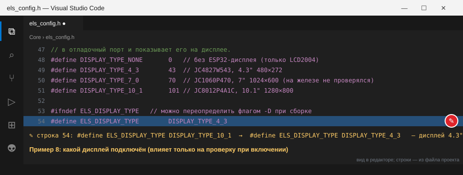

### Пример 9. Wi-Fi в прошивке дисплея

Обычно Wi-Fi задают на экране (⚠ → НАСТРОЙКИ → WI-FI). Если хотите вшить сеть в прошивку:

1. В папке `ELS_Display\include` скопируйте `wifi_config.example.h` и назовите копию **`wifi_config.h`**.
2. Впишите в копию сеть и пароль роутера. Ниже в том же файле — имя и пароль точки доступа дисплея (`WIFI_AP_SSID`, `WIFI_AP_PASS`, пароль не короче 8 символов): поменяйте пароль на свой.
3. Прошейте **дисплей** (env дисплея → **→ Upload**).

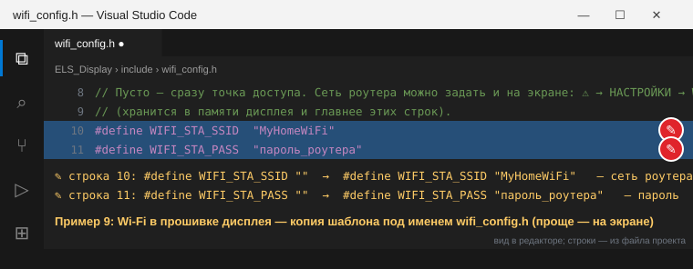

Файл `wifi_config.h` остаётся только у вас: он не попадает на GitHub. Без него сборка тоже работает, тогда Wi-Fi
задаётся на экране. Сеть, заданная на экране, главнее этих строк.

### Что ещё есть в els_config.h

Каждая строка подписана по-русски, разделы пронумерованы:
1. Что подключено.
2. Механика станка.
3. Подачи, ускорения, отскоки, РГИ.
4. Линейки напрямую.
5. Связь.
6. Ручка подачи.
7. Проверка проводки.

Меняйте только то, что понимаете. Если что-то пошло не так, скачайте исходники заново: в новом архиве файл будет
исходным.

---

## 7 дюймов — какой файл и если экран не включился

7" **Guition JC1060P470** у автора проекта нет. Прошивка собрана по открытым описаниям платы и на настоящем
экране **не проверялась**. Если не заработает — напишите на форуме или в Issues на GitHub (что ниже — то и
пишите), поправим.

Под одним названием продаются две панели и две ревизии чипа:

| Корпус сзади | Ревизия ESP32-P4 | Файл (env) |
|---|---|---|
| нет надписи «V2» | v1.x | `els-display-jc1060p470.bin` (`jc1060p470`) |
| есть «V2» | v1.x | `els-display-jc1060p470_v2.bin` (`jc1060p470_v2`) |
| есть «V2» | v3.x | `els-display-jc1060p470_v3.bin` (`jc1060p470_v3`) |

Ревизию видно при подключении: строка «Connected to device: ESP32-P4 (revision **v1.3**)» в esptool-js или
«Chip type: ESP32-P4 (revision v1.3)» в PlatformIO.

- **Белый экран с полосой шума** — прошита прошивка для другой панели. Прошейте второй вариант (без «V2» ↔ «V2»).
- **Экран не светится вовсе, а в порт ничего не приходит** — не совпала ревизия чипа. Прошейте `_v3` вместо
  `_v2` или наоборот.
- Плате это не вредит: прошивать можно сколько угодно раз.

**Что написать, если не работает:**
- метка на корпусе;
- ревизия чипа;
- что на экране (ничего / белый / шум / картинка перевёрнута / тач не туда);
- работает ли связь с платой STM32 (экран показывает позиции или «НЕТ ДАННЫХ ОТ STM32»).

Провода к STM32 — на разъём UART дисплея (TX, RX, GND). TX дисплея идёт на RX платы, и наоборот.
