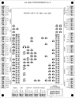

# Шилд ELS под STM32F4DISCOVERY

**Rev 2 — компактный, как Shield3.0 под Mega.** Плата 96×126 мм. Discovery вставляется сверху в гнёзда лицом
вверх (USB ST-LINK — к верхнему краю): кнопки, светодиоды и оба USB остаются видны и доступны. Мелочь — SMD 0805
и SOT-23 — под Discovery (зазор ≈ 8 мм), разъёмы — штыревые 2.54 мм с защёлкой (KF2510 / Molex KK-254) по трём
краям, переключатель режимов — коробка IDC 2×5 (подписи M1…M8, как на экране). На шелкографии у мелочи — номинал
(«1k», «10k», «3904»), у разъёмов — назначение каждого вывода. Схемотехника — как у шилда автора 7e2, с поправками
на 3.3-вольтовый STM32 (см. `design.py`).



## Состояние

| Что | Готово |
|---|---|
| Схема KiCad (`els_shield.kicad_sch`, PDF — `els_shield_schematic.pdf`) | да, ERC — 0 ошибок |
| Список деталей (`bom.md`, `bom.csv`) | да |
| Плата: 96×126 мм, размещение, земля с двух сторон, подписи | да |
| Дорожки | да — KiCad MCP (`autoroute`, Freerouting 2.1.0), земля — полигоны + переходы (`fix_zones.py`) |
| Проверка | DRC — **0 нарушений, 0 неразведённых**; сверка со схемой — цепи совпадают 1:1 |
| Gerber-файлы для заказа | `els_shield_gerbers.zip` (медь, маска, шелкография с двух сторон, контур, сверловка) |

Перед заказом обязательно:
1. Сверить расстояние между гнёздами J1/J2 с вашей платой Discovery (по чертежу UM1472 — 53.34 мм между
   крайними рядами), лучше всего — распечатать слой F.Cu в масштабе 1:1 и приложить плату.
2. Проверить снизу Discovery: под ней на шилде — SMD-детали высотой до 1.5 мм (C8 1206 — до 1.8 мм).

## Как собрать и развести

Всё генерируется из `design.py` — единого описания деталей и цепей. Цепи выводов STM32 берутся из
`Core/e2/e2_pins.h`, поэтому шилд всегда совпадает с прошивкой.

1. Схема, BOM, размещение (KiCad 10, macOS: `/Applications/KiCad`):
   ```bash
   bash hardware/shield/build.sh
   ```
2. Трассировка — через KiCad MCP: `open_project` (els_shield.kicad_pcb) → `autoroute` (Freerouting 2.1.0 под
   Java 21, 3 попытки, берётся лучшая) → `add_gnd_stitching_vias` (сетка 6 мм) → `save_board`.
3. Земля: `$KPY hardware/shield/fix_zones.py` — сплошное подключение площадок, убрать переходы с малым зазором,
   по переходу в каждый оторванный кусок верхней земли, залить полигоны (`$KPY` — Python KiCad:
   `/Applications/KiCad/KiCad.app/Contents/Frameworks/Python.framework/Versions/Current/bin/python3`).
4. Проверка и файлы: MCP `run_drc` (0 нарушений), `run_drc` со сверкой схемы, `export_gerbers` + `export_drill`
   в `gerbers/`, архив — `els_shield_gerbers.zip`.

Размещение генерируется заново из `design.py` — после него трассировку нужно повторить.

## Что на плате

| Разъём | Что подключать |
|---|---|
| J3 ПИТАНИЕ 5В | блок питания 5 В 2 А — питает Discovery (через вывод 5V), пульт, LCD |
| J4 ЭНКОДЕР | энкодер шпинделя: +5 В, GND, A, B (подтяжка 1k к 3V и 1 нФ — на плате) |
| J5 / J6 ДРАЙВЕР Z / X | входы драйверов PUL±, DIR±, ENA± (NPN-ключи 2N3904 на плате) |
| J7 РЕЖИМ | галетный переключатель 8 положений (IDC 2×5: M1…M8 и GND), общий — GND |
| J8 ПОДРЕЖИМ | Внутренний / Ручной / Наружный, общий — GND |
| J9 КНОПКИ | Влево, Вправо, Вверх, Вниз, Выбор, общий — GND |
| J10 ДЖОЙСТИК | 4 направления + ускоренный ход, общий — GND |
| J11 УПОРЫ, J12 СВЕТОДИОДЫ | кнопки упоров; светодиоды — анод на +3V, катод на клемму (220 Ом на плате) |
| J13 РГИ, J14 РГИ ПЕРЕКЛ. | маховичок (+5 В, GND, A, B; 10 нФ на плате) и переключатели оси и масштаба |
| J15 ЗУММЕР | активный зуммер 5 В: «+» на +5V, «−» на клемму «−» |
| J16 ТАХОМЕТР | выход импульса на оборот (3.3 В через 100 Ом) |
| J17 ПОДАЧА | переменный резистор 10k: крайние — +3V и GND, средний — СР |
| J18 LCD2004 | I2C-модуль LCD: GND, +5V, SDA, SCL |
| J19 ДИСПЛЕЙ | сенсорный дисплей ESP32: GND, +5V, TX (к RX дисплея), RX (к TX дисплея) |
| J20 DRO | блок DRO HS800-2: GND, RX (к TX блока) |
| J21 ОТЛАДКА | USB-UART для монитора порта: GND, TX, RX |
| J22 / J23 ЛИНЕЙКА Z / X | линейки напрямую: +5V, GND, A, B, REQ (470 Ом последовательно); схемы сопряжения — `docs/scales` |

Настройки прошивки под этот шилд — значения по умолчанию в `Core/els_config.h`:
`DRIVER_SIGNALS_DIRECT 0`, `BEEPER_ON_LEVEL 1`.

## Особенности

- Под гнёзда J1/J2 взято посадочное место **штыревого** разъёма 2×25: у гнезда из библиотеки KiCad ряды
  зеркальные (вывод 2 слева от вывода 1), а Discovery вставляется лицом вверх, и её вывод 2 справа.
  Паяется обычное гнездо 2×25.
- Выводы PD4 (сброс аудиочипа платы) и PA2 наружу не выводятся.
- Синяя кнопка USER на Discovery — это вход «Упор задний» (PA0).
